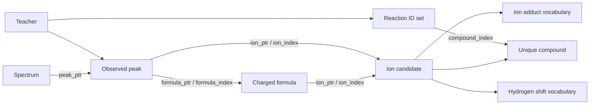

# Annotated spectra and training data (v2)

Prepared `.preft.pt` files use schema `fredis.annotated-spectrum-training.v2`.
Regenerate datasets produced with any earlier schema; no migration or compatibility
aliases are provided.

`SourceReactionStructure` composes independent chemical/observational annotations,
a concrete reaction registry, reaction-state topology, and a `TeacherData` object.
`AnnotatedSpectrumData` has no teacher fields and can be used for inspection without
training labels. Training consumes these same annotations rather than storing a
second set of observed peaks or chemical structures in its teacher object.

```python
data = SourceReactionStructure.load(path)
measurements = data.annotations.spectra
compounds = data.annotations.compounds
formulas = data.annotations.formulas
ions = data.annotations.ions
assignments = data.annotations.assignments
states = data.states
teacher = data.teacher
```

## Identity and index domains

All indices are global **inside the prepared object/batch**, not global across the
dataset. `-1` is allowed only where documented as an absent result/root. CSR row `r`
is `index[ptr[r]:ptr[r + 1]]`; `ptr` starts at zero and ends at the index-array size.

| Symbol | Rows |
| --- | --- |
| M | Original source molecules |
| S | Observed spectra, including separate collision energies |
| P | Observed peaks, concatenated across spectra |
| C | Unique compounds, identified by canonical isomeric SMILES including charge |
| F | Unique charged formulas; same formula does not imply same structure |
| I | Unique `(compound, formula, ion adduct, hydrogen shift)` candidates |
| V | Chemical reaction-set states, including unobserved materialized alternatives |
| Q | Active state projection used for branching supervision/continuations |
| J | Expanded runtime `(spectrum, fragment occurrence, ion condition)` rows |
| H | Supervised observed peaks with at least one nonempty branching path |

**One structure has exactly one Compound ID**, even across source molecules or
adduct/CE groups in a batch. Many reaction states may point to the same Compound.
Runtime graph occurrences retain group membership but refer to this unique table;
they are not additional chemical identities. Within each generated FragmentTree,
canonical SMILES also merges structurally identical nodes.



## Observations and chemistry

`SpectrumData` owns measurements. `peak_ptr [S+1]` selects rows of `mz [P]`,
`intensity [P]` and `precursor [P]`. `source_index [S]` references source molecules;
`branch_group_index [S]` references `(source molecule, main adduct)` groups.
`collision_energy [S]` and `precursor_mz [S]` retain measured conditions. Adduct labels
and small non-peak metadata are stored per spectrum.

`CompoundData` stores `smiles` and `compounds` of length C and one atom graph per
unique compound in `graph` (`graph.ptr [C+1]`). `occurrence_index [N]` maps runtime
fragment occurrences to Compound IDs. `state_index [V]` maps chemical reaction
states to Compound IDs (`-1` for unmaterialized states). The inverse is
`state_ptr [C+1]` / `state_rows`, pointing to the **same V-state table**.

`FormulaData.composition [F,D]` contains elemental counts in `annotations.elements`
order followed by charge. `mz [F]` stores exact m/z and `valid [F]` marks nonnegative
element counts. A formula row can have many structural ion explanations, selected
by `ion_ptr [F+1]` / `ion_index` into the I-row ion table.

`IonCandidateData` holds `compound_index [I]`, `formula_index [I]`, `adduct_index [I]`
and `hydrogen_shift_index [I]`. Adduct indices reference `annotations.ion_adducts`;
shift indices reference `ions.hydrogen_shifts` containing signed integer shifts.
The candidate identity does not include collision energy. `runtime_index [J]`
and `runtime_sample_index [J]` connect the execution grid to candidates/spectra.

`PeakAssignmentData` stores two CSR relations over the same P observed peaks:

* `formula_ptr [P+1]` / `formula_index`: alternative charged formulas.
* `ion_ptr [P+1]` / `ion_index`: admissible structural/adduct/shift explanations.

The ion relation is retained because an observation may not admit every globally
available explanation of a formula under its particular source/adduct condition.
Ambiguity is preserved, not resolved to one arbitrary compound or path.

## Reactions and states

`ReactionTensorData` owns concrete source-specific reactions, matched/retained atom
CSR tables, and conflict/invalidation pairs. Its comments specify each shape,
column meaning and pair direction. Atom IDs index the batched `source_graph.x`.
Dominance is not supported.

`ReactionStateData.candidate_reaction_ptr [V+1]` / `candidate_reaction_index` stores
**all chemical reaction sets once**. `candidate_branch_group_index [V]` identifies
the source/adduct group and `compound_index [V]` references `CompoundData`.
Different reaction sets remain different states even when their products coincide.

`candidate_index [Q]` selects active rows of that V-state table. The Q-state
`reaction_ptr`, `reaction_index` and `reaction_count` are computed views, not
additional persisted copies. Representative parents and full recorded transitions
reference Q; valid continuations use `next_ptr [Q+1]`, `next_reaction_index` and
`next_state_index` (destinations reference V). The comments distinguish these
index spaces explicitly.

## Teachers and runtime views

`TeacherData` stores learning-specific information:

* Positive and weak-negative reaction CSR lists, indexed by Q active states.
* `observed [Q]` labels.
* `peak_index [H]` pointing to actual P-row observed peaks.
* Peak → alternative path → `(active state, concrete reaction)` step CSR lists.

`teacher.spectrum_targets(data.annotations)` derives J-row intensity targets from
observed peak-to-formula assignments. Ambiguous candidates share the maximum
assigned observed intensity; invalid formulas receive zero. Measurements,
formulas and structures are not copied into the teacher object.

To retain annotations without branch labels:

```python
unlabelled = data.without_teacher()
assert unlabelled.annotations is data.annotations
```

The spectrum model still uses an expanded `SpectrumModelBatch` to execute graph
probability propagation. These are runtime views of normalized data, not the
persistent chemical identity tables. Serialization omits expanded molecule graphs,
formula arrays and intensity targets and restores them from the current-format
annotations on load, without RDKit chemistry. Display dictionaries are likewise
created on demand by `sample_annotations`; they are not stored as duplicate peak
records in either the structure or the metadata sidecar.

Batch collation directly combines the normalized tables, deduplicates identities
across items and corrects foreign keys. Spectrum selection remaps peak assignments
and teacher paths to the selected observation rows. `validate()` checks CSR
boundaries, uniqueness and foreign-key domains during preparation/collation.
