# FREDIS architecture, tensor flow, and training objectives

Implementation reference: 2026-10-22. This document describes the current code,
including separate main-adduct-specific Fragment and State Heads. Numbers below are either explicitly identified defaults or a
worked example; they are not measurements from a trained checkpoint.

<a id="architecture-1"></a>

## 1. Model boundary and execution order

**Connections:** This overview connects the shared [encoders (5, 7)](#architecture-5), [conditions (8)](#architecture-8), [branch selection (9)](#architecture-9), [intensity model (12–14)](#architecture-12), and [losses (16–18)](#architecture-16).

`SourceAnchoredFragmentSpectrumGenerator` constructs the shared molecular
encoder, reaction edge feature model, and competitive spectrum
model. Its `forward()` returns reaction selection only; `predict_batches()` and
`predict()` implement the complete spectrum pipeline.

```text
SMILES + precursor adduct + collision energy (CE)
  -> CPU preparation per unique molecule
     -> concrete reaction instances
     -> conflict / invalidation relations
     -> molecular graphs and reaction input tensors
  -> shared MolEncoder and pattern-owned reaction encoders
  -> prepared CompoundReactionGraph and formula explanation candidates
  -> main-adduct-conditioned edge scoring and reachable selection (no CE)
  -> Fragment Head: Child / Self / Sink softmax per parent fragment
  -> one topological DAG pass for fragment survival probabilities
  -> State Head: ion-adduct x hydrogen-shift softmax per fragment
  -> joint probabilities = fragment probability * conditional state probability
  -> prepared mmkit formula and mass annotations
  -> formula aggregation, valid-peak normalization and export
```

Main implementation: [generator](specgen/source_anchored_spectrum_predictor.py),
[spectrum model](specgen/competitive_spectrum_model.py),
[training wrapper](training/fragment_tree_training/model.py).

<a id="overall-architecture"></a>

### 1.1 Overall architecture

The section numbers in the boxes identify the detailed parts below. Solid arrows
carry tensors, probabilities or targets. Dashed arrows carry discrete structure
selection or bank/condition routing; they are not gradient paths.

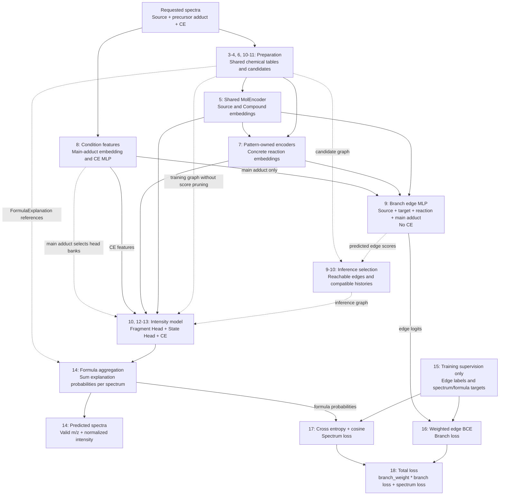

Training uses the prepared candidate graph and its labels; it does not run learned
edge pruning before the intensity loss. Inference uses the same chemical
components without supervision, selects edges once per BranchGroup, and reuses
the selected structure across CE conditions. Branch logits are not multiplied
into intensity probabilities. Spectrum loss therefore does not train the branch
edge MLP through selection; both objectives train their shared encoders.

<a id="inside-intensity-model"></a>

### 1.2 Inside the intensity model

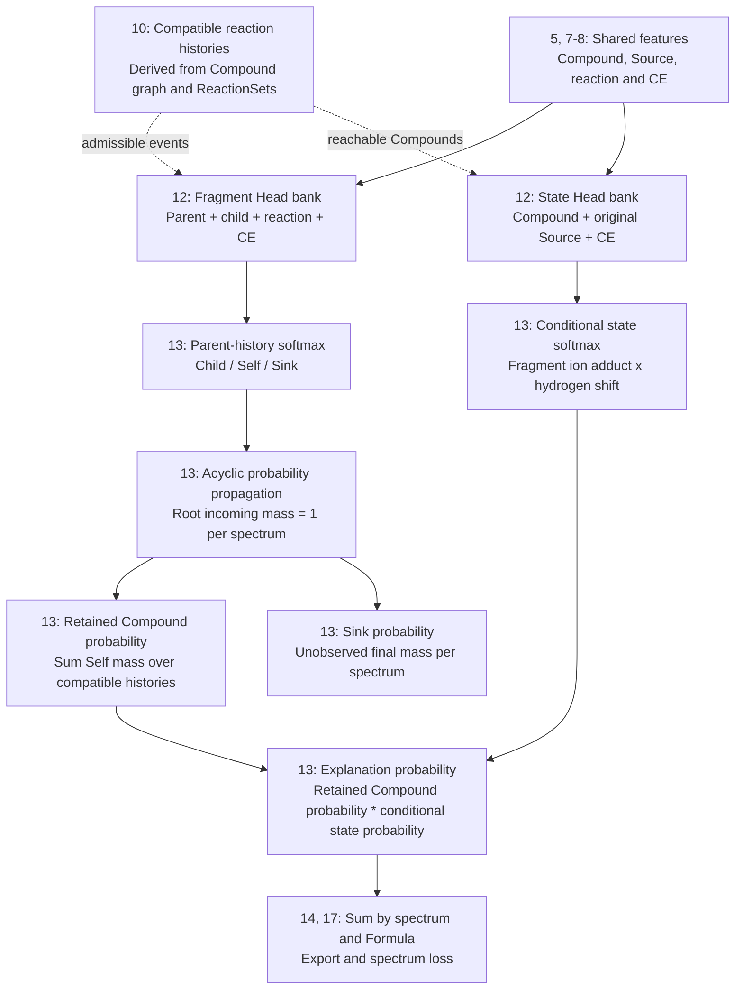

Main adduct chooses independent Fragment/State Head banks. Fragment adduct and
hydrogen shift choose State Head slices; they are not Fragment Head input
features. Formula and m/z annotate explanations and determine aggregation and
supervision, without entering either head's neural features. Optional selected
descriptors extend intensity molecular features only. Structural self loops
and cycles are handled by the finite compatible-history expansion, so propagation
remains acyclic. Sink mass is not assigned a measured formula target.

### 1.3 Loss construction and gradient paths

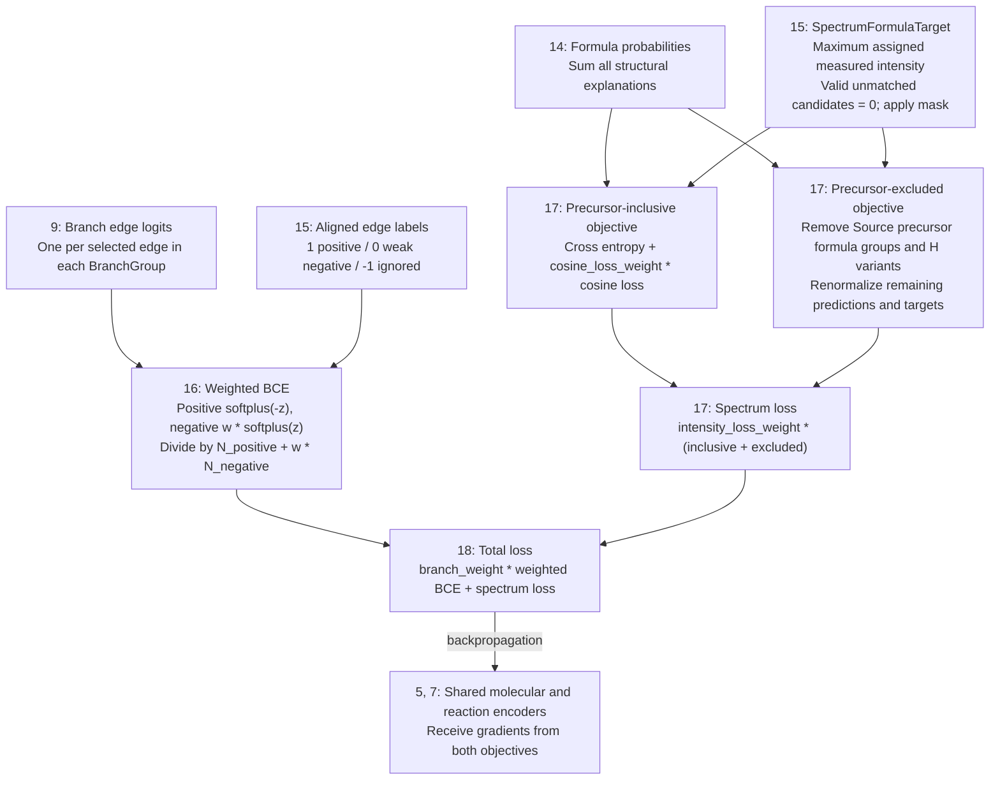

Here `w = negative_weight`. Label -1 contributes no branch loss or gradient.
A spectrum without positive supervised target intensity is omitted from that
spectrum objective. The precursor-excluded term is omitted when no positive
remaining targets exist. The branch MLP and main-adduct projection receive
branch gradients; the CE MLP and Fragment/State Heads receive spectrum gradients.
Frozen parameters are excluded from updates. IDs, chemistry, teacher assignment
and discrete graph selection are not differentiable. There is no additional
presence/confidence classification loss.

### 1.4 Component detail map and tensor notation

Each box in [Overall architecture](#overall-architecture) has a detailed diagram
and an input/output contract below. The diagrams describe runtime computation;
persisted field definitions and CSR references are in [the input schema](input/SCHEMA.md).

| Overall box | Detailed component | Primary implementation |
|---|---|---|
| INPUT | [Requested spectra](#component-input) | [`prepare()` / input adapters](specgen/source_anchored_spectrum_predictor.py) |
| PREP | [Preparation](#component-preparation) | [`ReactionStructureBuilder`](input/structure_builder.py) |
| MOL | [Shared MolEncoder](#component-molecular) | [`MolEncoder`](mol/mol_encoder.py) / [`encode_compounds()`](specgen/source_reaction_feature_model.py) |
| REACTION | [Pattern-owned encoders](#component-reaction) | [`ReactionInstanceEncoder`](specgen/components/reaction/reaction_instance_encoder.py) |
| CONDITION | [Condition features](#component-condition) | [`AdductEmbeddingLayer`](specgen/components/condition/adduct_embedding.py) / [`CollisionEnergyFeatureLayer`](specgen/components/condition/collision_energy_feature.py) |
| BRANCH | [Branch edge MLP](#component-branch) | [`SourceReactionFeatureModel.score_edges()`](specgen/source_reaction_feature_model.py) |
| SELECT | [Inference selection](#component-selection) | [`_select_graph()`](specgen/source_anchored_spectrum_predictor.py) / [`execution_graph`](input/source_reaction_structure.py) |
| INTENSITY | [Intensity model](#component-intensity) | [`CompetitiveSpectrumModel`](specgen/competitive_spectrum_model.py) |
| FORMULA | [Formula aggregation](#component-formula) | [`_spectrum_loss()` / `merge_candidate_peaks()`](specgen/competitive_spectrum_model.py) |
| EXPORT | [Predicted spectra](#component-export) | [`predict_batches()`](specgen/source_anchored_spectrum_predictor.py) / [MSDataset adapter](specgen/source_reaction_msdataset.py) |
| TEACHER | [Training supervision](#component-teacher) | [`from_preparation()` / `with_targets()`](input/source_reaction_structure.py) |
| LB | [Weighted edge BCE](#component-branch-loss) | [`branch_edge_loss()`](training/fragment_tree_training/model.py) |
| LS | [Spectrum loss](#component-spectrum-loss) | [`_spectrum_loss()`](specgen/competitive_spectrum_model.py) |
| TOTAL | [Total loss](#component-total-loss) | [`ReactionFragmentTreeTrainingModel.forward()`](training/fragment_tree_training/model.py) |

The following symbols are row counts, not new stored fields. `N_edge_use` counts
entries in the BranchGroup edge CSR, so the same structural edge may contribute
several rows under different groups. Likewise, `N_explanation_use` counts entries
in the spectrum explanation CSR, including repeated explanations at different CE.

| Symbol | Meaning |
|---|---|
| `N_source`, `N_compound`, `N_reaction` | Source, unique Compound, and concrete Reaction rows |
| `N_group`, `N_spectrum` | Unique (Source, main adduct) pairs and requested spectrum conditions |
| `N_edge_use`, `N_explanation_use` | Group-edge and spectrum-explanation CSR entries |
| `N_history`, `N_event` | Sample-expanded admissible history rows and Child/Self/Sink events |
| `N_spectrum_compound` | Reachable (spectrum, Compound) pairs after history aggregation |
| `N_formula_target` | Represented (spectrum, Formula) pairs used by the objective |
| `D_mol`, `D_reaction`, `D_branch`, `D_adduct`, `D_CE` | Widths called Dm, Dr, Db, Da and Dc in section 2 |

<a id="component-input"></a>

### 1.5 Inside requested spectra (INPUT)

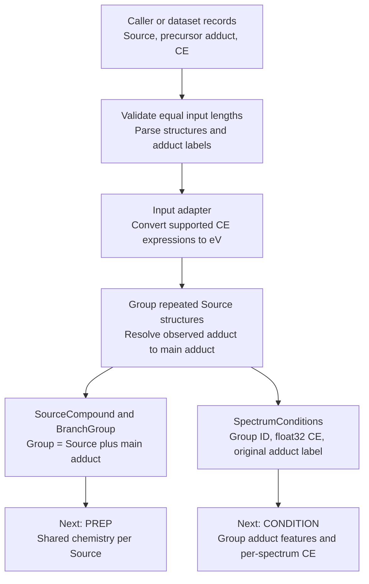

| Interface | Type / shape | Consumer |
|---|---|---|
| `sources`, `precursor_types` | Sequences of length `N_spectrum` | `prepare()`; repeated Sources are grouped |
| CE passed to `predict()` | Numeric eV values, length `N_spectrum` | `SpectrumConditions.collision_energy_eV` |
| `conditions.branch_group_index` | int64 `[N_spectrum]` | Conditions, selection and intensity |
| `conditions.collision_energy_eV` | float32 `[N_spectrum]` | CE MLP |
| `conditions.observed_adducts` | tuple of `N_spectrum` original labels | Precursor identification and output metadata |

For example, `(CCO, [M+H]+, 10)` and `(CCO, [M+H]+, 40)` share a Source
and BranchGroup, while retaining two spectrum rows. `(CCO, [M+Na]+, 20)` uses
the same Source but a different BranchGroup. CE strings/unit conversion belong
to CLI/dataset adapters; the generator's direct prediction API expects eV.
The Source root maps through `SourceCompound.compound_index` to CompoundBatch.

**Next:** [PREP](#component-preparation), [CONDITION](#component-condition).

<a id="architecture-2"></a>

## 2. Worked example and dimensions

**Connections:** These example dimensions apply to [graph inputs (4)](#architecture-4), [reaction inputs (6)](#architecture-6), [head inputs (12)](#architecture-12), and [probability rows (13)](#architecture-13); this section introduces no additional model component.

Use three records, two unique molecules, and two structural-search groups:

| Sample | Molecule | Represented atoms | Precursor adduct | CE |
|---|---|---:|---|---:|
| 0 | A | 6 | `[M+H]+` | 20 eV |
| 1 | A | 6 | `[M+H]+` | 40 eV |
| 2 | B | 4 | `[M+H]+` | 20 eV |

A and B are illustrative structures. A's two CE conditions share structural
search; molecular graphs are not duplicated just because CE differs.

```python
sample_tree_index         = [0, 0, 1]  # [B=3], derived through BranchGroup
sample_branch_group_index = [0, 0, 1]  # [B=3]
branch_groups.source_compound_index = [0, 1]     # [G=2]
```

| Symbol | Setting or meaning | Example |
|---|---|---:|
| B | Spectrum-condition count | 3 |
| U | Unique source-molecule count | 2 |
| G | `(molecule, main adduct)` group count | 2 |
| Dn | `mol_encoder_params.node_dim` | 16 |
| Dm | `mol_encoder_params.graph_dim` | 64 |
| Dr | `reaction_model_params.hidden_dim` | 128 |
| Db | `reaction_model_params.branch_main_adduct_dim` | 128 |
| Da | `spectrum_model_params.adduct_embedding_dim` | 32 |
| Dc | `spectrum_model_params.collision_energy_dim` | 16 |
| M | `fragmenter.tree_max_reaction_count` | 3 |
| C | Ion/shift conditions for one main adduct | 12 |

The layer widths in this table match major CLI defaults. `M=3` is an example
chemistry setting, not an architecture-wide constant. Actual checkpoint settings
must be read from that checkpoint's model configuration.

<a id="architecture-3"></a>

## 3. CPU workers and per-molecule relation matrices

**Connections:** Receives requested Sources/adducts from [the entry point (1)](#architecture-1). Produces [molecular graphs (4)](#architecture-4), [concrete reactions (6)](#architecture-6), and compatibility data for [history expansion (10)](#architecture-10).

Batch prediction validates records and molecular vocabulary, groups identical
SMILES, then runs `prepare_compound_cache()` per molecule. With
`--num-workers > 1`, preparation uses OS subprocesses, not Python threads.
`--chunk-size` controls preparation task size.

For a molecule with R concrete reaction instances, CPU preparation computes:

- Conflict: two reactions change overlapping bonds.
- Invalidation: one reaction discards atoms required by the other's match.

These are conceptually two `[R,R]` relations. Workers return sparse index
pairs and domain relation data. `prepare_source_reactions()` reuses them;
it does not repeat pairwise chemistry in the prediction phase.

`build_reaction_pool()` expands the pairs on the model device:

```text
pool.conflict      [G, Rmax, Rmax] bool
pool.invalidation  [G, Rmax, Rmax] bool
pool.retained      packed per-reaction retained-atom bitsets
```

Relation computation is shared by CE and adduct conditions of the same molecule.
The dense pool currently has a separate group axis, so the same relation can be
represented more than once for different main-adduct groups. Pair relations
alone cannot establish that the intersection of all retained-atom sets is
nonempty; that remains a set-level operation during expansion.

Code: [worker](specgen/prepare_worker.py), [batch adapter](specgen/source_reaction_msdataset.py),
[input preparation](input/source_reaction_structure.py),
[relation rules](../domain/fragment/reaction/ReactionRelations.py).

<a id="component-preparation"></a>

### 3.1 Inside preparation (PREP)

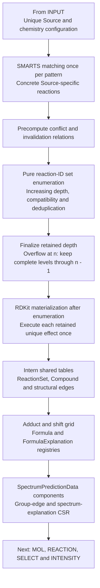

| Output | Stored content / reference | Consumer |
|---|---|---|
| `source_compounds`, `compounds` | Source Batch; unique Compound Batch; Source-to-Compound mapping | Shared molecular encoder |
| `reactions`, `reaction_sets` | Source atom references; concrete reactions; sorted reaction-ID sets | Reaction encoder and history validity |
| `compound_graph`, `reaction_contexts` | Source/target Compound and reaction columns; selected-edge CSR per group | Branch MLP, selection and intensity |
| `adducts`, `branch_groups`, `conditions` | Adduct/shift vocabulary; Source/main-adduct groups; spectrum conditions | Condition features and routing |
| `formulas`, `formula_explanations`, `spectrum_explanations` | Chemical explanations and candidate CSR per spectrum | State slices, formula aggregation and targets |

Combination search uses precomputed integer relations. If any attempt in depth n
exceeds the cumulative combination budget, even successful candidates already
found at depth n are discarded before compilation. Overflow in depth 1 retains
only the Source. The separate unique-structure limit is evaluated during
materialization. Candidate chemistry remains shared across CE; preparing another
CE does not create another Compound identity. Descriptors are selected later by
the intensity model. Observations additionally enter [TEACHER](#component-teacher)
when training data is prepared.

**Next:** [MOL](#component-molecular), [REACTION](#component-reaction),
[SELECT](#component-selection), [INTENSITY](#component-intensity).
**Code:** [search](../domain/fragment/reaction/ReactionSequenceSearch.py),
[preparation builder](input/structure_builder.py).

<a id="architecture-4"></a>

## 4. Molecular graph input

**Connections:** Receives structures and symbol vocabulary from [preparation (3)](#architecture-3). Packed Source/Compound graphs feed the shared [MolEncoder (5)](#architecture-5); raw Source atom/bond tensors also feed [reaction encoding (7)](#architecture-7).

With the nine-element vocabulary `C,N,O,P,S,F,Cl,Br,I`, atom features have width
35: element 9, formal charge 3, ring category 5, hybridization 5, hydrogen count
5, and explicit valence 8. The code calls the last category `valence_electrons`,
but obtains it with `GetExplicitValence()`; it is not a valence-electron count.
These features are categorical encodings, not trainable embeddings.

Bonds have width 9: bond type 4 plus ring category 5. Hydrogens normally appear
as atom features rather than separate graph nodes in `graph_atoms()`.

For the ten represented atoms in the example:

```text
source_graph.x          [10,35]
source_graph.edge_index [2,E]       # directed edge entries
source_graph.edge_attr  [E,9]
source_graph.batch      [10]       # [0,0,0,0,0,0,1,1,1,1]
source_graph.ptr        [3]        # [0,6,10]
```

Code: [graph builder](mol/graph_builder.py), [atom features](mol/atom_feature.py),
[bond features](mol/bond_feature.py).

<a id="architecture-5"></a>

## 5. MolEncoder computation and external features

**Connections:** Receives [packed graphs (4)](#architecture-4). Source embeddings feed [reaction readout (7)](#architecture-7); shared Compound embeddings feed [branch edges (9)](#architecture-9) and [Fragment/State Heads (12)](#architecture-12). Optional intensity descriptors are appended only on the latter path.

The same `MolEncoder` instance encodes original molecules and generated fragments.
Atom features are projected to Dn=16 and augmented with learned in/out-degree
embeddings. Degree indices are clipped by `max_degree` (default 4):

```text
h_i = node_proj(x_i) + in_deg_emb(in_degree_i) + out_deg_emb(out_degree_i)
```

Graphormer attention adds learned shortest-path and bond-path biases:

```text
attention_ij = softmax_j(Q_i K_j^T / sqrt(head_width)
                         + spatial_bias_ij + edge_path_bias_ij)
```

`max_spatial_dist=3` and `max_edge_dist=3` bound structural encodings, not a local
attention window. Blocks use pre-normalization, residual attention, then a
residual GELU FFN of width `Dn -> 4Dn -> Dn`, with molecular dropout.

Graph token count is `ceil(Dm/Dn)=4`. If both molecules are represented in a
capacity-6 padded bucket, the shapes are:

```text
atoms                         [2,6,16]
learned graph tokens          [2,4,16]
combined tokens               [2,10,16]
Q/K/V, four heads             [2,4,10,4]
attention scores              [2,4,10,10]
graph token outputs           [2,4,16]
flatten -> graph_projection   [2,64] -> [2,64]
source_embeddings             [2,64]
```

Actual bucket allocation is dynamic; padding capacity is not a model parameter.
Graph readout concatenates graph tokens and applies a Linear layer; it is not
mean pooling. Atom tokens may attend to graph tokens (`graph_to_node=True`).

`MolEncoder` has no `descriptors` constructor argument. For
`external_feature_dim=8`, a caller may provide `external_features[2,8]`:

```text
external_features [2,8] -> Linear(8,64) -> GELU -> Linear(64,64) -> [2,64]
concat(graph_output, external_output)                         -> [2,128]
Linear(128,64)                                               -> [2,64]
```

Only the graph embedding is fused; atom outputs stay structural. Selection,
scaling and missing-value handling are the caller's responsibility. Inputs must
have the configured shape and finite values. Width zero disables this branch.
The standard SMILES-only preparation/prediction path does not automatically
supply external features; nonzero widths require features for source and
fragment graphs. Descriptors are one possible external-vector source.

Code: [MolEncoder](mol/mol_encoder.py), [molecular Graphormer](mol/mol_graphormer.py),
[Graphormer layers](common/layers/graphormer.py).

<a id="component-molecular"></a>

### 5.1 Inside the shared MolEncoder (MOL)

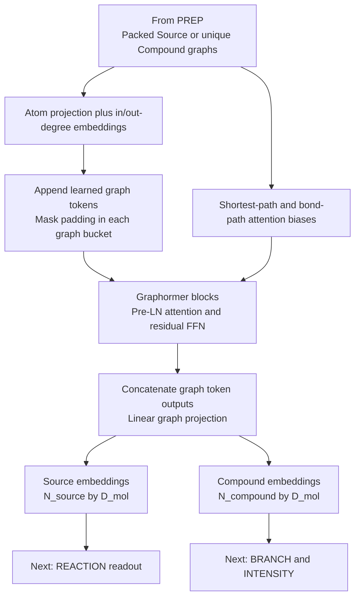

| Interface | Shape / operation | Meaning |
|---|---|---|
| Graph inputs | `x [N_atom,F_atom]`, `edge_index [2,N_bond]`, `edge_attr [N_bond,F_bond]` plus PyG Batch metadata | Packed graphs; counts are totals in that input Batch |
| Graph tokens per graph | `ceil(D_mol / node_dim)` | Learned readout tokens; concatenated before projection |
| `source_embeddings` | float `[N_source,D_mol]` | Original Source context used by reaction encoding and State Head |
| Molecular embeddings | float `[N_compound,D_mol]` | Indexed directly by Compound IDs for branch and intensity inputs |
| Source reuse | `compound_index [N_source]` | Reuses Source embeddings when the same structure is in CompoundBatch |

Source and Compound paths use the same model weights. `encode_compounds()` gathers
already encoded roots and encodes the remaining unique structures in bounded
chunks. The standard path uses graph features; section 5's optional caller-supplied
external vector fusion occurs after graph readout. Configured intensity descriptors
are appended separately on the intensity path, preserving the branch feature width.
Both branch and spectrum objectives update this encoder unless it is frozen.

**Next:** [REACTION](#component-reaction), [BRANCH](#component-branch),
[INTENSITY](#component-intensity).

<a id="architecture-6"></a>

## 6. Concrete reactions and category IDs

**Connections:** Receives concrete chemistry from [preparation (3)](#architecture-3). Source/atom references and reaction categories feed [reaction encoding (7)](#architecture-7); reaction IDs and pair relations also constrain [history expansion (10)](#architecture-10).

Suppose A has three reactions and B has two:

```python
reaction_type = [           # [5,3], integer IDs, NOT one-hot
    [0,0,0], [0,1,0], [1,0,1],  # A
    [0,0,0], [1,0,0],           # B
]  # columns: pattern ID, rule ID, product ID
reaction_source_compound_index = [0,0,0,1,1]  # [5]
```

Pattern ID selects pattern-owned modules. Rule and product IDs index learned
embedding tables in that pattern's readout. Product ID identifies a product
choice in the reaction definition, not a molecular representation.

Pattern 0 processes rows `[0,1,3]`; pattern 1 processes rows `[2,4]`. Each pattern
owns its neighborhood encoder, optional global encoder, reactant Graphormer and
readout. Equal numeric rule IDs in different patterns do not share embeddings.

<a id="architecture-7"></a>

## 7. Pattern-owned reaction encoding

**Connections:** Receives [reaction references/categories (6)](#architecture-6), [raw Source features (4)](#architecture-4), and [Source embeddings (5)](#architecture-5). Its concrete reaction embeddings feed [branch edges (9)](#architecture-9) and the [Fragment Head (12)](#architecture-12), not the State Head.

Assume pattern 0 has two SMARTS atoms and three concrete matches. Raw matched
atom features are `[3,2,35]`. Default external-neighborhood settings are
`neighborhood_hops=3`, `neighborhood_hidden_dim=32`.

For each SMARTS role, traversal excludes other SMARTS atoms. Messages move from
outer shells toward the queried atom. With raw bond feature e:

```text
s_v = GELU(atom_projection(x_v)); root initial state is zero
message_(u<-v,d) = W_d concat(s_v, e_vu)
s_u <- s_u + GELU(mean_of_incoming_messages_at_shell_d)
```

Root chemistry is a separate channel. The neighborhood output is `[3,2,32]`;
an isolated role receives zero. Different patterns have different weights.

Pattern 0's reactant Graphormer input is:

```text
matched atoms          [3,2,35]
external neighborhood  [3,2,32]
SMARTS position one-hot[3,2,2]
concat                 [3,2,69]
projection             [3,2,128]
with one graph token   [3,3,128]
attention, four heads  [3,4,3,3]
reactant graph output  [3,128]
```

The graph topology is the SMARTS query. `bond_dim=0` here: actual internal bond
features are not directly fed to this Graphormer's edge bias. Source graph,
neighborhood/global features and reaction categories provide other context.

Pattern 1 with three SMARTS atoms and two matches has input `[2,3,70]` and still
returns `[2,128]`. SMARTS-position one-hot is not a pattern-ID one-hot.

### Readout: source, category

For pattern 0:

```text
source   [3,64]  = source_embeddings[[0,0,1]]
category [3,128] = rule_embedding(rule_id) + product_embedding(product_id)
```

`source` describes the complete original molecule. Rows 0 and 1 are identical
because they belong to A. `category` describes rule/product choice; equal IDs
in the same pattern give identical vectors even at different match positions.
```text
concat(source,category)        [3,192]
context: Linear(192,128)       [3,128]
concat(reactant_graph,context) [3,256]
Linear(256,128) -> GELU -> LN  [3,128]
```

Scatter pattern outputs back to global reaction order: `reaction_h[5,128]`.
These features are computed from the original source, not re-encoded at each
fragmentation step. New patterns add their own modules but retain common output
width Dr. Pattern IDs and imported weights must remain correctly associated.

Code: [reaction encoder](specgen/components/reaction/reaction_instance_encoder.py),
[neighborhood](reaction/external_neighborhood.py),
[reactant Graphormer](reaction/reactant_graphormer.py).

<a id="component-reaction"></a>

### 7.1 Inside the pattern-owned encoders (REACTION)

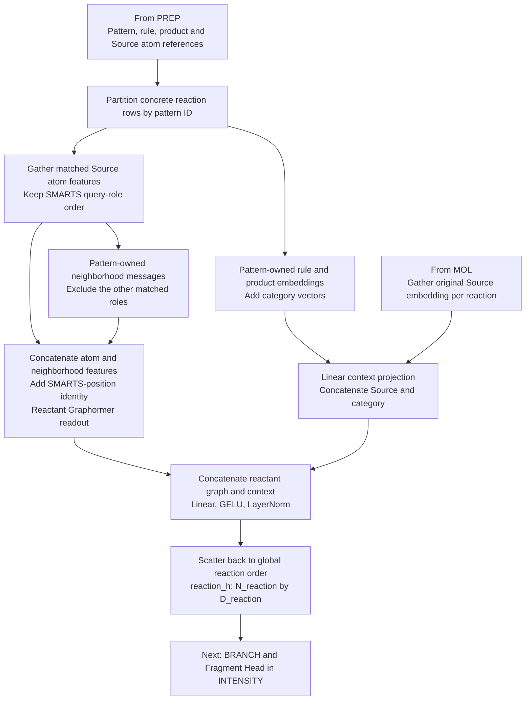

| Interface | Shape / interpretation |
|---|---|
| `reaction_type` | int64 `[N_reaction,3]`: pattern, rule and product IDs |
| Matched sites for pattern p | int64 `[N_reaction_p,N_role_p]`, gathered through atom-reference CSR |
| Reactant features | float `[N_reaction_p,N_role_p,F_atom + D_neighborhood]`; position identity is added by the reactant encoder |
| Original Source context | float `[N_reaction_p,D_mol]`, gathered by `reaction_source_compound_index` |
| Final `reaction_h` | float `[N_reaction,D_reaction]`, common output width across patterns |

Each pattern owns its neighborhood encoder, reactant Graphormer and readout.
Rule/product category vectors are summed, concatenated with the Source embedding,
and projected to `D_reaction`; fusion with the reactant graph then produces the
final vector. A concrete reaction is encoded once from its original Source,
independent of CE and the current fragment. Pattern-specific internal widths can
differ while the shared output width remains fixed. State Head uses molecular
and CE features directly; reaction embeddings enter its preceding fragment-flow path.

**Next:** [BRANCH](#component-branch), [INTENSITY Fragment Head](#component-intensity).

<a id="architecture-8"></a>

## 8. Branch adduct features and CE features

**Connections:** Receives main adduct and CE from [requested conditions (1)](#architecture-1). Main-adduct embedding/projection feeds [branch edges (9)](#architecture-9); CE features feed [both intensity heads (12)](#architecture-12). Main adduct separately routes intensity head banks.

Main-adduct IDs select a learned embedding of width `adduct_embedding_dim=32`.
This is now a branch-search feature, not a spectrum-head input:

```text
group adduct IDs [2] -> Embedding -> [2,32]
Linear(32,128) -> GELU -> LayerNorm -> branch_main_adduct_h [2,128]
```

`--reaction-main-adduct-dim` controls projection width 128;
`--adduct-embedding-dim` controls the underlying width 32. The removed separate
spectrum-adduct projection is not part of the current architecture.

For three samples:

```text
CE [20,40,20] -> [3,1]
(CE - ce_center) / ce_scale -> [[0.2],[0.4],[0.2]]
Linear(1,32) -> ReLU -> Linear(32,16) -> collision_energy_h [3,16]
```

Defaults: `ce_center=0`, `ce_scale=100`, `ce_fc_dims=[32]`. CE has no dropout,
Fourier expansion or post-MLP LayerNorm. Unit conversion to eV is an input
adapter operation; this normalization alone does not convert instrument units.
CE is used only in spectrum transition scoring, not structural search.

Code: [feature model](specgen/source_reaction_feature_model.py),
[CE layer](specgen/components/condition/collision_energy_feature.py).

<a id="component-condition"></a>

### 8.1 Inside condition features (CONDITION)

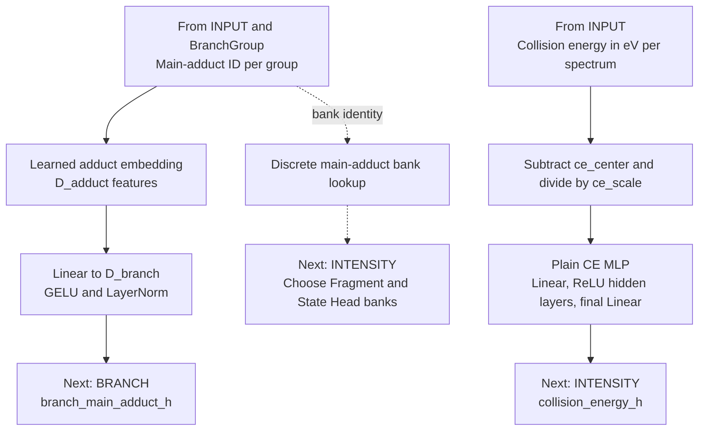

| Output | Shape | Used by |
|---|---|---|
| Adduct embedding before projection | float `[N_group,D_adduct]` | Branch main-adduct projection |
| `branch_main_adduct_h` | float `[N_group,D_branch]` | Branch edge MLP only |
| `collision_energy_h` | float `[N_spectrum,D_CE]` | Fragment Head and State Head |
| Main-adduct bank key | One registered label per spectrum, via its BranchGroup | Head-module routing; no learned spectrum-adduct vector |

For CE `[10,40]`, center 0 and scale 100 produce inputs `[[0.1],[0.4]]`.
With `ce_fc_dims=[32]` and `D_CE=16`, the CE network is `1 -> 32 -> 16`.
Repeated CE values receive the same CE encoding. Branch main-adduct features are
shared by all spectra in a group. Adduct embedding/projection receives branch
loss gradients; the CE MLP receives spectrum loss gradients. Routing itself is
an integer/label lookup.

**Next:** [BRANCH](#component-branch), [INTENSITY](#component-intensity).

<a id="architecture-9"></a>

## 9. CE-independent edge classification

**Connections:** Receives [Compound embeddings (5)](#architecture-5), [reaction embeddings (7)](#architecture-7), [main-adduct features (8)](#architecture-8), and prepared edge references. Edge logits feed [branch BCE (16)](#architecture-16); inference scores select edges for [history expansion (10)](#architecture-10), without a differentiable link through selection.

Each BranchGroup selects canonical CompoundReactionGraph edges by CSR. The edge
MLP concatenates source Compound embedding, target Compound embedding, concrete
reaction embedding and main-adduct projection. `edge_num_layers` controls its
hidden layers; `edge_dropout` controls dropout. CE does not enter branch logits.
Sigmoids are independent edge probabilities. Prediction accumulates their log
probabilities along admissible reaction histories and applies the path threshold
and unique-Compound budget per group, shared across CE.

<a id="component-branch"></a>

### 9.1 Inside the branch edge MLP (BRANCH)

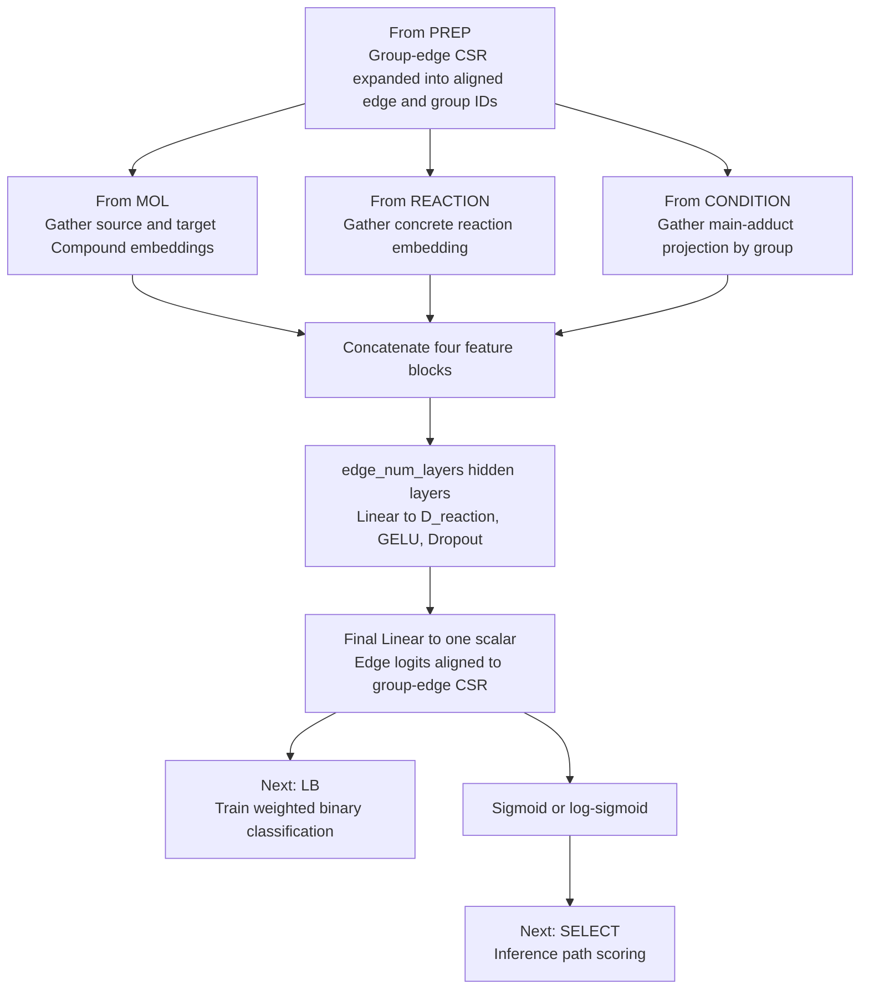

| Interface | Shape / example |
|---|---|
| Expanded `edge_index`, group IDs | int64 `[N_edge_use]` each; aligned with labels during training |
| Concatenated input | float `[N_edge_use,2*D_mol + D_reaction + D_branch]` |
| Hidden activations | float `[N_edge_use,D_reaction]` |
| Logits / sigmoid probabilities | float `[N_edge_use]` |

At `D_mol=64`, `D_reaction=128`, `D_branch=128`, each edge input has width 384.
The same structural edge under two main-adduct groups has two scoring rows.
Each probability is independent: outgoing branch sigmoids do not sum to one.
CE and reaction-history embeddings do not enter this head. Training sends logits
to weighted BCE; inference accumulates their log-sigmoids along valid histories.
These branch probabilities are selection scores, separate from the Fragment
Head event probabilities used to predict intensity.

**Next:** [LB](#component-branch-loss) during training;
[SELECT](#component-selection) during prediction.

<a id="architecture-10"></a>

## 10. Shared structures and admissible histories

**Connections:** Receives prepared Compound/ReactionSet/edge registries from [preparation (3)](#architecture-3), plus [edge selection (9)](#architecture-9) during inference. Admissible histories supply the event topology for [probability propagation (13)](#architecture-13); reachable Compounds determine [candidate state rows (11)](#architecture-11).

Preparation performs reaction chemistry before neural scoring and interns unique
Compound structures and ReactionSets. Formula explanations use these shared
Compound IDs directly; SourceCompound maps each root to CompoundBatch.
Training and prediction use the same prepared chemical component classes.

A derived finite execution graph distinguishes `(group, Compound, ReactionSet)`
histories while reusing molecular embeddings. Edges add one unused compatible
reaction and must match a registered generating set at their destination.
Structural cycles and identity self loops therefore do not cause infinite
propagation or introduce impossible merged paths. This runtime expansion is
not serialized. Predicted final mass is summed over histories of each Compound.

Code: [canonical input](input/source_reaction_structure.py),
[edge model](specgen/source_reaction_feature_model.py),
[batched generator](specgen/source_anchored_spectrum_predictor.py).

<a id="component-selection"></a>

### 10.1 Inside inference selection and compatible histories (SELECT)

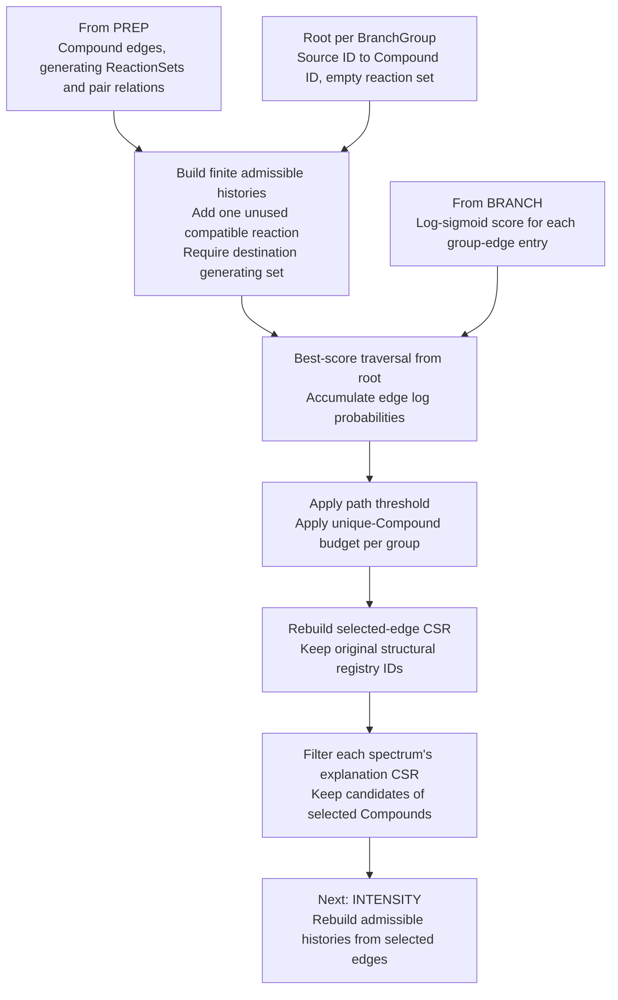

| Interface | Shape / operation |
|---|---|
| Root mapping | `root_source_compound_index [N_group]` -> `SourceCompound.compound_index` -> Compound ID |
| Admissible history identity | `(BranchGroup, Compound ID, sorted reaction set)`; derived at runtime |
| Search path score | Sum of `logsigmoid(edge_logit)`; root score is 0 |
| Selected `edge_ptr/index` | int64 CSR with `N_group` rows, referencing the original CompoundReactionGraph |
| Selected spectrum explanations | int64 CSR with `N_spectrum` rows, referencing original FormulaExplanationData |

A repeated reaction, conflict or invalidation blocks an extension. Reaching a
Compound through a new valid reaction set retains another history without
copying its molecular graph. A threshold of zero disables score pruning; otherwise
scores are compared in log space. `max_fragment_nodes` counts unique Compounds,
including the root, once per group. Accepted edges determine the final graph,
and admissible histories are derived again for intensity computation. Selection
runs under `no_grad`; label tensors are absent from prediction inputs.
Training directly uses the prepared graph instead of this predicted selection.

**Next:** [INTENSITY](#component-intensity), using the same chemical registries
and spectrum-condition interfaces as training.

<a id="architecture-11"></a>

## 11. Complete ion-condition state grid and metadata

**Connections:** Receives reachable Compounds from [the shared graph (10)](#architecture-10) and adduct/shift vocabularies from preparation. Candidate rows select [State Head slices (12)](#architecture-12), align [joint probabilities (13)](#architecture-13), and reference formulas for [aggregation (14)](#architecture-14) and [target construction (15)](#architecture-15).

A condition is `(fragment-ion adduct, hydrogen shift)`. Conditions are ordered
by adduct-list order, then increasing shift. With ions `[M+H]+, [M-H]+` and shifts
`[-5,-4,-3,-2,-1,0]`, C=12. A custom Na rule with ions `[M+Na]+, [M+H]+` also has
12. The repository's single-bond positive preset currently has three Na
fragment-ion types, hence 18; the custom two-ion example is not that preset.

Each structural node gets the full grid before formula validation. For the
three samples and seven structural nodes above:

```text
A, CE20: 4 * 12 = 48 states
A, CE40: 4 * 12 = 48 states
B, CE20: 3 * 12 = 36 states
K = 132
```

Each row represents one structural-node/condition/sample state.
Formula-equivalent conditions stay separate before scoring.

| Tensor | Shape | Meaning |
|---|---|---|
| `state_node_index` | `[132]` | State -> global structural node |
| `state_sample_index` | `[132]` | State -> spectrum condition |
| `state_adduct_index` | `[132]` | Condition's fragment-ion vocabulary ID |
| `state_hydrogen_shift` | `[132]` | Condition's signed shift |
| `state_formula_tensor` | `[132,F]` | Output-only elemental counts + charge |
| `state_mz` | `[132]` | Output mass annotation |

For a one-node/one-sample mini-example with two ions and shifts `[-1,0]`:

```python
node_index   = [0,0,0,0]
sample_index = [0,0,0,0]
adduct_index = [0,0,1,1]
shift        = [-1,0,-1,0]
```

Each state directly indexes its condition. With a second CE, the node labels repeat but sample IDs change. Source and fragment
molecular vectors are selected by node IDs; CE is selected by sample IDs.
Formula/mz fields are prepared in the common input for training and prediction.
They annotate candidates and do not enter neural event features or softmaxes.

Code: [state preparation and annotation](specgen/fragment_spectrum_model.py),
[sample selection/collation](input/reaction_batching.py).

<a id="architecture-12"></a>

## 12. Fragment Head and State Head

**Connections:** Receives [molecular features (5)](#architecture-5), [reaction features (7)](#architecture-7) for Child events, [CE/bank routing (8)](#architecture-8), [history topology (10)](#architecture-10), and [condition slices (11)](#architecture-11). Head logits feed the two softmax operations and [probability propagation (13)](#architecture-13).

Each main precursor adduct owns two independent banks, shared across fragments.
The main adduct selects the bank directly. Both use `ConditionHead` GELU MLPs
with configurable hidden widths and dropout.

Fragment Head inputs are parent molecular features, child molecular features,
added reaction features and CE. Ion adduct and hydrogen shift are absent.
Its three MLP slices score Child, Self and Sink. Self and Sink use the parent's
features twice and zero reaction features. With molecule width 64, reaction
width 128 and CE width 16, its input width is 272; first-layer weights are
`[3,128,272]` with default hidden widths `[128,64]`.

State Head inputs are fragment molecular features, original Source molecular
features and CE. Its weights are shared by all fragments within the main-adduct
bank, with one slice per ion/shift combination. For C=12 its input width is 144
and its first-layer weights are `[12,128,144]`. It runs after Fragment DAG
propagation and normalizes over all C states for each fragment/sample.
Optional signed-log spectrum descriptors extend both molecular feature inputs.

<a id="component-intensity"></a>

### 12.1 Inside the two head banks (INTENSITY)

The [intensity overview](#inside-intensity-model) shows mass propagation.
This diagram expands the neural inputs and learned transformations inside it.

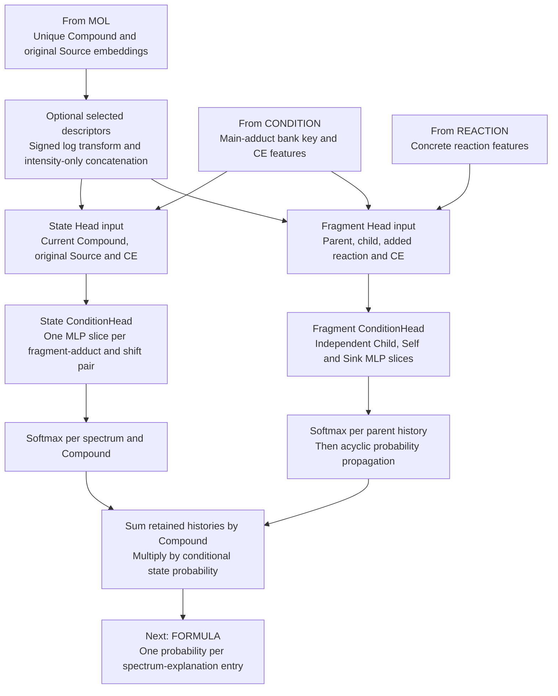

| Interface | Shape / interpretation |
|---|---|
| Descriptor-extended molecular width | `D_intensity = D_mol + N_selected_descriptor` |
| Fragment Head input | float `[N_event,2*D_intensity + D_reaction + D_CE]` |
| Fragment event logits/probabilities | float `[N_event]`; event type selects Child, Self or Sink slice |
| Retained Compound probability | float `[N_spectrum_compound]`, after summing history Self mass |
| State Head input | float `[N_explanation_use,2*D_intensity + D_CE]` |
| Conditional state / joint explanation probability | float `[N_explanation_use]` each |
| Sink probability | float `[N_spectrum]` |

Self and Sink use the parent molecular vector in both molecular slots and zero
reaction features. Each main-adduct bank has independent weights, shared across
its fragments. State softmax is over that main adduct's complete ion/shift grid
for a (spectrum, Compound) pair, not across all Compounds. Propagation is over
finite sample-expanded histories; molecular vectors remain shared. Joint
probability is retained Compound mass times conditional state probability.
With retained mass 0.4 and state probability 0.25, that explanation contributes
0.1 to its Formula. Formula/mass annotations supply grouping and supervision.

**Next:** [FORMULA](#component-formula); sink mass remains a separate diagnostic.
**Code:** [ConditionHead](specgen/components/condition/condition_linear.py),
[canonical intensity forward](specgen/competitive_spectrum_model.py).

<a id="architecture-13"></a>

## 13. Fragment events, DAG propagation and State probabilities

**Connections:** Receives [head logits (12)](#architecture-12) and [compatible-history topology (10)](#architecture-10). Retained Compound mass and conditional state probabilities produce explanation probabilities for [formula aggregation (14)](#architecture-14). Sink probability is a separate diagnostic output.

The event graph contains sample-specific compatible-history rows; histories
that reach the same Compound share its molecular features. The simple counts
below assume one history per physical fragment. Each parent
competes over its Child events, Self and Sink in one softmax. A terminal fragment
still predicts both Self and Sink. No ion/shift Cartesian product appears in
Fragment events. For the worked example, 11 fragment/sample rows and 10 Child
edges produce 10 Child + 11 Self + 11 Sink = 32 events; State Head has 132 rows.

```text
P(Self | i) + sum_j P(j | i) + P(Sink | i) = 1
```

Initialize `incoming[root]=1` per sample. Visit each fragment once in topological
order after summing every parent's contribution. Finalize
`fragment_probability[i] = incoming[i] * P(Self | i)` and
`sink[i] = incoming[i] * P(Sink | i)`; add only Child mass to child incoming values.
Self and Sink are never repropagated. The derived history graph is acyclic,
even when the shared Compound graph has cycles or self loops. After summing
retained histories by Compound, for each sample,
`sum(fragment_probability) + sum(sink) = 1`.

For root probabilities Self=0.2, Child=0.7, Sink=0.1 and terminal probabilities
Self=0.6, Sink=0.4, retained masses are 0.2 and 0.42, with total sink mass 0.38.

After propagation, State Head normalizes ion/H-shift logits within each fragment:

```text
sum_k state_probability[i,k] = 1
joint_probability[i,k] = fragment_probability[i] * state_probability[i,k]
log_joint_probability = log_fragment_probability + log_state_probability
```

These probabilities are multiplied, never added. State predictions cannot affect
fragment flow. Different states retain separate rows until final formula-level
aggregation. Formula/mass/charge do not control event or State normalization.

Output diagnostics expose fragment probabilities and their node/sample indices,
conditional state probabilities, and the state-to-fragment map. `ion_probability`
is the joint probability. Transition diagnostics index fragment rows; Sink target
is -1, Self reaction is -1 and Sink reaction is -2. `sink_probability` is per
sample. `probability_mass_error` measures retained plus sink minus initial mass.

<a id="architecture-14"></a>

## 14. Formula annotation, aggregation and export

**Connections:** Receives [joint explanation probabilities (13)](#architecture-13) and prepared [candidate/formula references (11)](#architecture-11). Aggregated formula probabilities feed [spectrum loss (17)](#architecture-17); valid m/z and maximum-normalized intensities feed exported spectra. Display normalization does not feed the loss.

Shared preparation computes FormulaExplanationData annotations before neural
scoring; propagation later supplies their probabilities. The chemistry is:

```python
shift = Adduct.from_dict({'H': hydrogen_shift})
formula = fragment_ion_adduct.apply_to_formula(
    shift.apply_to_formula(fragment_compound.formula)
).normalized
mz = formula.exact_mass / abs(fragment_ion_adduct.charge)
```

The implementation uses `exact_mass` for the annotation; the model's precursor
resolver supports singly charged precursor adducts. This is not a learned m/z
regression head. Formula tensors store counts in `FormulaTensorizer.element_order`
and charge in the last column. They can be used for loss/output grouping, but
not transition inputs, initial-state selection or event validity.

Equivalent states are summed by `(sample, formula including charge)` after
propagation. Export removes negative-element formulas and non-positive masses.
This does not redistribute their internal probability mass. Display intensity
is divided by the largest valid formula-grouped probability per sample.
Confidence is fixed to one, not a learned existence probability.

The MSDataset batch export adapter uses `merge_candidate_peaks()`. The generator
returns candidate rows, and the Workbench backend retains
candidate/node rows for inspection rather than applying that same aggregation;
its candidate rows must not be mistaken for already formula-merged peaks.

<a id="component-formula"></a>

### 14.1 Inside formula aggregation (FORMULA)

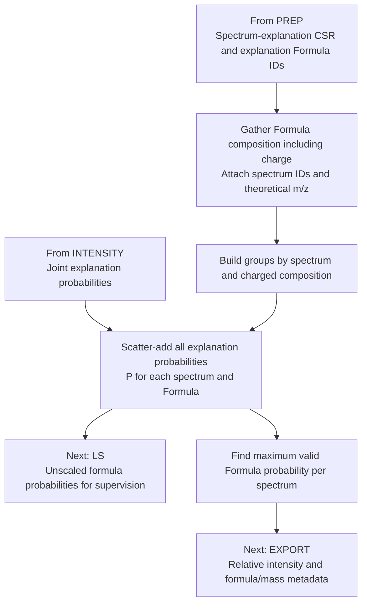

| Interface | Shape / operation |
|---|---|
| Explanation probabilities | float `[N_explanation_use]`, aligned to spectrum explanation CSR |
| Formula registry | int64 `composition [N_formula,N_element+1]`; float64 `mz [N_formula]` |
| Runtime grouping key | Spectrum ID plus elemental counts and charge; equivalent to canonical spectrum/Formula identity |
| Aggregated probabilities | float `[N_formula_target]`; sum contributions from all explanations of a Formula |
| Relative formula intensity | `P_formula / max_valid_formula_probability_for_that_spectrum` |

For explanation probabilities `[0.2,0.3,0.1]` with Formula IDs `[7,9,9]` in one
spectrum, aggregation gives `{7:0.2, 9:0.4}`. Display intensities are `{7:0.5,
9:1.0}`. Equal m/z alone does not merge formulas: elemental composition and charge
define identity. Candidate-level model outputs retain explanation rows for
inspection; `merge_candidate_peaks()` materializes the formula-grouped export.
Spectrum loss uses the unscaled probabilities, before display normalization.

**Next:** [LS](#component-spectrum-loss), [EXPORT](#component-export).

<a id="component-export"></a>

### 14.2 Inside predicted-spectrum export (EXPORT)

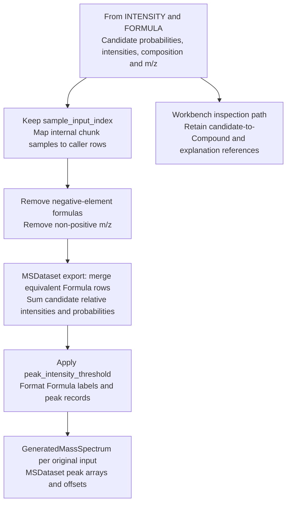

| Interface | Shape / consumer |
|---|---|
| `SpectrumModelOutput` candidate fields | `sample_index`, `mz`, `intensity`, `ion_probability`: `[N_explanation_use]`; formula tensor has `N_element+1` columns |
| `sample_input_index` | Tuple of chunk sample -> original caller index mappings |
| Formula-grouped exported peaks | Variable-length peak rows per input; empty results remain representable |
| Exported confidence | Ones; no separate learned confidence head |
| Workbench references | Candidate Compound IDs and `formula_explanation_index` before formula merging |

`predict_batches()` shares Source/reaction encodings within a prepared pack and
yields bounded spectrum chunks. The MSDataset adapter explicitly merges formula
rows and restores original input positions. The direct generator output keeps
candidate rows so Workbench can inspect multiple explanations of one peak.
After merging, a peak no longer has a single unambiguous explanation ID.
Display filtering changes exported peaks only; it does not rerun probability
propagation or redistribute rejected state mass.

**Next:** caller spectra/MSDataset and Workbench; this display path does not
feed the training objective. **Code:** [export adapter](specgen/source_reaction_msdataset.py).

<a id="architecture-15"></a>

## 15. Measurements and targets

**Connections:** Receives measured peaks and prepared chemical explanations from [preparation (3)](#architecture-3). CE-pooled edge labels supervise [branch loss (16)](#architecture-16); per-spectrum formula intensity/mask targets supervise [spectrum loss (17)](#architecture-17). This component is absent from prediction inputs.

The shared input is SpectrumPredictionData. SourceReactionStructure adds
SpectrumData observations, PeakAssignmentData and derived SpectrumFormulaTarget.
See the authoritative [schema](input/SCHEMA.md) and [workflow](input/README.md).
A peak can reference several FormulaExplanationData rows, which can explain
several formulas. Each explanation refers to one Formula, Compound, fragment
adduct and hydrogen shift. SpectrumExplanationData supplies candidate explanation
CSR per spectrum, including unmatched candidates.

For each (spectrum, Formula), target intensity is the maximum assigned measured
intensity; predicted explanation contributions are summed. Valid unmatched
candidates have target zero. Unavailable or invalid targets are masked out,
including from cosine normalization. `observed` is metadata, not a presence head.
Observed peaks with no represented candidate do not contribute intensity loss.

<a id="component-teacher"></a>

### 15.1 Inside training supervision (TEACHER)

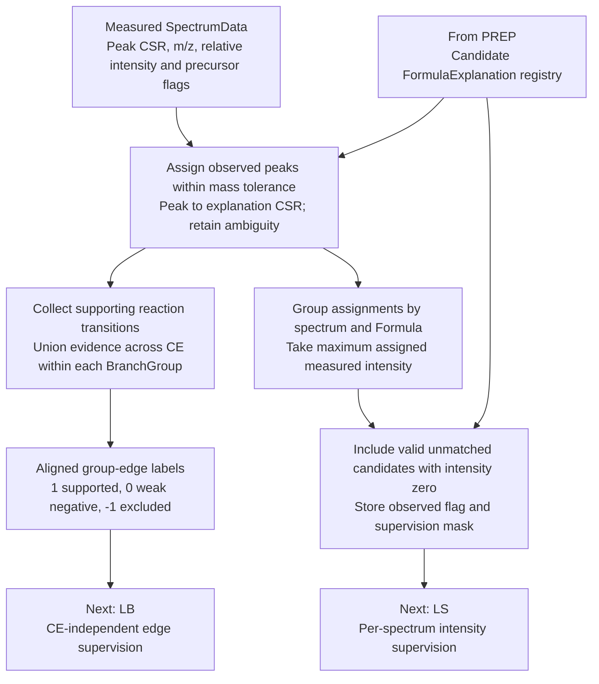

| Interface | Shape / semantics |
|---|---|
| Observed peaks | `peak_ptr [N_spectrum+1]`; aligned `mz`, `intensity`, `precursor` columns |
| Peak assignments | CSR with one row per observed peak; values reference FormulaExplanationData |
| Branch `edge_label` | int8 `[N_edge_use]`, aligned with `ReactionContextData.edge_index` |
| `SpectrumFormulaTarget` | `spectrum_index`, `formula_index`, `observed`, `intensity`, `supervision_mask`: `[N_formula_target]` each |
| Observed spectrum CE | float64 measurement metadata; model CE input is separately float32 |

A peak may support several Formulas and several structural explanations of one
Formula. A supported edge means it occurs in at least one retained chemical
explanation, not that the experiment identifies a unique path. Current preparation
emits 1 for supported edges and 0 for other retained candidate edges; -1 is the
supported explicit exclusion label for training inputs. Formula targets keep
CE-specific intensities even when branch labels are shared across CE.
`for_prediction()` removes observations, targets and edge labels while sharing
the chemical components. It does not infer labels from model output.

**Next:** [LB](#component-branch-loss), [LS](#component-spectrum-loss).

<a id="architecture-16"></a>

## 16. Weighted branch edge loss

**Connections:** Receives [edge logits (9)](#architecture-9) and [aligned labels (15)](#architecture-15). Weighted BCE contributes to [total loss (18)](#architecture-18), with gradients to the branch MLP, main-adduct features and shared encoders.

Preparation unions supported branch edges across CE within each BranchGroup.
Labels aligned to the group's edge CSR are 1 (positive), 0 (weak negative),
and -1 (excluded). The implemented objective is

```text
L_branch = (sum_positive softplus(-logit)
          + negative_weight * sum_negative softplus(logit))
           / (N_positive + negative_weight * N_negative)
```

The empty objective is zero. Ignored labels have zero gradient.
Default `negative_weight=0.5`; there is no MIL temperature or path-label table.
Code: [branch_edge_loss](training/fragment_tree_training/model.py).

<a id="component-branch-loss"></a>

### 16.1 Inside weighted edge BCE (LB)

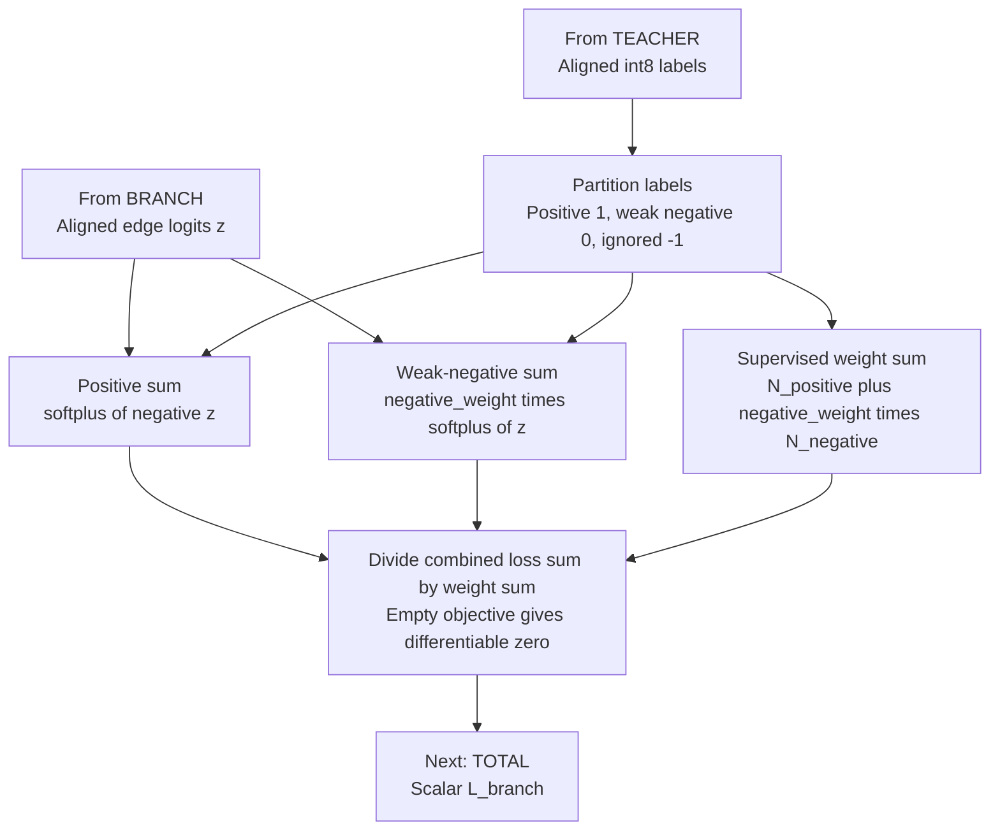

| Interface | Shape / meaning |
|---|---|
| Logits and labels | `[N_edge_use]` each; labels must be int8 with values -1, 0 or 1 |
| `negative_weight` | Finite nonnegative scalar; default 0.5 |
| `branch_loss` | Scalar, reduced over all supervised edge entries in the input batch |
| Diagnostic positive/negative means | Separate unweighted means; used for metrics, not an additional objective |

For `z=[0,0,0]`, labels `[1,0,-1]` and weight 0.5, the numerator is
`1.5*log(2)` and denominator 1.5, giving loss `log(2)`. The third logit has
zero gradient. A zero negative weight also gives weak negatives zero weight.
The implementation clamps the denominator for the empty case. Within one forward pass, branch entries are per group-edge pair rather than
per CE row, with no separate per-group balanced reduction. Separate training
batches may revisit the same group.

**Next:** [TOTAL](#component-total-loss); gradients reach BRANCH, its main-adduct
features, and the shared molecular/reaction encoders.

<a id="architecture-17"></a>

## 17. Spectrum loss: cross entropy and cosine

**Connections:** Receives [formula probabilities (14)](#architecture-14) and [intensity/mask targets (15)](#architecture-15). Inclusive and precursor-excluded objectives contribute to [total loss (18)](#architecture-18), with gradients through both intensity heads, CE features and shared encoders.

Let B+ contain samples with positive total candidate-assigned target intensity.
Normalize teacher intensities by their sample sum:

```text
w_bF = max(y_bF,0) / sum_F max(y_bF,0)
L_cross_entropy = -(1/|B+|) * sum_b_in_B+ sum_F w_bF * log(max(P_bF,1e-12))
cos_b = dot(P_b,y_b) / max(norm(P_b)*norm(y_b),1e-12)
L_cos = 1 - mean_b_in_B+ cos_b
L_with_precursor = intensity_loss_weight * (L_cross_entropy + cosine_loss_weight * L_cos)
L_spectrum = L_with_precursor + L_without_precursor
```

The loss uses final probabilities, not maximum-normalized display intensities.
Zero-target and invalid-condition probabilities still compete for total mass;
cosine also penalizes probability allocated to zero-target entries. Samples
without positive candidate-assigned targets contribute no spectrum loss.

Example, four states with formulas `[F0,F1,F1,F2]`:

```text
state probabilities [0.2,0.3,0.1,0.4] -> P = [0.2,0.4,0.4]
state targets       [20,100,100,0]     -> y = [20,100,0]
w = [1/6,5/6,0]
L_cross_entropy ~ 1.032; cosine ~ 0.719
L_with_precursor ~ 1.032 + 1*(1-0.719) ~ 1.313
valid display intensities = [0.5,1,1]
```


`L_without_precursor` uses the same cross entropy and cosine objective after
removing all formula-level peaks of the Source with the declared precursor
adduct and its hydrogen-shift variants. Both predictions and targets are separately normalized by their remaining
sample sums. Samples without remaining positive targets are omitted from this
term's average. Both terms have equal weight and share the existing intensity
and cosine weights. Hydrogen-only changes preserve the adduct charge, molecule
count, and all non-hydrogen element differences. Other Source ion conditions
remain unless their formula matches one of these excluded peaks. Precursor exclusion affects supervision only.

Code: [spectrum objective](specgen/competitive_spectrum_model.py),
[loss settings](specgen/fragment_spectrum_model.py).

<a id="component-spectrum-loss"></a>

### 17.1 Inside spectrum loss (LS)

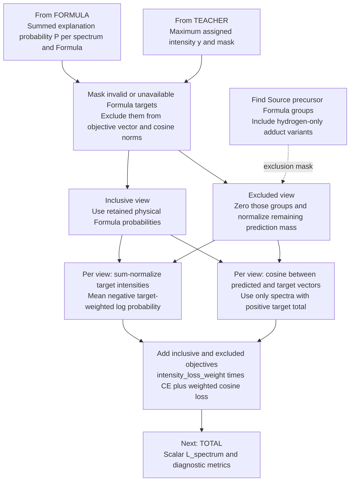

| Interface | Shape / operation |
|---|---|
| Formula probability/target/mask | `[N_formula_target]` each, grouped by spectrum |
| Target distribution in either view | `y / sum_formula(y)` per spectrum |
| Inclusive prediction | Physical formula probability after masking; not sum-normalized or display-normalized |
| Precursor-excluded prediction | Remaining formula probability divided by its remaining sample sum |
| Active spectra | Positive target sum in that view; inactive spectra contribute zero |
| Output | Scalar `spectrum_loss`; separate inclusive/excluded cross-entropy and cosine metrics |

The inclusive objective can penalize mass lost to Sink through low probabilities
of observed formulas. Cosine measures the relative formula-intensity pattern.
The excluded objective evaluates fragment intensities separately from the Source
precursor and its hydrogen-only variants. Formula ambiguity is handled by summing
predictions and taking maximum assigned target intensity, not by selecting one
Compound explanation. Invalid states still participate in neural softmaxes;
masking excludes direct target terms, not their competition for neural mass.
There is no independent observed/presence BCE objective.

**Next:** [TOTAL](#component-total-loss); gradients pass through aggregation,
joint multiplication, state softmax and history propagation to the intensity
heads and their encoders. Discrete chemical assignment remains fixed.

<a id="architecture-18"></a>

## 18. Total objective and gradient boundaries

**Connections:** Combines [branch BCE (16)](#architecture-16) and [spectrum loss (17)](#architecture-17). Backpropagation updates the connected trainable components according to the table below; it stops at discrete [selection/history construction (9–10)](#architecture-9) and [teacher assignment (15)](#architecture-15).

```text
L_total = branch_weight * L_branch
        + L_spectrum
```

Defaults: branch 1, negative 0.5, intensity 1, cosine 1. The two numerical
examples above cover only the precursor-inclusive term; the total also adds
the precursor-excluded term.

| Module | Branch-loss gradient | Spectrum-loss gradient |
|---|---|---|
| Shared MolEncoder, including configured external fusion | Yes | Yes |
| Reaction-instance encoders | Yes | Yes |
| Branch adduct embedding/projection | Yes | No |
| Compound/reaction edge MLP | Yes | No |
| CE MLP | No | Yes |
| Main-adduct Fragment Head | No | Yes |
| Main-adduct State Head | No | Yes |
| Chemistry relations, IDs and formula annotations | Not trainable | Not trainable |

Freezing overrides updates for affected parameters. Spectrum gradients flow
through probability propagation but not discrete search, pruning, reaction-set
materialization or chemical target assignment. Training and inference therefore
use the same canonical structural tables; inference selects a reachable
subgraph using predicted edge scores.

<a id="component-total-loss"></a>

### 18.1 Inside the total training objective (TOTAL)

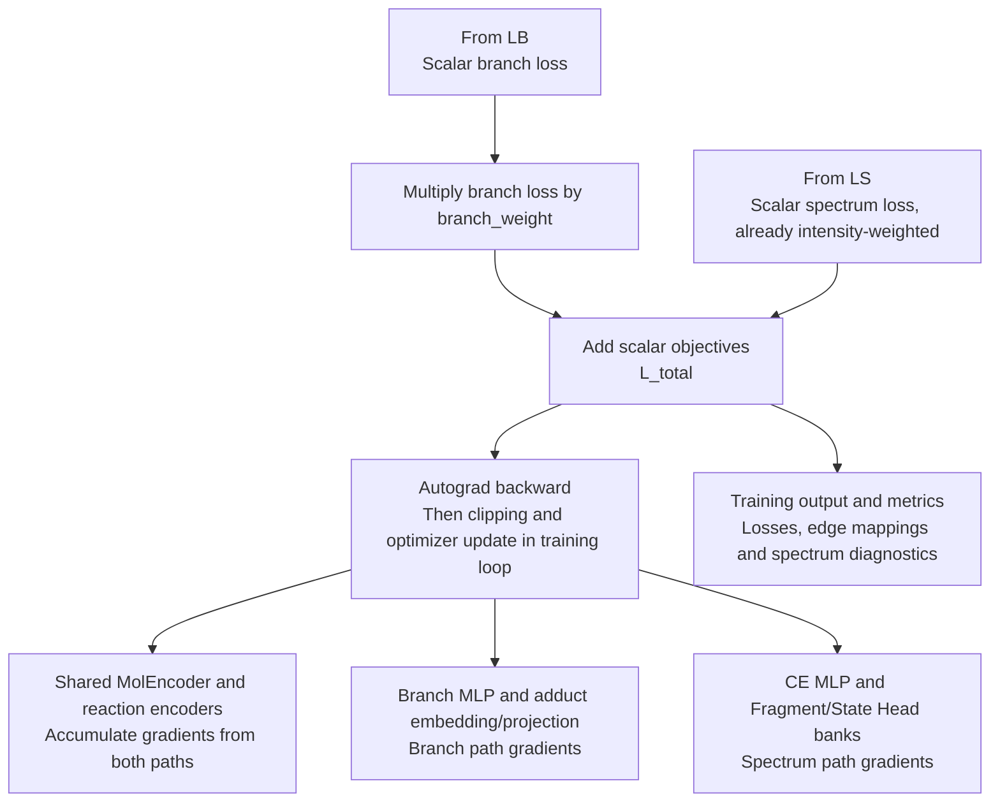

| Interface | Shape / semantics |
|---|---|
| `branch_weight` | Scalar multiplying only `L_branch` |
| `L_spectrum` | Includes intensity/cosine weights and both precursor views before addition |
| `ReactionTrainingOutput.loss` | Scalar optimized by the training loop |
| Output branch mappings | Edge IDs and BranchGroup IDs aligned with logits for inspection |
| Spectrum output | Candidate probabilities, relative intensities, event diagnostics and loss metrics |

The trainer reuses the molecular embeddings computed for edge scoring in the
intensity forward pass. The numerical branch objective is not added again inside
the spectrum objective. Shared parameters accumulate both gradient contributions;
frozen modules remain unchanged. Optimizer scheduling, clipping and checkpointing
are training-loop operations following this model output. Chemistry, IDs,
branch selection and teacher assignment have no differentiable parameters.
Inference calls the generator without invoking this training wrapper or targets.

**Next:** optimizer updates and training reports; prediction uses
[INPUT through EXPORT](#component-input) without TEACHER/LB/LS/TOTAL supervision.

<a id="architecture-19"></a>

## 19. Configuration and UI map

**Connections:** Architecture and generation settings configure [encoders (5, 7)](#architecture-5), [conditions (8)](#architecture-8), [selection (9)](#architecture-9), and [heads (12)](#architecture-12). Training settings configure [loss weights (16–18)](#architecture-16); these settings are not extra neural input features.

| Setting | CLI | Default / role |
|---|---|---|
| `node_dim`, `graph_dim` | `--node-dim`, `--graph-dim` | 16, 64 |
| `num_layers`, `num_heads` (molecule) | `--num-layers`, `--num-heads` | 2, 4 |
| Molecular dropout | `--dropout` | 0 |
| Reaction `hidden_dim` | `--reaction-hidden-dim` | 128 |
| `branch_main_adduct_dim` | `--reaction-main-adduct-dim` | 128 |
| Reaction `num_heads`, branch `edge_num_layers` | `--reaction-num-heads`, `--reaction-edge-layers` | 4, 2 |
| Branch `edge_dropout` | `--fragment-tree-dropout` | 0.5 in CLI |
| `adduct_embedding_dim` | `--adduct-embedding-dim` | 32, branch only |
| `collision_energy_dim` | `--collision-energy-feature-dim` | 16 |
| `ce_fc_dims`, `ce_center`, `ce_scale` | `--ce-fc-dims`, `--ce-center`, `--ce-scale` | `[32]`, 0, 100 |
| `fragment_fc_dims` | `--fragment-fc-dims` | `[128,64]`, Fragment Head |
| `fragment_dropout` | `--fragment-dropout` | 0 |
| `state_fc_dims` | `--state-fc-dims` | `[128,64]`, State Head |
| `state_dropout` | `--state-dropout` | 0 |
| Spectrum `descriptors` | `--intensity-descriptors` | `[]` |
| Branch / weak-negative weight | `--branch-weight`, `--negative-weight` | 1, 0.5 |
| Spectrum / cosine weights | `--intensity-loss-weight`, `--cosine-loss-weight` | 1, 1 |
| Search/output limits | `--branch-path-threshold`, `--max-fragment-nodes`, `--peak-intensity-threshold` | 0, 100, 0 |

API constructor defaults and Workbench presets can differ from CLI defaults;
for example the reaction API's edge dropout defaults to 0, while the CLI sets
0.5. Inspect saved model_config for the effective architecture.
`external_feature_dim` is a MolEncoder configuration/API field, not an automatic
external-feature data provider or dedicated training CLI flag.

Workbench groups branch-adduct and CE settings in collapsed sections and exposes
Fragment/State Head widths and dropout. Retired ion/shift embedding and ion-state-MLP
settings are removed. Old checkpoint compatibility is not implemented.

Code: [CLI settings](training/fragment_tree_training/training.py),
[molecular options](training/fragment_tree_training/mol_encoder_options.py),
[Workbench editor](../../fredis_workbench/src/workbench/parameter-editor.js).

<a id="architecture-20"></a>

## 20. Implementation-review checkpoints

**Connections:** These checks verify the paths in [the overall architecture (1)](#architecture-1), especially [history validity (10)](#architecture-10), [probability conservation (13)](#architecture-13), and [loss/gradient boundaries (16–18)](#architecture-16).

- Reaction features always refer to the original source match.
- Structural search depends on main adduct, not CE.
- Pair relations are prepared per molecule on CPU; retained-set validity remains dynamic.
- The complete condition grid is preserved before scoring, including invalid formulas.
- Main-adduct banks and condition slices have independent parameters.
- Parent ion condition has no additional learned input channel.
- Formulas/masses annotate and supervise; they do not constrain learned transition topology.
- Initial fragment mass is 1 at each sample's original Source root.
- Probabilities represent final Self mass after a single topological DAG pass.
- Formula aggregation is post-propagation; display filtering does not restore discarded mass.
- Spectrum supervision is limited to represented candidate formulas.
- Spectrum loss does not backpropagate through structural proposal selection.

Regression references: [condition-head and probability tests](../../tests/ml/reaction/test_competitive_spectrum.py),
[training/structure tests](../../tests/ml/reaction/test_fragment_tree_model.py),
[batch prediction tests](../../tests/ml/specgen/test_predict_source_msdataset.py).

Old coupled Transition Head checkpoints are incompatible with the new banks and softmax definitions; retrain the model.
