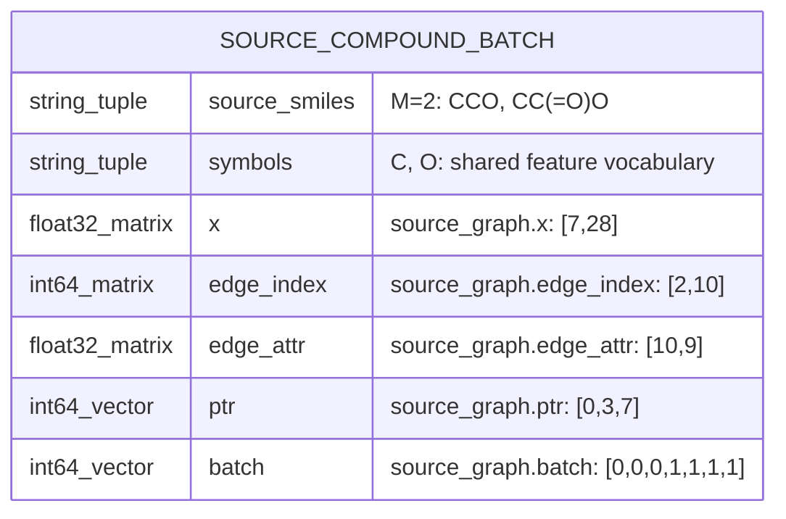
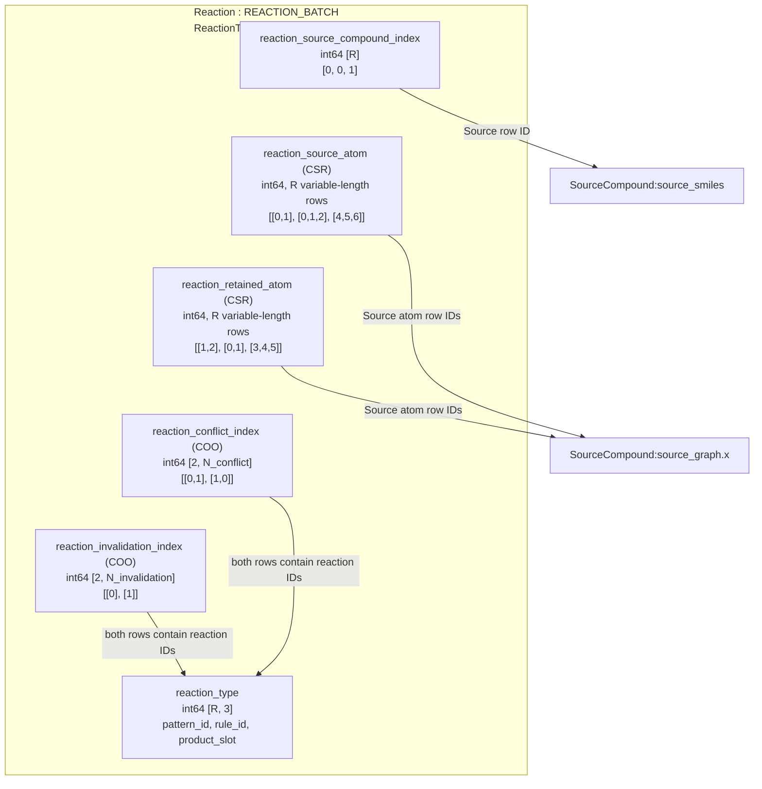
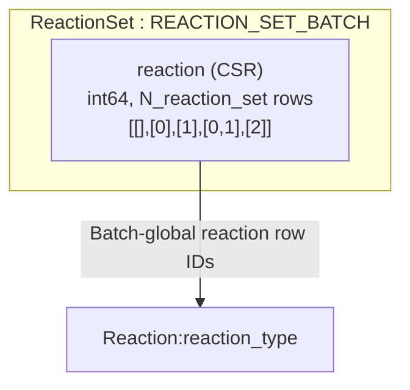
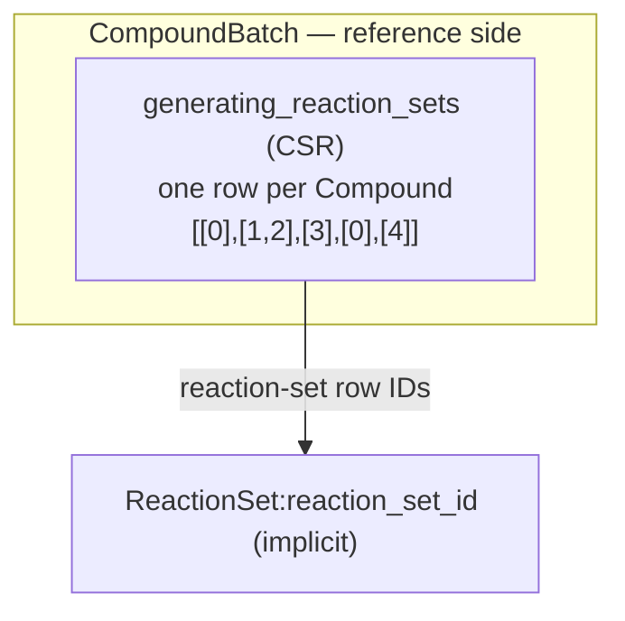
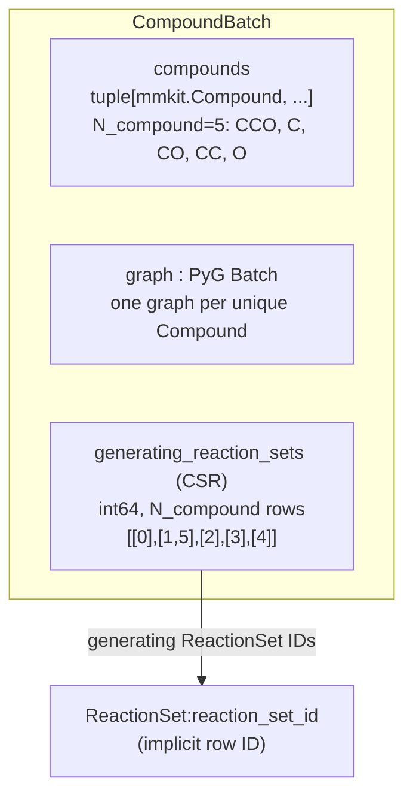
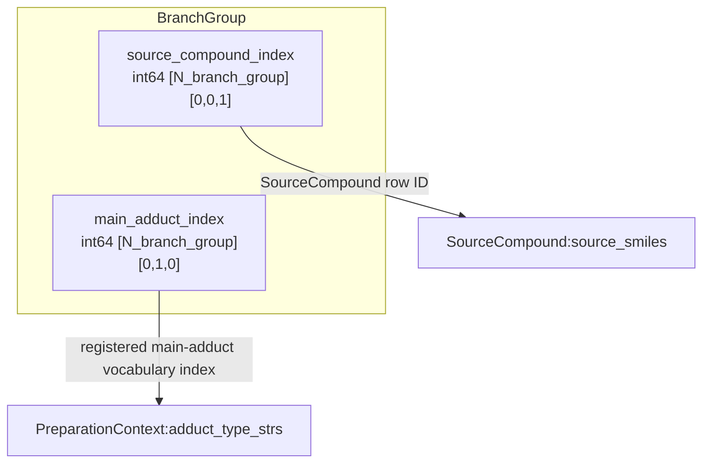
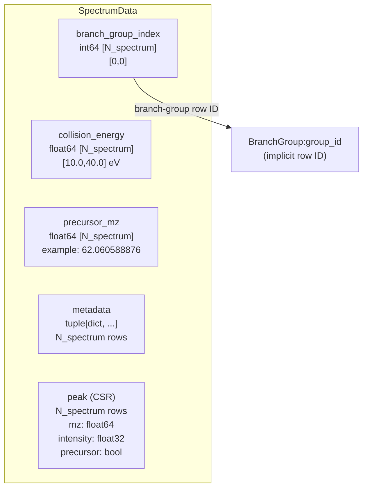

# SourceReactionStructure schema

SourceCompound, Reaction, ReactionSet, and CompoundBatch describe the implemented Batch
tables in schema `fredis.annotated-spectrum-training`. External references are shown by name,
and CSR relations are shown as single logical fields. No SQL database is created.

## 2.1 SourceCompound: independent Batch structure

The actual molecular graph storage is `source_graph: torch_geometric.data.Batch`,
including `ptr` and `batch`. This section describes that physical Batch first,
not a single-molecule RDB row. `source_smiles` is stored alongside the Batch in
SourceReactionStructure. The implemented `SourceCompound` class owns `source_graph`, `source_smiles`,
and the shared `symbols` vocabulary, under `structure.source_compounds`.
`structure.source_graph` and `structure.source_smiles` are read-only views.
There are no external foreign keys in this component.

### Batch schema with concrete field values

Use ethanol `CCO` and acetic acid `CC(=O)O`, with `symbols=("C","O")`.
M=2 molecules, A=7 total atoms, E=10 directed edges. Atom feature dimension is
`F_atom=len(sorted(set(symbols)))+26=28`; bond feature dimension is `F_bond = MolGraphBuilder.bond_dim = 9` in the current implementation (4 bond-type + 5 ring-type features).



| Actual field | Type / shape | Concrete value / meaning |
|---|---|---|
| `source_smiles` | tuple[str, ...], length M | `("CCO", "CC(=O)O")` |
| `symbols` | tuple[str, ...], shared | `("C", "O")`; atom feature vocabulary |
| `source_graph.x` | float32 `[A,F_atom]` | `[7,28]`; concatenated atom features |
| `source_graph.edge_index` | int64 `[2,E]` | `[2,10]`; endpoints use Batch-global atom rows |
| `source_graph.edge_attr` | float32 `[E,F_bond]` | `[10,9]`; directed-edge features |
| `source_graph.ptr` | int64 `[M+1]` | `[0,3,7]`; atom-row boundaries per molecule |
| `source_graph.batch` | int64 `[A]` | `[0,0,0,1,1,1,1]`; molecule ID per atom |

```python
source_smiles = ("CCO", "CC(=O)O")
source_graph.ptr = [0, 3, 7]                    # [M+1]
source_graph.batch = [0, 0, 0, 1, 1, 1, 1]     # [A]
source_graph.edge_index = [
    [0, 1, 1, 2, 3, 4, 4, 5, 4, 6],
    [1, 0, 2, 1, 4, 3, 5, 4, 6, 4],
]
# source_graph.x:           float32 [7,28]
# source_graph.edge_attr:   float32 [10,9]
```

For Source row `m=1`, `source_smiles[1]` is acetic acid, atoms are
`x[ptr[1]:ptr[2]] = x[3:7]`.
The Source identifier is the implicit molecule row `m`; there is no separate
stored scalar `source_id` and no Batch-level PK field. Other tables can refer
to `m` later. `ptr` and `batch` describe the same atom ownership in complementary
forms. There is no separately stored `edge_ptr` in the builder output.

### One-molecule feature values inside the Batch

The values below were computed with `Compound.from_smiles("CCO")` and
`MolGraphBuilder(("C","O"))`. They show Source 0's three atom rows and four
edge rows inside the Batch. A one-molecule Batch still has `ptr=[0,3]` and
`batch=[0,0,0]`.

The atom rows are `0:C(CH3)`, `1:C(CH2)`, `2:O(OH)`. Atom-map labels are
`[1,2,3]` in this run, but are not separately stored in the molecular graph.
Atom row IDs differ from atom-map labels. Features below are numerical values,
not a replacement for the Batch fields above.

### Exact atom and bond feature values

Integer-looking entries below are stored as float32 in `x` and `edge_attr`;
`edge_index` is int64. All vectors are prepared features, not learned embeddings.

```python
smiles = "CCO"
symbols = ("C", "O")
x = [
    [1, 0, 0, 1, 0, 1, 0, 0, 0, 0, 0, 0, 1, 0, 0, 0, 0, 0, 1, 0, 1, 0, 0, 0, 0, 0, 0, 0],
    [1, 0, 0, 1, 0, 1, 0, 0, 0, 0, 0, 0, 1, 0, 0, 0, 0, 1, 0, 0, 0, 1, 0, 0, 0, 0, 0, 0],
    [0, 1, 0, 1, 0, 1, 0, 0, 0, 0, 0, 0, 1, 0, 0, 0, 1, 0, 0, 0, 1, 0, 0, 0, 0, 0, 0, 0],
]
edge_index = [[0, 1, 1, 2], [1, 0, 2, 1]]
edge_attr = [
    [0, 1, 0, 0, 1, 0, 0, 0, 0],
    [0, 1, 0, 0, 1, 0, 0, 0, 0],
    [0, 1, 0, 0, 1, 0, 0, 0, 0],
    [0, 1, 0, 0, 1, 0, 0, 0, 0],
]
```

Atom feature columns for this exact two-symbol configuration:

| Slice | Feature | Vocabulary / order |
|---|---|---|
| `0:2` | symbol | C, O |
| `2:5` | charge | -1, 0, +1 |
| `5:10` | ring_type | no-ring, small-ring, 5-cycle, 6-cycle, large-ring |
| `10:15` | hybridization | sp, sp2, sp3, sp3d, sp3d2 |
| `15:20` | num_hydrogens | 0, 1, 2, 3, 4 |
| `20:28` | valence_electrons | 1, 2, 3, 4, 5, 6, 7, 8 |

Each feature block is one-hot when the value belongs to its vocabulary.
Unsupported symbols raise an error; out-of-vocabulary values in the other
feature blocks can be all-zero. Symbols are sorted/deduplicated by the builder.
The implementation calls `GetExplicitValence()` for `valence_electrons`:
that block is explicit valence, despite its current field name. It is not the
number of elemental valence electrons.

Bond columns `0:4` are `[AROMATIC,SINGLE,DOUBLE,TRIPLE]`; columns `4:9` are
`[no-ring,small-ring,5-cycle,6-cycle,large-ring]`. Ethanol's two single bonds
are stored in both directions, hence four equal rows. E counts directed edges,
not physical bonds. A molecule with no represented bonds has `edge_index [2,0]`
and `edge_attr [0,9]`.

### Multiple SourceCompounds: physical Batch layout

For M source molecules, A total graph atoms, and E total directed edges:

| Stored field | Type / shape | Single ethanol example |
|---|---|---|
| `source_smiles` | tuple[str, ...], length M | `("CCO",)` |
| `source_graph.x` | float32 `[A,F_atom]` | `[3,28]` |
| `source_graph.edge_index` | int64 `[2,E]` | `[2,4]` |
| `source_graph.edge_attr` | float32 `[E,F_bond]` | `[4,9]` |
| `source_graph.ptr` | int64 `[M+1]` | `[0,3]` |
| `source_graph.batch` | int64 `[A]` | `[0,0,0]` |

`ptr` and `batch` are packing metadata for multiple molecules, not additional
molecular properties. For two graph atom counts 3 and 4, `ptr=[0,3,7]` and
`batch=[0,0,0,1,1,1,1]`; edge endpoints are shifted to batch-global atom rows.
There is no separate stored `edge_ptr` in this builder's output.

Interpretation requires the atom/bond vocabularies and graph hydrogen policy.
Current code holds these in the graph builder; `SourceCompound.symbols` now also persists the normalized atom vocabulary. Hydrogens become
independent graph nodes only when `"H"` is in `symbols`; hydrogen counts remain
atom features. One shared configuration applies to a packed Batch.

`source_id` is a batch-local row number, not an immutable dataset-global ID.
SMILES uniqueness is not automatically enforced by the dataclass. Whether to
require a unique molecular identity is a separate schema decision to make
before adding dependent tables.

Implementation references:
[MolGraphBuilder](../mol/graph_builder.py),
[atom features](../mol/atom_feature.py),
[bond features](../mol/bond_feature.py).

## 2.2 Reaction: concrete reaction Batch

Actual storage is `SourceReactionStructure.reactions: ReactionTensorData`.
R is the total number of concrete reactions in the current Batch. A reaction ID
is an implicit row `r` of `reaction_type`; it is not a pattern ID. These IDs and
atom IDs are Batch-global. The revised ReactionSet table below uses these registry row IDs directly.
Current implementation differences are documented in that section.

### Notation and reference diagram

External targets are named only, as `Component:field`. The SourceCompound
Batch is not expanded again. A CSR relation is shown once as `(CSR)` with its
logical list values; its index and ptr arrays are not drawn as separate fields.
`reaction_source_atom` and `reaction_retained_atom` below are display names for
their respective stored CSR pairs, not additional dataclass fields.

Conflict/invalidation arrays are actually COO pairs, so they remain `(COO)`;
they are not relabelled CSR. The examples below are schematic reaction registry
values, not chemistry-calculated reactions or real configured pattern IDs.
They use the Source example's atom rows 0..2 and 3..6.



### Fields, values, and foreign-row references

| Field / relation | Type and shape | Concrete logical value | Reference target |
|---|---|---|---|
| `reaction_source_compound_index` | int64 `[R]` | `[0,0,1]` | → `SourceCompound:source_smiles` (Source row m) |
| `reaction_type` | int64 `[R,3]` | `[[10,0,0],[11,0,0],[10,1,0]]` | Pattern/rule definitions; product slot is a value, not a Compound FK |
| `reaction_source_atom (CSR)` | int64; R variable-length lists | `[[0,1],[0,1,2],[4,5,6]]` | → `SourceCompound:source_graph.x` |
| `reaction_retained_atom (CSR)` | int64; R variable-length lists | `[[1,2],[0,1],[3,4,5]]` | → `SourceCompound:source_graph.x` |
| `reaction_conflict_index (COO)` | int64 `[2,N_conflict]` | `[[0,1],[1,0]]` | Both endpoints → `Reaction:reaction_type` |
| `reaction_invalidation_index (COO)` | int64 `[2,N_invalidation]` | `[[0],[1]]` | Both endpoints → `Reaction:reaction_type` |

`reaction_source_compound_index[r]=m` selects `source_smiles[m]` and
atom rows `source_graph.ptr[m]:source_graph.ptr[m+1]`. The referenced ID is the
Source row, not a ptr value or an atom row. Every matched/retained atom of reaction
r must lie inside that Source's interval.

### What each field means

**reaction_type.** The columns are `[reaction_pattern_id, reaction_rule_id,
product_molecule_id]`. For example row 2 `[10,1,0]` selects pattern ID 10, rule ID
1, and product slot 0. The implementation calls the last field
`product_molecule_id`, but it does not reference `annotations.compounds`.
Pattern/rule definitions belong to the preparation Fragmenter; their schema is
outside this Reaction section. The concrete reaction row additionally encodes
which Source and which matched/retained atoms are involved.

**reaction_source_atom (CSR).** One list per concrete reaction of the Source
atom rows participating in its match. Reaction 1's list `[0,1,2]` points to
`source_graph.x[[0,1,2]]`. Values are graph row indices, not atom-map labels.
Do not apply the State-set ascending-order rule here: matched atom rows are
stored by preparation and are not guaranteed to be numerically sorted.

**reaction_retained_atom (CSR).** One list per concrete reaction of atoms retained
in its product. Reaction 2 keeps atom rows `[3,4,5]` of Source 1. These represent
retention relative to the Source, rather than new product-local atom numbering.
Empty lists are supported.

For each CSR relation there are R logical rows, so its physical pointer has
length R+1 and its value array has length equal to the sum of list lengths.
In this example both displayed relations have 8 values across 3 rows. The
schema shows the single logical relation rather than two separate arrows.

**reaction_conflict_index (COO).** Each column is `[reaction_i,reaction_j]`.
`[[0,1],[1,0]]` has two columns: `(0,1)` and `(1,0)`. Reactions that modify a
common Source bond conflict; both directions are stored. These are co-existence
constraints, not edges indicating execution order.

**reaction_invalidation_index (COO).** Each column is
`[invalidating_reaction,invalidated_reaction]`. `[[0],[1]]` means reaction 0
discards an atom needed by reaction 1's Source match. Here reaction 0 discards
atom 0 and reaction 1 needs atom 0. This relation is directional; a reverse pair
is not implied. Sets containing an invalidating pair are rejected regardless of
reaction order. An empty pair relation has shape `[2,0]`.

### One row read through its references

| r | Source row | reaction_type | Matched atoms (CSR) | Retained atoms (CSR) |
|---|---|---|---|---|
| 0 | 0: CCO | [10,0,0] | [0,1] | [1,2] |
| 1 | 0: CCO | [11,0,0] | [0,1,2] | [0,1] |
| 2 | 1: CC(=O)O | [10,1,0] | [4,5,6] | [3,4,5] |

For r=2, Source row 1 supplies the parent molecule; graph atom rows `[4,5,6]`
supply its match features. The type values alone do not identify this concrete
match. Two rows can share a pattern/rule/product slot but differ in Source or
matched position.

When collating Batches, Source IDs, Source atom IDs, and both endpoints of
reaction pair relations are offset. Pattern/rule IDs and product slots remain
unchanged. CSR boundaries are recomputed/offset as packing metadata. The revised set table uses global reaction IDs; its memberships therefore
require the same registry remapping when Batches are combined.

The packed table does not itself store complete reaction edit objects or all
atom-map labels. Pattern/rule definitions and preparation chemistry supply
those semantics. Its tensors are the prepared model inputs and constraints.

Implementation: [ReactionTensorData](reaction_tensor_data.py),
[ReactionRelations](../../domain/fragment/reaction/ReactionRelations.py).

## 2.3 ReactionSet: independent reaction-set CSR table

The implemented `ReactionSet` class (`structure.reaction_sets`) contains only
canonical membership. Group, Compound, topology, and teacher information are
references to the independent set table, not membership ownership.

### Only reaction membership belongs to this table

Each row is a unique set of concrete reaction IDs. Its identifier is the implicit
row number `reaction_set_id`; it need not be stored as another vector.
The only payload is `reaction (CSR)`. Its values directly reference Batch-global
rows of REACTION_BATCH. There is no group-local vocabulary conversion here.



| Field / relation | Type / logical shape | Example | Reference |
|---|---|---|---|
| `reaction (CSR)` | int64; `N_reaction_set` variable-length rows | `[[],[0],[1],[0,1],[2]]` | → `Reaction:reaction_type` |

`reaction` is a logical name for one CSR relation. The schema does not draw its
physical index and ptr arrays as two fields. Its physical pointer length is
`N_reaction_set + 1`; its value count is the sum of all member counts (5 here).
The numerical example assumes reactions 0 and 1 are compatible, independently
of the preceding illustrative conflict-pair values.

### Concrete rows

| reaction_set_id (implicit row) | reaction (CSR) | Referenced REACTION_BATCH rows |
|---|---|---|
| 0 | [] | none: empty set |
| 1 | [0] | reaction row 0 |
| 2 | [1] | reaction row 1 |
| 3 | [0,1] | reaction rows 0 and 1 |
| 4 | [2] | reaction row 2 |

All lists are strictly ascending, without duplicate reaction IDs. Identical lists
are one row, regardless of reaction order, adduct, CE, or the consumer referring
to them. `[0,1]` represents the same set whether a path adds 0 then 1 or 1 then 0.
Different lists remain different rows even if they generate the same Compound.

Concrete reaction IDs already identify their Source through
`reaction_source_compound_index`. Reactions in a nonempty valid set must belong
to one Source and satisfy the registry compatibility constraints.
The empty set contains no Source information: its Source must be supplied by the
referencing context. Do not infer a Source from empty membership.

### Compound references sets; sets do not reference Compound

The inverse relationship requested for Compound belongs on the Compound side.
Each Compound row has a list of reaction-set IDs that can generate it.
It is not a list of concrete reaction IDs.



| Compound row | generating_reaction_sets (CSR) | Meaning |
|---|---|---|
| 0 | [0] | Empty set in Source 0 context |
| 1 | [1,2] | Different sets {0} and {1} generate this one Compound |
| 2 | [3] | Set {0,1} generates this Compound |
| 3 | [0] | Empty set in Source 1 context |
| 4 | [4] | Set {2} generates this Compound |

This example illustrates sharing and references rather than calculated products.
It has 5 Compounds, so the Compound-side CSR's physical pointer length is
`N_compound + 1 = 6`. The set-membership CSR also has 5 rows in this example;
that equality is incidental. The two row counts are independent.
Compound 1 remains one node/structure with two generating sets. Empty-set row 0
can be reused across Source contexts; the relationship's Source context must
remain available on its reference side.

### Fields that do not belong in REACTION_SET_BATCH

| Information | Where it belongs |
|---|---|
| Source/main-adduct context | A group/context table referencing a set row |
| Which Compound a set generates | Compound's `generating_reaction_sets (CSR)` relationship |
| Runtime graph occurrence | Runtime topology/context view referencing Compound and set as needed |
| Parent, added reaction, transition | Transition/path tables referencing set IDs and context |
| Positive/weak negative labels | Teacher tables referencing set IDs, reaction IDs, and context |
| CE, observed peaks, assignments | Spectrum/assignment tables |

A context-bearing state/view can reference `(group_id, reaction_set_id)`; it must
not duplicate the membership list into a new canonical set. A different group
may reuse the same set row while retaining its own topology/labels. These
consumer tables will be specified separately, rather than being treated as
fields of the set table.

### Implemented classes and references

| Schema component | Class / stored fields |
|---|---|
| SourceCompound | `SourceCompound(source_graph, source_smiles, symbols)` |
| Reaction | `ReactionTensorData`; concrete global registry rows |
| ReactionSet | `ReactionSet(reaction_ptr, reaction_index)` |
| Context -> set | `ReactionContextData.candidate_reaction_set_index` |
| Active teacher context -> set | `states.candidate_index` -> candidate context -> set |
| Compound -> generating sets | `CompoundBatch.generating_reaction_sets_ptr/index`; generating_reaction_sets CSR |
| Materialization context -> Compound | `MaterializedContextData.compound_index` |
| Annotation context -> set | `MaterializedContextData.reaction_set_index` |

ReactionContextData contains group, occurrence, active-state projection and
transition references. It stores no membership CSR and no set-owned Compound.
Root contexts with different Sources can point to the same empty set and different
Compounds. Repeated group contexts for the same Compound/set pair create only
one entry in the Compound inverse CSR.

`ReactionSet.from_rows()` normalizes/deduplicates memberships and returns a
row-to-set-ID mapping. Collation offsets global reaction IDs before interning,
then remaps contexts and Compound references. Sample selection retains the
independent Source/reaction/set registries and slices the dependent contexts.
`candidate_reactions()` / `active_reactions()` build runtime CSR projections from
FKs; those memberships are not stored twice. Training converts the global members
to the decoder's local pool slots only for scoring.

Files use `fredis.annotated-spectrum-training` without a version suffix.
Loading/validation does not run chemistry. Further dependent schemas
can be refined independently of canonical set identity.

Implementation: [SourceCompound](source_compound.py),
[ReactionSet](reaction_set.py), [ReactionContextData](reaction_context_data.py).

## 2.4 CompoundBatch: unique product compounds and their generating sets

This is the implemented `CompoundBatch` class at
`structure.annotations.compounds`. Distinguish a single **mmkit.Compound** molecule object from the
**CompoundBatch** container holding multiple unique molecules.

### Three fields in CompoundBatch



| Field / relation | Type / shape | Concrete example | Reference / meaning |
|---|---|---|---|
| `compounds` | tuple[mmkit.Compound, ...], length N_compound | Five objects whose SMILES are CCO, C, CO, CC, O | One object per unique structure |
| `graph` | PyG Batch | 5 graphs, 9 atoms, 8 directed edges | One structural-feature graph per `compounds` row |
| `generating_reaction_sets (CSR)` | int64; N_compound variable-length rows | `[[0],[1,5],[2],[3],[4]]` | → `ReactionSet:reaction_set_id` |

The Compound ID is the implicit index into `compounds` and the graph rows.
There is no separately stored `compound_id` vector. `compounds[i]` means one
mmkit.Compound; CompoundBatch means the whole collection.

`smiles` is not independently stored: obtain it as `compounds[i].smiles`.
A convenience property may derive all SMILES without becoming another stored
field. Uniqueness is based on canonical isomeric SMILES, including stereochemistry
and charge, not Python object identity.

### Generating sets are different from set membership

`ReactionSet.reaction (CSR)` contains concrete Reaction IDs. In contrast,
`CompoundBatch.generating_reaction_sets (CSR)` contains **ReactionSet IDs**.
One Compound can have several generating sets.

| Compound row | Derived SMILES | generating_reaction_sets (CSR) | Member reactions after following each set ID |
|---|---|---|---|
| 0 | CCO | [0] | {} |
| 1 | C | [1,5] | {0}, {1,2} |
| 2 | CO | [2] | {1} |
| 3 | CC | [3] | {2} |
| 4 | O | [4] | {3} |

These relationships use the actual ethanol preparation example computed earlier.
The empty set produces the unchanged root in its Source context. The table can
therefore include an unchanged root as well as reaction products.
Compound 1 has one molecular object and one graph even though two different sets
produce it. The set rows remain separate. Repeated group/CE references do not
create another Compound or duplicate a Compound/set pair.

The generating-set CSR has N_compound logical rows; its physical pointer length
is N_compound+1 (6 here). There are 6 generating-set entries in this example.
Each Compound's set IDs are sorted and unique. The schema shows this as one
logical relation rather than separate index/ptr fields.

### graph: packed structural features

N_atom and N_edge count atoms and directed edges of the unique Compound graphs,
not Source atom rows. F_atom and F_bond come from the preparation feature
configuration. The actual example uses F_atom=35 and F_bond=9.

| Graph field | Type / shape | Concrete example / reference |
|---|---|---|
| `graph.x` | float32 [N_atom,F_atom] | [9,35] |
| `graph.edge_index` | int64 [2,N_edge] | [2,8]; -> `CompoundBatch:graph.x` |
| `graph.edge_attr` | float32 [N_edge,F_bond] | [8,9] |
| `graph.ptr` | int64 [N_compound+1] | [0,3,4,6,8,9] |
| `graph.batch` | int64 [N_atom] | [0,0,0,1,2,2,3,3,4]; -> `CompoundBatch:compound_id` |

`graph.ptr` delimits atom rows; generating_reaction_sets CSR delimits set-ID
lists. Both have N_compound+1 boundaries, but they index different arrays.
For Compound 2 (CO), atom features are `graph.x[4:6]`.
Charged formula/m/z and ion-condition fields remain outside CompoundBatch.

### Implemented storage

`CompoundBatch` stores `compounds`, `graph`, and the physical CSR pair
`generating_reaction_sets_ptr/index`. The pair represents the single logical
relation generating_reaction_sets (CSR). `smiles` is a derived read-only view of
`compounds[i].smiles`, not another stored field.
The saved format is `fredis.annotated-spectrum-training` without a version suffix. Implementation: [CompoundBatch](compound_batch.py),
[normalization and reference tables](annotated_spectrum_data.py).

## 2.5 BranchGroup: SourceCompound and main-adduct context

A BranchGroup row identifies one `(SourceCompound, main adduct)` pair.
It supplies the context in which branch predictions/topology are shared.
CE, measured peaks, and observed intensities are not part of its identity.
The group ID is its implicit row number; there is no additional group_id vector.

This diagram defines the logical field names `source_compound_index` and
`main_adduct_index`. There is currently no standalone BranchGroup class: the
corresponding arrays live in SourceReactionStructure under the names mapped
below. This section changes documentation only, not those Python field names.

### Fields and references



| Logical field | Type / shape | Concrete example | Reference |
|---|---|---|---|
| `source_compound_index` | int64 [N_branch_group] | [0,0,1] | → `SourceCompound:source_smiles` |
| `main_adduct_index` | int64 [N_branch_group] | [0,1,0] | → `PreparationContext:adduct_type_strs` |

`adduct_type_strs` is the registered main-adduct vocabulary created from the
preparation Fragmenter's adduct rule set. It is a shared tuple, not an invented
new table or a stored field on each group. Prediction uses the corresponding
model vocabulary. IDs are meaningful only with that vocabulary and ordering.

### Concrete group rows

For illustration, let the Sources be `("CCO","CC(=O)O")` and the main-adduct
vocabulary be `("[M+H]+","[M+Na]+")`.

| group_id (implicit row) | source_compound_index | main_adduct_index | Meaning |
|---|---|---|---|
| 0 | 0 | 0 | CCO with [M+H]+ |
| 1 | 0 | 1 | CCO with [M+Na]+ |
| 2 | 1 | 0 | CC(=O)O with [M+H]+ |

The two columns have the same length N_branch_group=3. The pair is unique:
multiple spectra of CCO/[M+H]+ at 10 and 40 eV both reference group 0. Changing
main adduct creates another group; changing Source creates another group.
An observed adduct with a neutral loss can resolve to the same registered main
adduct, so the raw observed string is not the group key.

ReactionSet membership remains independent of BranchGroup. Groups can reference
the same set row while retaining their own branch context; no reaction-membership
CSR belongs in BranchGroup. Its purpose is context/sharing, not Compound identity.

### Mapping to current storage

| Logical schema field / relation | Current storage |
|---|---|
| `BranchGroup.source_compound_index` | `SourceReactionStructure.branch_group_tree_index` |
| `BranchGroup.main_adduct_index` | `SourceReactionStructure.branch_group_adduct_index` |
| Spectrum -> group | `SpectrumData.branch_group_index`; model-input view `sample_branch_group_index` |
| Candidate context -> group | `ReactionContextData.candidate_branch_group_index` |

The last two entries are references from their respective records, not extra
columns owned by BranchGroup. SpectrumData below references these implicit group
rows. Its Source and main-adduct information are obtained through the group.

Implementation: [group arrays](source_reaction_structure.py),
[preparation vocabulary](../data_preparation/fragment_tree/context.py).

## 2.6 SpectrumData: observed spectrum rows and peak lists

This is the refined logical schema for `structure.annotations.spectra`.
The Python class still stores `source_index` and `adducts`; this documentation
change does not yet remove those stored fields.
One row is one observed spectrum. N_spectrum counts spectra and N_peak counts
their total observed peaks. A spectrum ID is its implicit row number; there is
no separately stored spectrum_id vector. Different CE observations remain
separate spectrum rows even when their SourceCompound, main adduct, and peak
m/z values are the same.

### Schema and references

The example uses actual prepared values from SourceCompound `CC(N)O`, observed
adduct `[M+H]+`, and CE 10/40 eV. Both spectra refer to branch group 0, which selects Source row 0; the group is shared because CE is not part of group identity.
The branch-group schema is referenced by name only.



| Field / relation | Type / shape | Concrete value | Reference / meaning |
|---|---|---|---|
| `branch_group_index` | int64 [N_spectrum] | [0,0] | → `BranchGroup:group_id`; implicit group row |
| `collision_energy` | float64 [N_spectrum] | [10.0,40.0] | Observational CE in eV |
| `precursor_mz` | float64 [N_spectrum] | [62.060588876,62.060588876] | Precursor m/z recorded for each spectrum |
| `metadata` | tuple[dict, ...], length N_spectrum | Dictionaries in the example below | Remaining per-spectrum annotations |
| `peak (CSR)` | N_spectrum variable-length rows | Two peaks per spectrum here | Aligned observed mz/intensity/precursor values |

`group_id` is an implicit BranchGroup row. Source and registered main adduct
are obtained through that row, so SpectrumData has no separate source_index or
main-adduct column in this schema.

An observed precursor adduct can differ from the main adduct: `[M+H-H2O]+` may
resolve to the same group main adduct as `[M+H]+`. The original label is therefore
not generally derivable from BranchGroup. If it needs preserving, put it in
optional `metadata["observed_adduct"]`, rather than a mandatory adducts column.
A redundant mainAdduct label does not need copying into metadata.

### Concrete spectrum rows

```python
# Spectrum rows:     0                    1
branch_group_index = [0, 0]
collision_energy = [10.0, 40.0]
precursor_mz = [62.060588876, 62.060588876]

# Logical CSR rows: (mz, intensity, precursor)
peak = [
    [(18.033826, 0.5, False), (44.049476, 1.0, False)],
    [(18.033826, 1.0, False), (44.049476, 0.5, False)],
]

metadata = (
    {"assignmentScore": 1.0,
     "assignmentScoreWithoutPrecursor": 1.0},
    {"assignmentScore": 1.0,
     "assignmentScoreWithoutPrecursor": 1.0},
)
```

Spectrum 0 and spectrum 1 have identical m/z values but different measured
relative intensities and CE. These are separate observations, not a shared
Compound or ion identity. `metadata` contains optional per-spectrum annotations, including an original
observed_adduct label only if needed. Core conditions derived from BranchGroup
are not copied into it. The shown score
fields are preparation annotations, not model predictions.

### peak (CSR): multiple aligned values per spectrum

The single logical relation `peak (CSR)` uses a shared row boundary for three
parallel value arrays. It has no separately stored peak-index array: the
observed peak ID is the implicit flattened peak row.

| Peak value | Type / physical shape | Concrete values |
|---|---|---|
| `mz` | float64 [N_peak] | [18.033826,44.049476,18.033826,44.049476] |
| `intensity` | float32 [N_peak] | [0.5,1.0,1.0,0.5] |
| `precursor` | bool [N_peak] | [False,False,False,False] |

There are N_spectrum=2 CSR rows and N_peak=4 values in each aligned array.
The physical boundary vector is `[0,2,4]`, length N_spectrum+1; in code it is
`peak_ptr`. It is packing metadata for the one peak relation, not an additional
foreign-key field in the diagram. Spectrum 1's peaks occupy flattened rows 2:4.
Empty spectra have empty CSR slices, not a fabricated zero-intensity peak.

`mz` and `intensity` are observation inputs. `precursor` is an annotation flag:
the current builder marks whether a peak is within the configured precursor mass
tolerance. Intensities are retained as supplied by preparation; this table does
not itself apply an additional intensity normalization.

### Precursor and CE interpretation

`precursor_mz` stores the value of the observation's precursorMz field. The current
ReactionStructureBuilder derives that value from the Source formula and observed
adduct, so the example is a theoretical precursor m/z, not a separately read
instrument measurement. The field itself is per-spectrum metadata.

SpectrumData stores CE as float64. The separate model-input view
`SourceReactionStructure.collision_energy_eV` is float32; corresponding sample
values must agree after that dtype conversion. This documents current storage
rather than introducing a new duplicated condition field.

Compound/formula/ion assignments are not columns of SpectrumData: the current
PeakAssignmentData table references these implicit observed peak rows. Its schema
can be specified separately. This section only defines SpectrumData.

Implementation: [SpectrumData and normalization](annotated_spectrum_data.py).
