# SourceReactionStructure schema

The tables below are implemented for preparation, training, and prediction.
`SpectrumPredictionData` owns the shared chemical tables and spectrum conditions.
`SourceReactionStructure` adds observations and derived targets for training.
Prediction inputs have no annotations, intensity targets, or branch labels.
The saved schema identifier remains `fredis.annotated-spectrum-training`. External references are shown by name,
and CSR relations are shown as single logical fields. No SQL database is created.

The References links below each diagram are ordinary Markdown links to the
corresponding sections. Diagram node navigation depends on the preview's Mermaid support.

## 2.1 SourceCompound

**independent Batch structure**

The actual molecular graph storage is `source_graph: torch_geometric.data.Batch`,
including `ptr` and `batch`. This section describes that physical Batch first,
not a single-molecule RDB row. `source_smiles` is stored alongside the Batch in
SourceReactionStructure. The implemented `SourceCompound` class owns `source_graph`, `source_smiles`,
and the shared `symbols` vocabulary, under `structure.source_compounds`.
`structure.source_graph` and `structure.source_smiles` are read-only views.
The mapping below links
each Source row to its shared CompoundBatch identity.

### Source-to-CompoundBatch correspondence

SourceCompound stores compound_index, one shared Compound row ID per Source
row. Source atom graphs and reaction atom references retain their Source row /
atom index spaces. compound_index is a separate index space and need not equal
the Source row number.

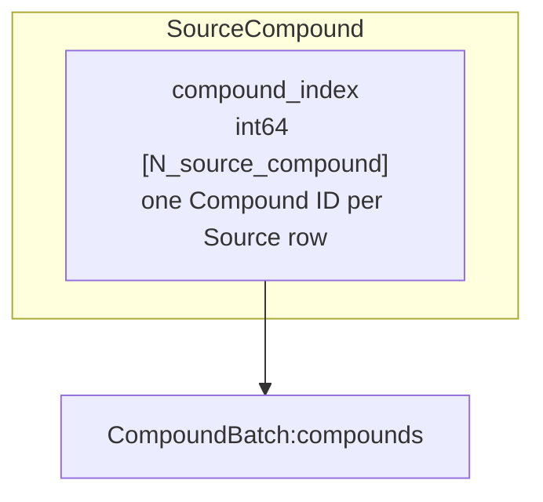

References: [CompoundBatch](#24-compoundbatch)

| Proposed field | Type / shape | Example | Direct reference |
|---|---|---|---|
| `compound_index` | int64 [N_source_compound], the existing M rows | `[0,5]` | → [CompoundBatch](#24-compoundbatch):`compounds` |

This mapping example assumes CompoundBatch row 0 is CCO and row 5 is CC(=O)O.
Multiple main-adduct groups for one Source reuse its Source row and this mapping.
The corresponding structures must agree, and every mapped root must reference
an existing Compound row; -1 is not permitted for root resolution.
The Python class stores this mapping.

### Batch schema with concrete field values

Use ethanol `CCO` and acetic acid `CC(=O)O`, with `symbols=("C","O")`.
M=2 molecules, A=7 total atoms, E=10 directed edges. Atom feature dimension is
`F_atom=len(sorted(set(symbols)))+26=28`; bond feature dimension is `F_bond = MolGraphBuilder.bond_dim = 9` in the current implementation (4 bond-type + 5 ring-type features).

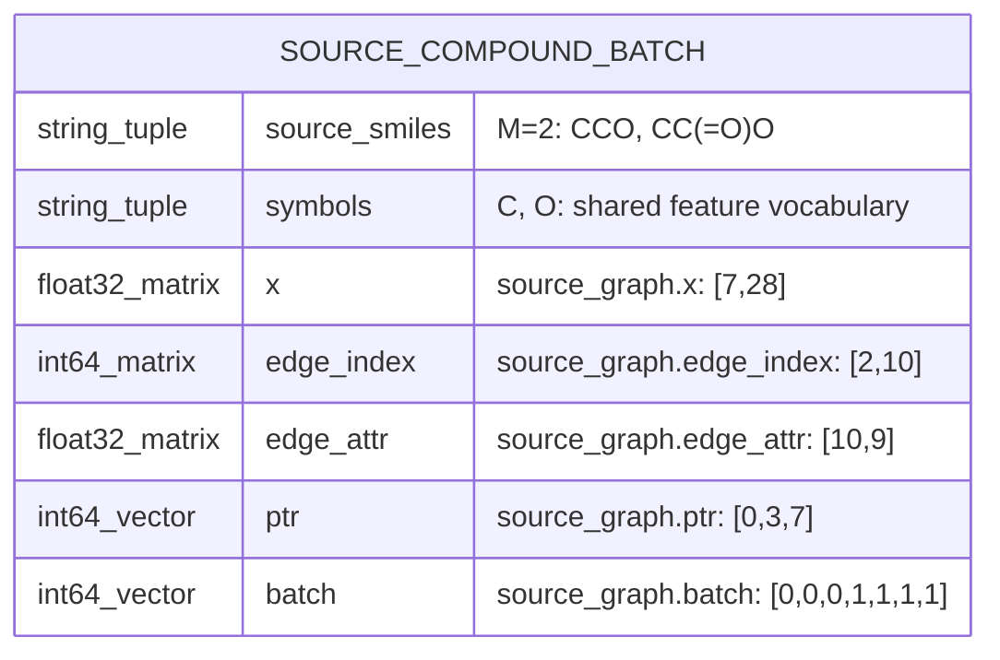

| Actual field | Type / shape | Concrete value / meaning |
|---|---|---|
| `source_smiles` | tuple[str, ...], length M | `("CCO", "CC(=O)O")` |
| `symbols` | tuple[str, ...], shared | `("C", "O")`; atom feature vocabulary |
| `source_graph.x` | float32 `[A,F_atom]` | `[7,28]`; concatenated atom features |
| `source_graph.edge_index` | int64 `[2,E]` | `[2,10]`; endpoints use Batch-global atom rows |
| `source_graph.edge_attr` | float32 `[E,F_bond]` | `[10,9]`; directed-edge features |
| `source_graph.ptr` | int64 `[M+1]` | `[0,3,7]`; atom-row boundaries per molecule |
| `source_graph.batch` | int64 `[A]` | `[0,0,0,1,1,1,1]`; molecule ID per atom |

```python
source_smiles = ("CCO", "CC(=O)O")
source_graph.ptr = [0, 3, 7]                    # [M+1]
source_graph.batch = [0, 0, 0, 1, 1, 1, 1]     # [A]
source_graph.edge_index = [
    [0, 1, 1, 2, 3, 4, 4, 5, 4, 6],
    [1, 0, 2, 1, 4, 3, 5, 4, 6, 4],
]
# source_graph.x:           float32 [7,28]
# source_graph.edge_attr:   float32 [10,9]
```

For Source row `m=1`, `source_smiles[1]` is acetic acid, atoms are
`x[ptr[1]:ptr[2]] = x[3:7]`.
The Source identifier is the implicit molecule row `m`; there is no separate
stored scalar `source_id` and no Batch-level PK field. Other tables can refer
to `m` later. `ptr` and `batch` describe the same atom ownership in complementary
forms. There is no separately stored `edge_ptr` in the builder output.

### One-molecule feature values inside the Batch

The values below were computed with `Compound.from_smiles("CCO")` and
`MolGraphBuilder(("C","O"))`. They show Source 0's three atom rows and four
edge rows inside the Batch. A one-molecule Batch still has `ptr=[0,3]` and
`batch=[0,0,0]`.

The atom rows are `0:C(CH3)`, `1:C(CH2)`, `2:O(OH)`. Atom-map labels are
`[1,2,3]` in this run, but are not separately stored in the molecular graph.
Atom row IDs differ from atom-map labels. Features below are numerical values,
not a replacement for the Batch fields above.

### Exact atom and bond feature values

Integer-looking entries below are stored as float32 in `x` and `edge_attr`;
`edge_index` is int64. All vectors are prepared features, not learned embeddings.

```python
smiles = "CCO"
symbols = ("C", "O")
x = [
    [1, 0, 0, 1, 0, 1, 0, 0, 0, 0, 0, 0, 1, 0, 0, 0, 0, 0, 1, 0, 1, 0, 0, 0, 0, 0, 0, 0],
    [1, 0, 0, 1, 0, 1, 0, 0, 0, 0, 0, 0, 1, 0, 0, 0, 0, 1, 0, 0, 0, 1, 0, 0, 0, 0, 0, 0],
    [0, 1, 0, 1, 0, 1, 0, 0, 0, 0, 0, 0, 1, 0, 0, 0, 1, 0, 0, 0, 1, 0, 0, 0, 0, 0, 0, 0],
]
edge_index = [[0, 1, 1, 2], [1, 0, 2, 1]]
edge_attr = [
    [0, 1, 0, 0, 1, 0, 0, 0, 0],
    [0, 1, 0, 0, 1, 0, 0, 0, 0],
    [0, 1, 0, 0, 1, 0, 0, 0, 0],
    [0, 1, 0, 0, 1, 0, 0, 0, 0],
]
```

Atom feature columns for this exact two-symbol configuration:

| Slice | Feature | Vocabulary / order |
|---|---|---|
| `0:2` | symbol | C, O |
| `2:5` | charge | -1, 0, +1 |
| `5:10` | ring_type | no-ring, small-ring, 5-cycle, 6-cycle, large-ring |
| `10:15` | hybridization | sp, sp2, sp3, sp3d, sp3d2 |
| `15:20` | num_hydrogens | 0, 1, 2, 3, 4 |
| `20:28` | valence_electrons | 1, 2, 3, 4, 5, 6, 7, 8 |

Each feature block is one-hot when the value belongs to its vocabulary.
Unsupported symbols raise an error; out-of-vocabulary values in the other
feature blocks can be all-zero. Symbols are sorted/deduplicated by the builder.
The implementation calls `GetExplicitValence()` for `valence_electrons`:
that block is explicit valence, despite its current field name. It is not the
number of elemental valence electrons.

Bond columns `0:4` are `[AROMATIC,SINGLE,DOUBLE,TRIPLE]`; columns `4:9` are
`[no-ring,small-ring,5-cycle,6-cycle,large-ring]`. Ethanol's two single bonds
are stored in both directions, hence four equal rows. E counts directed edges,
not physical bonds. A molecule with no represented bonds has `edge_index [2,0]`
and `edge_attr [0,9]`.

### Multiple SourceCompounds: physical Batch layout

For M source molecules, A total graph atoms, and E total directed edges:

| Stored field | Type / shape | Single ethanol example |
|---|---|---|
| `source_smiles` | tuple[str, ...], length M | `("CCO",)` |
| `source_graph.x` | float32 `[A,F_atom]` | `[3,28]` |
| `source_graph.edge_index` | int64 `[2,E]` | `[2,4]` |
| `source_graph.edge_attr` | float32 `[E,F_bond]` | `[4,9]` |
| `source_graph.ptr` | int64 `[M+1]` | `[0,3]` |
| `source_graph.batch` | int64 `[A]` | `[0,0,0]` |

`ptr` and `batch` are packing metadata for multiple molecules, not additional
molecular properties. For two graph atom counts 3 and 4, `ptr=[0,3,7]` and
`batch=[0,0,0,1,1,1,1]`; edge endpoints are shifted to batch-global atom rows.
There is no separate stored `edge_ptr` in this builder's output.

Interpretation requires the atom/bond vocabularies and graph hydrogen policy.
Current code holds these in the graph builder; `SourceCompound.symbols` now also persists the normalized atom vocabulary. Hydrogens become
independent graph nodes only when `"H"` is in `symbols`; hydrogen counts remain
atom features. One shared configuration applies to a packed Batch.

`source_id` is a batch-local row number, not an immutable dataset-global ID.
Source rows may repeat when independently prepared batches are collated.
Their CompoundBatch mapping still shares one unique structural identity.

Implementation references:
[MolGraphBuilder](../mol/graph_builder.py),
[atom features](../mol/atom_feature.py),
[bond features](../mol/bond_feature.py).

## 2.2 Reaction

**concrete reaction Batch**

Actual storage is `SourceReactionStructure.reactions: ReactionTensorData`.
R is the total number of concrete reactions in the current Batch. A reaction ID
is an implicit row `r` of `reaction_type`; it is not a pattern ID. These IDs and
atom IDs are Batch-global. The revised ReactionSet table below uses these registry row IDs directly.
Current implementation differences are documented in that section.

### Notation and reference diagram

External targets are named only, as `Component:field`. The SourceCompound
Batch is not expanded again. A CSR relation is shown once as `(CSR)` with its
logical list values; its index and ptr arrays are not drawn as separate fields.
`reaction_source_atom` and `reaction_retained_atom` below are display names for
their respective stored CSR pairs, not additional dataclass fields.

Conflict/invalidation arrays are actually COO pairs, so they remain `(COO)`;
they are not relabelled CSR. The examples below are schematic reaction registry
values, not chemistry-calculated reactions or real configured pattern IDs.
They use the Source example's atom rows 0..2 and 3..6.

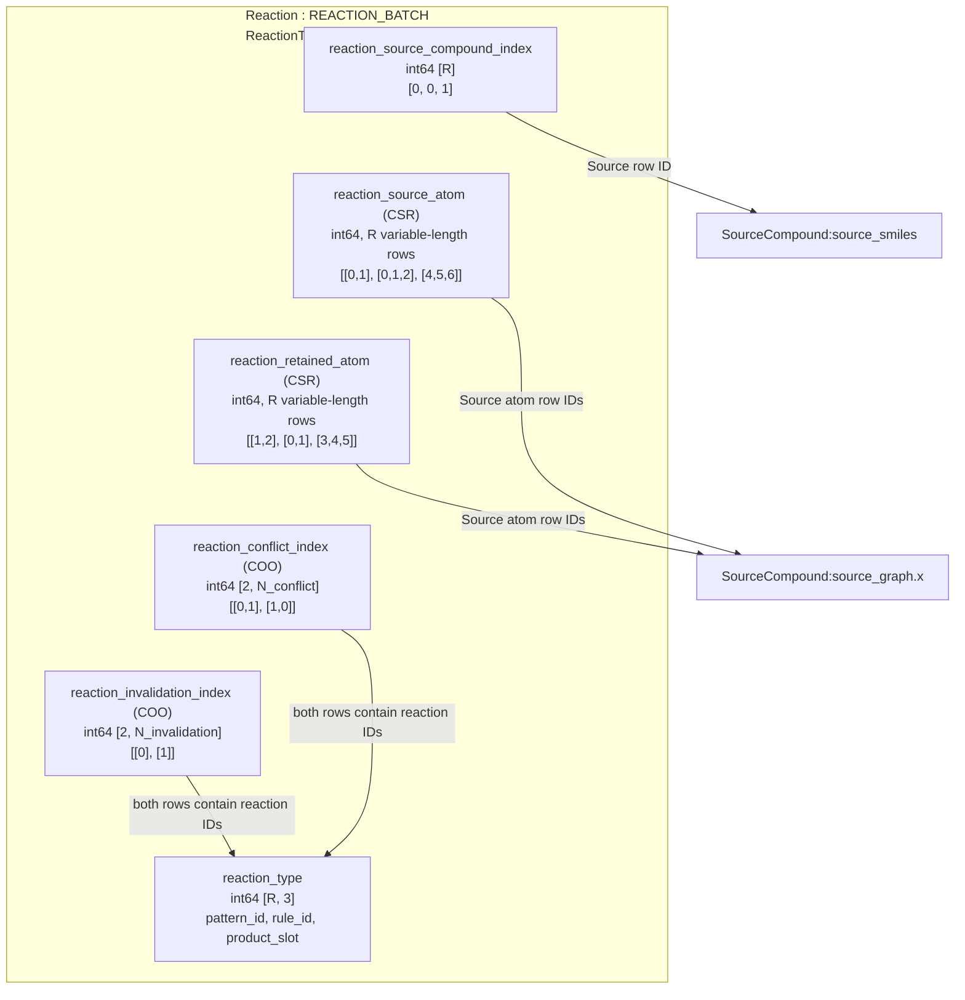

References: [SourceCompound](#21-sourcecompound)


### Fields, values, and foreign-row references

| Field / relation | Type and shape | Concrete logical value | Reference target |
|---|---|---|---|
| `reaction_source_compound_index` | int64 `[R]` | `[0,0,1]` | → [SourceCompound](#21-sourcecompound):`source_smiles` (Source row m) |
| `reaction_type` | int64 `[R,3]` | `[[10,0,0],[11,0,0],[10,1,0]]` | Pattern/rule definitions; product slot is a value, not a Compound FK |
| `reaction_source_atom (CSR)` | int64; R variable-length lists | `[[0,1],[0,1,2],[4,5,6]]` | → [SourceCompound](#21-sourcecompound):`source_graph.x` |
| `reaction_retained_atom (CSR)` | int64; R variable-length lists | `[[1,2],[0,1],[3,4,5]]` | → [SourceCompound](#21-sourcecompound):`source_graph.x` |
| `reaction_conflict_index (COO)` | int64 `[2,N_conflict]` | `[[0,1],[1,0]]` | Both endpoints → [Reaction](#22-reaction):`reaction_type` |
| `reaction_invalidation_index (COO)` | int64 `[2,N_invalidation]` | `[[0],[1]]` | Both endpoints → [Reaction](#22-reaction):`reaction_type` |

`reaction_source_compound_index[r]=m` selects `source_smiles[m]` and
atom rows `source_graph.ptr[m]:source_graph.ptr[m+1]`. The referenced ID is the
Source row, not a ptr value or an atom row. Every matched/retained atom of reaction
r must lie inside that Source's interval.

### What each field means

**reaction_type.** The columns are `[reaction_pattern_id, reaction_rule_id,
product_molecule_id]`. For example row 2 `[10,1,0]` selects pattern ID 10, rule ID
1, and product slot 0. The implementation calls the last field
`product_molecule_id`, but it does not reference `compounds`.
Pattern/rule definitions belong to the preparation Fragmenter; their schema is
outside this Reaction section. The concrete reaction row additionally encodes
which Source and which matched/retained atoms are involved.

**reaction_source_atom (CSR).** One list per concrete reaction of the Source
atom rows participating in its match. Reaction 1's list `[0,1,2]` points to
`source_graph.x[[0,1,2]]`. Values are graph row indices, not atom-map labels.
Do not apply the State-set ascending-order rule here: matched atom rows are
stored by preparation and are not guaranteed to be numerically sorted.

**reaction_retained_atom (CSR).** One list per concrete reaction of atoms retained
in its product. Reaction 2 keeps atom rows `[3,4,5]` of Source 1. These represent
retention relative to the Source, rather than new product-local atom numbering.
Empty lists are supported.

For each CSR relation there are R logical rows, so its physical pointer has
length R+1 and its value array has length equal to the sum of list lengths.
In this example both displayed relations have 8 values across 3 rows. The
schema shows the single logical relation rather than two separate arrows.

**reaction_conflict_index (COO).** Each column is `[reaction_i,reaction_j]`.
`[[0,1],[1,0]]` has two columns: `(0,1)` and `(1,0)`. Reactions that modify a
common Source bond conflict; both directions are stored. These are co-existence
constraints, not edges indicating execution order.

**reaction_invalidation_index (COO).** Each column is
`[invalidating_reaction,invalidated_reaction]`. `[[0],[1]]` means reaction 0
discards an atom needed by reaction 1's Source match. Here reaction 0 discards
atom 0 and reaction 1 needs atom 0. This relation is directional; a reverse pair
is not implied. Sets containing an invalidating pair are rejected regardless of
reaction order. An empty pair relation has shape `[2,0]`.

### One row read through its references

| r | Source row | reaction_type | Matched atoms (CSR) | Retained atoms (CSR) |
|---|---|---|---|---|
| 0 | 0: CCO | [10,0,0] | [0,1] | [1,2] |
| 1 | 0: CCO | [11,0,0] | [0,1,2] | [0,1] |
| 2 | 1: CC(=O)O | [10,1,0] | [4,5,6] | [3,4,5] |

For r=2, Source row 1 supplies the parent molecule; graph atom rows `[4,5,6]`
supply its match features. The type values alone do not identify this concrete
match. Two rows can share a pattern/rule/product slot but differ in Source or
matched position.

When collating Batches, Source IDs, Source atom IDs, and both endpoints of
reaction pair relations are offset. Pattern/rule IDs and product slots remain
unchanged. CSR boundaries are recomputed/offset as packing metadata. The revised set table uses global reaction IDs; its memberships therefore
require the same registry remapping when Batches are combined.

The packed table does not itself store complete reaction edit objects or all
atom-map labels. Pattern/rule definitions and preparation chemistry supply
those semantics. Its tensors are the prepared model inputs and constraints.

Implementation: [ReactionTensorData](reaction_tensor_data.py),
[ReactionRelations](../../domain/fragment/reaction/ReactionRelations.py).

## 2.3 ReactionSet

**independent reaction-set CSR table**

The implemented `ReactionSet` class (`structure.reaction_sets`) contains only
canonical membership. Group, Compound, topology, and teacher information are
references to the independent set table, not membership ownership.

### Only reaction membership belongs to this table

Each row is a unique set of concrete reaction IDs. Its identifier is the implicit
row number `reaction_set_id`; it need not be stored as another vector.
The only payload is `reaction (CSR)`. Its values directly reference Batch-global
rows of REACTION_BATCH. There is no group-local vocabulary conversion here.

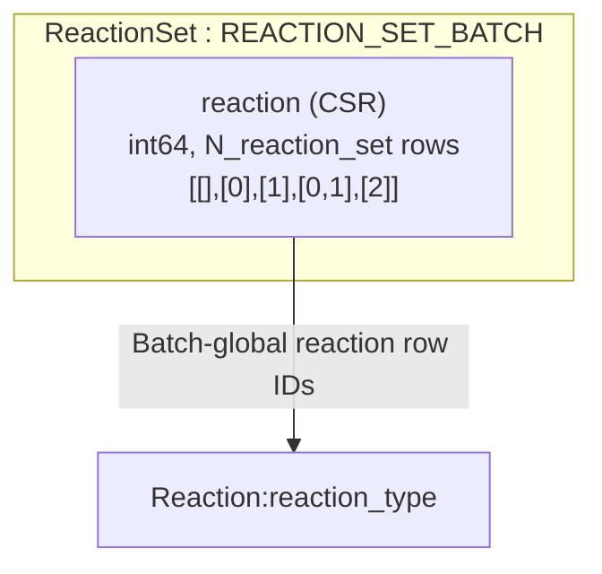

References: [Reaction](#22-reaction)


| Field / relation | Type / logical shape | Example | Reference |
|---|---|---|---|
| `reaction (CSR)` | int64; `N_reaction_set` variable-length rows | `[[],[0],[1],[0,1],[2]]` | → [Reaction](#22-reaction):`reaction_type` |

`reaction` is a logical name for one CSR relation. The schema does not draw its
physical index and ptr arrays as two fields. Its physical pointer length is
`N_reaction_set + 1`; its value count is the sum of all member counts (5 here).
The numerical example assumes reactions 0 and 1 are compatible, independently
of the preceding illustrative conflict-pair values.

### Concrete rows

| reaction_set_id (implicit row) | reaction (CSR) | Referenced REACTION_BATCH rows |
|---|---|---|
| 0 | [] | none: empty set |
| 1 | [0] | reaction row 0 |
| 2 | [1] | reaction row 1 |
| 3 | [0,1] | reaction rows 0 and 1 |
| 4 | [2] | reaction row 2 |

All lists are strictly ascending, without duplicate reaction IDs. Identical lists
are one row, regardless of reaction order, adduct, CE, or the consumer referring
to them. `[0,1]` represents the same set whether a path adds 0 then 1 or 1 then 0.
Different lists remain different rows even if they generate the same Compound.

Concrete reaction IDs already identify their Source through
`reaction_source_compound_index`. Reactions in a nonempty valid set must belong
to one Source and satisfy the registry compatibility constraints.
The empty set contains no Source information: its Source must be supplied by the
referencing context. Do not infer a Source from empty membership.

### Compound references sets; sets do not reference Compound

The inverse relationship requested for Compound belongs on the Compound side.
Each Compound row has a list of reaction-set IDs that can generate it.
It is not a list of concrete reaction IDs.

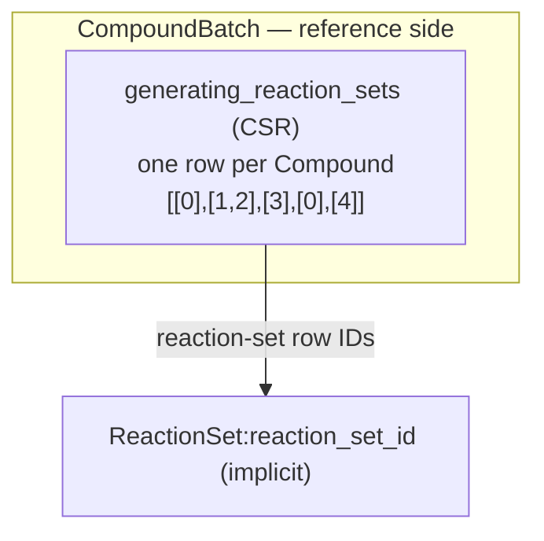

References: [ReactionSet](#23-reactionset)


| Compound row | generating_reaction_sets (CSR) | Meaning |
|---|---|---|
| 0 | [0] | Empty set in Source 0 context |
| 1 | [1,2] | Different sets {0} and {1} generate this one Compound |
| 2 | [3] | Set {0,1} generates this Compound |
| 3 | [0] | Empty set in Source 1 context |
| 4 | [4] | Set {2} generates this Compound |

This example illustrates sharing and references rather than calculated products.
It has 5 Compounds, so the Compound-side CSR's physical pointer length is
`N_compound + 1 = 6`. The set-membership CSR also has 5 rows in this example;
that equality is incidental. The two row counts are independent.
Compound 1 remains one node/structure with two generating sets. Empty-set row 0
can be reused across Source contexts; the relationship's Source context must
remain available on its reference side.

### Fields that do not belong in REACTION_SET_BATCH

| Information | Where it belongs |
|---|---|
| Source/main-adduct context | A group/context table referencing a set row |
| Which Compound a set generates | Compound's `generating_reaction_sets (CSR)` relationship |
| Runtime graph occurrence | Runtime topology/context view referencing Compound and set as needed |
| Parent, added reaction, transition | Transition/path tables referencing set IDs and context |
| Positive/weak negative labels | Teacher tables referencing set IDs, reaction IDs, and context |
| CE, observed peaks, assignments | Spectrum/assignment tables |

A context-bearing state/view can reference `(group_id, reaction_set_id)`; it must
not duplicate the membership list into a new canonical set. A different group
may reuse the same set row while retaining its own topology/labels. These
consumer tables will be specified separately, rather than being treated as
fields of the set table.

### Implemented classes and references

| Schema component | Class / stored fields |
|---|---|
| SourceCompound | `SourceCompound(source_graph, source_smiles, symbols)` |
| Reaction | `ReactionTensorData`; concrete global registry rows |
| ReactionSet | `ReactionSet(reaction_ptr, reaction_index)` |
| Context -> set | `ReactionContextData.candidate_reaction_set_index` |
| Active teacher context -> set | `states.candidate_index` -> candidate context -> set |
| Compound -> generating sets | `CompoundBatch.generating_reaction_sets_ptr/index`; generating_reaction_sets CSR |
| Materialization context -> Compound | `MaterializedContextData.compound_index` |
| Annotation context -> set | `MaterializedContextData.reaction_set_index` |

ReactionContextData contains group, occurrence, active-state projection and
transition references. It stores no membership CSR and no set-owned Compound.
Root contexts with different Sources can point to the same empty set and different
Compounds. Repeated group contexts for the same Compound/set pair create only
one entry in the Compound inverse CSR.

`ReactionSet.from_rows()` normalizes/deduplicates memberships and returns a
row-to-set-ID mapping. Collation offsets global reaction IDs before interning,
then remaps contexts and Compound references. Sample selection retains the
independent Source/reaction/set registries and slices the dependent contexts.
`candidate_reactions()` / `active_reactions()` build runtime CSR projections from
FKs; those memberships are not stored twice. Training converts the global members
to the decoder's local pool slots only for scoring.

Files use `fredis.annotated-spectrum-training` without a version suffix.
Loading/validation does not run chemistry. Further dependent schemas
can be refined independently of canonical set identity.

Implementation: [SourceCompound](source_compound.py),
[ReactionSet](reaction_set.py), [ReactionContextData](reaction_context_data.py).

## 2.4 CompoundBatch

**unique product compounds and their generating sets**

This is the implemented `CompoundBatch` class at
`structure.compounds`. Distinguish a single **mmkit.Compound** molecule object from the
**CompoundBatch** container holding multiple unique molecules.

### Three fields in CompoundBatch

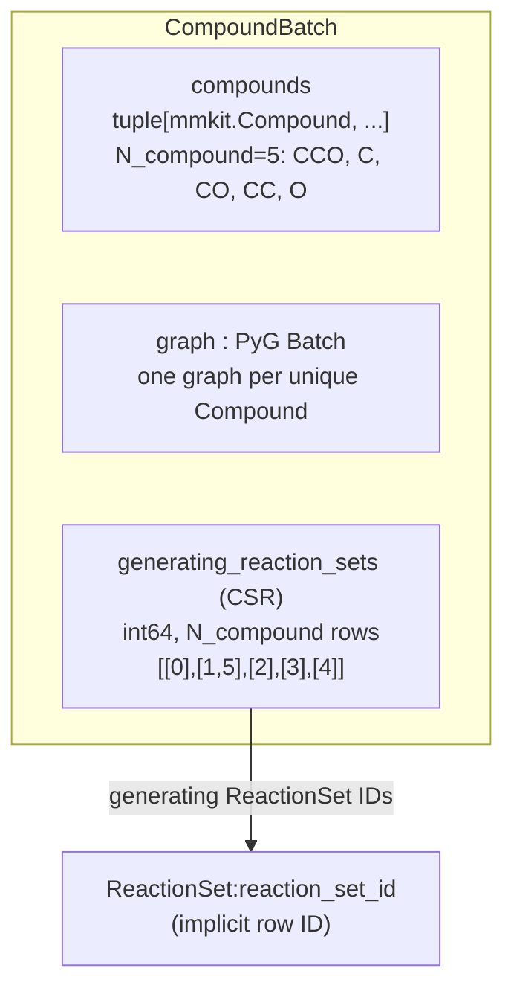

References: [ReactionSet](#23-reactionset)


| Field / relation | Type / shape | Concrete example | Reference / meaning |
|---|---|---|---|
| `compounds` | tuple[mmkit.Compound, ...], length N_compound | Five objects whose SMILES are CCO, C, CO, CC, O | One object per unique structure |
| `graph` | PyG Batch | 5 graphs, 9 atoms, 8 directed edges | One structural-feature graph per `compounds` row |
| `generating_reaction_sets (CSR)` | int64; N_compound variable-length rows | `[[0],[1,5],[2],[3],[4]]` | → [ReactionSet](#23-reactionset):`reaction_set_id` |

The Compound ID is the implicit index into `compounds` and the graph rows.
There is no separately stored `compound_id` vector. `compounds[i]` means one
mmkit.Compound; CompoundBatch means the whole collection.

`smiles` is not independently stored: obtain it as `compounds[i].smiles`.
A convenience property may derive all SMILES without becoming another stored
field. Uniqueness is based on canonical isomeric SMILES, including stereochemistry
and charge, not Python object identity.

### Generating sets are different from set membership

`ReactionSet.reaction (CSR)` contains concrete Reaction IDs. In contrast,
`CompoundBatch.generating_reaction_sets (CSR)` contains **ReactionSet IDs**.
One Compound can have several generating sets.

| Compound row | Derived SMILES | generating_reaction_sets (CSR) | Member reactions after following each set ID |
|---|---|---|---|
| 0 | CCO | [0] | {} |
| 1 | C | [1,5] | {0}, {1,2} |
| 2 | CO | [2] | {1} |
| 3 | CC | [3] | {2} |
| 4 | O | [4] | {3} |

These relationships use the actual ethanol preparation example computed earlier.
The empty set produces the unchanged root in its Source context. The table can
therefore include an unchanged root as well as reaction products.
Compound 1 has one molecular object and one graph even though two different sets
produce it. The set rows remain separate. Repeated group/CE references do not
create another Compound or duplicate a Compound/set pair.

The generating-set CSR has N_compound logical rows; its physical pointer length
is N_compound+1 (6 here). There are 6 generating-set entries in this example.
Each Compound's set IDs are sorted and unique. The schema shows this as one
logical relation rather than separate index/ptr fields.

### graph: packed structural features

N_atom and N_edge count atoms and directed edges of the unique Compound graphs,
not Source atom rows. F_atom and F_bond come from the preparation feature
configuration. The actual example uses F_atom=35 and F_bond=9.

| Graph field | Type / shape | Concrete example / reference |
|---|---|---|
| `graph.x` | float32 [N_atom,F_atom] | [9,35] |
| `graph.edge_index` | int64 [2,N_edge] | [2,8]; -> [CompoundBatch](#24-compoundbatch):`graph.x` |
| `graph.edge_attr` | float32 [N_edge,F_bond] | [8,9] |
| `graph.ptr` | int64 [N_compound+1] | [0,3,4,6,8,9] |
| `graph.batch` | int64 [N_atom] | [0,0,0,1,2,2,3,3,4]; -> [CompoundBatch](#24-compoundbatch):`compound_id` |

`graph.ptr` delimits atom rows; generating_reaction_sets CSR delimits set-ID
lists. Both have N_compound+1 boundaries, but they index different arrays.
For Compound 2 (CO), atom features are `graph.x[4:6]`.
Charged formula/m/z and ion-condition fields remain outside CompoundBatch.

### Implemented storage

`CompoundBatch` stores `compounds`, `graph`, and the physical CSR pair
`generating_reaction_sets_ptr/index`. The pair represents the single logical
relation generating_reaction_sets (CSR). `smiles` is a derived read-only view of
`compounds[i].smiles`, not another stored field.
The saved format is `fredis.annotated-spectrum-training` without a version suffix. Implementation: [CompoundBatch](compound_batch.py),
[normalization and reference tables](annotated_spectrum_data.py).

## 2.5 AdductData

**shared adduct rules and hydrogen shifts**

`structure.adducts` stores [AdductData](adduct_data.py).
This shared schema centralizes main adducts, fragment ion adducts, and signed
hydrogen shifts. All index values below refer to this table's ordering, which
must be shared by preparation and model inputs. These are chemical rule
vocabularies, not observed peaks or spectrum rows.

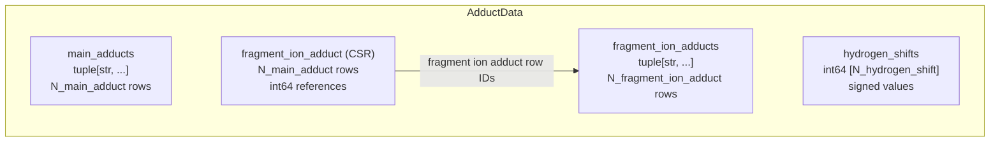

| Field / relation | Type / shape | Illustrative value | Meaning |
|---|---|---|---|
| `main_adducts` | tuple[str, ...], N_main_adduct | `("[M+H]+","[M+Na]+")` | Registered main-adduct labels; row IDs are implicit |
| `fragment_ion_adducts` | tuple[str, ...], N_fragment_ion_adduct | `("[M+H]+","[M+H-H2O]+","[M+Na]+")` | Unique fragment-ion adduct labels |
| `fragment_ion_adduct (CSR)` | int64, N_main_adduct variable-length rows | `[[0,1],[2]]` | Fragment ion adducts belonging to each main adduct; references [AdductData](#25-adductdata):`fragment_ion_adducts` |
| `hydrogen_shifts` | int64 [N_hydrogen_shift] | `[-1,0,1]` | Signed hydrogen-count adjustments; an index into this array differs from its value |

The physical CSR arrays in this example are
`fragment_ion_adduct_ptr = [0,2,3]` (length N_main_adduct+1) and
`fragment_ion_adduct_index = [0,1,2]` (length N_main_fragment_adduct_link).
The lists are configured by the preparation chemistry rules, not inferred from
label spelling. A shared fragment-adduct row may be referenced by multiple main
adducts when configured. Hydrogen shifts form a shared vocabulary; listing a
shift does not assert that every adduct/shift combination is chemically valid.
[BranchGroup](#27-branchgroup):`main_adduct_index` references [AdductData](#25-adductdata):`main_adducts`.

## 2.6 FormulaData

**unique charged formulas**

A FormulaData row is one unique elemental-count vector including charge.
Different Compounds and fragment-ion conditions can produce the same charged
formula. They share its formula row while retaining separate explanation rows.
Measured peak m/z is not the identity of a formula: different formulas may fall
within the same peak tolerance.

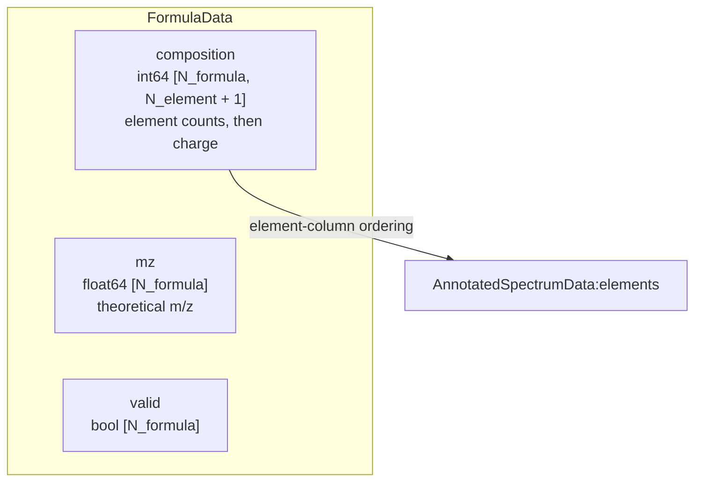

References: [AnnotatedSpectrumData](annotated_spectrum_data.py)


| Field / relation | Type / shape | Illustrative value | Meaning |
|---|---|---|---|
| `composition` | int64 [N_formula, N_element+1] | `[[2,7,1,1],[2,5,0,1]]` | With elements `("C","H","O")`: C2H7O+ and C2H5+; last column is charge |
| `mz` | float64 [N_formula] | approximately `[47.04914,29.03858]` | Exact theoretical m/z calculated from charged composition |
| `valid` | bool [N_formula] | `[True,True]` | Current criterion: element counts are nonnegative |

FormulaData contains only formula identities and their properties. It does not
own an explanation CSR. FormulaExplanationData references each formula directly.

### FormulaExplanationData

**Compound / fragment ion adduct / hydrogen shift**

Each row registers a Formula and its Compound / fragment ion adduct / hydrogen
shift explanation. Its formula_index is a direct foreign key to FormulaData.
PeakAssignmentData references only explanation rows, without storing formula IDs.

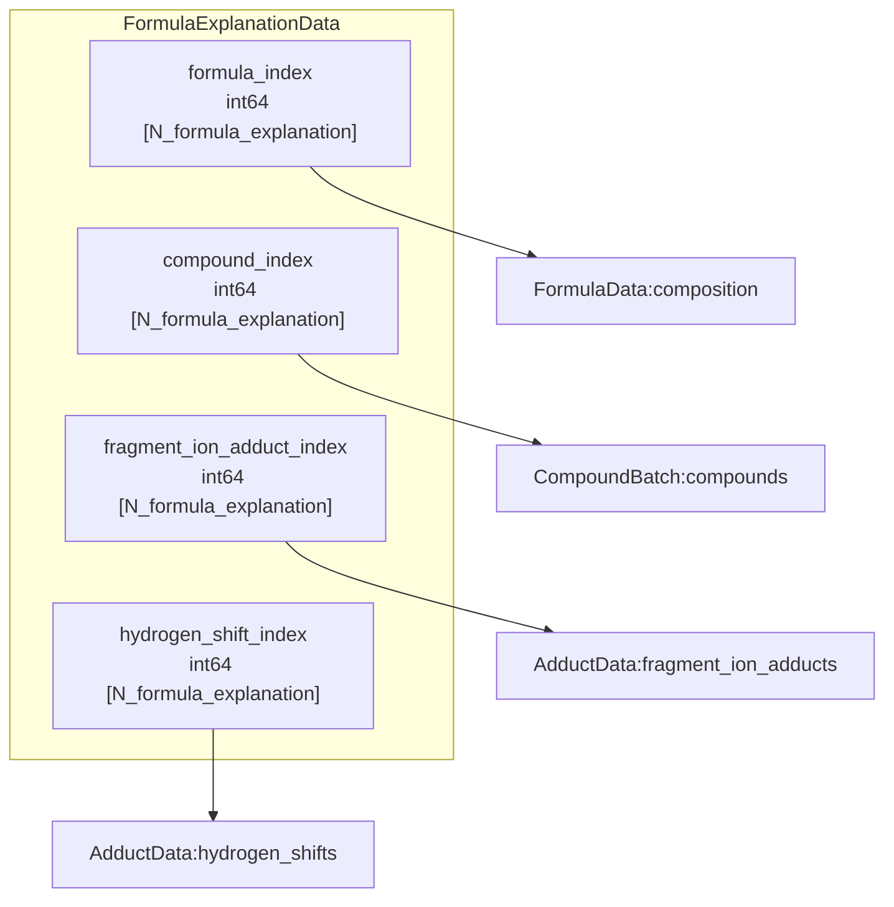

References: [FormulaData](#26-formuladata) · [CompoundBatch](#24-compoundbatch) · [AdductData](#25-adductdata)


For an illustrative registry where Compound rows 0 and 1 are ethanol (`CCO`)
and dimethyl ether (`COC`), the following rows explain the formulas above:

| Explanation row (implicit) | formula_index | compound_index | fragment_ion_adduct_index | hydrogen_shift_index |
|---|---|---|---|---|
| 0 | 0 | 0 | 0 | 1 |
| 1 | 0 | 1 | 0 | 1 |
| 2 | 1 | 0 | 1 | 1 |

Using section 2.5's vocabularies, rows 0 and 1 both use [M+H]+ and shift 0,
producing C2H7O+. Row 2 uses [M+H-H2O]+ and shift 0, producing C2H5+.
Thus a formula can retain distinct Compound explanations even at identical m/z.
Each explanation stores one formula_index. The referenced composition must
match that produced by its Compound/adduct/shift combination. Identical rows
are shared across peak assignments; different structures explaining the same
formula remain separate rows. All four columns are int64 [N_formula_explanation].

Implementation: `structure.formulas` and
`structure.formula_explanations` in [annotated_spectrum_data.py](annotated_spectrum_data.py).
SpectrumExplanationData references candidate explanations by CSR, one row per
spectrum. These references do not change FormulaExplanationData identity.

## 2.7 BranchGroup

**SourceCompound and main-adduct context**

A BranchGroup row identifies one `(SourceCompound, main adduct)` pair.
It supplies the context in which branch predictions/topology are shared.
CE, measured peaks, and observed intensities are not part of its identity.
The group ID is its implicit row number; there is no additional group_id vector.

The [BranchGroup](branch_group.py) class is stored as `structure.branch_groups`.
Its two columns reference SourceCompound and the shared `structure.adducts` table.

### Fields and references

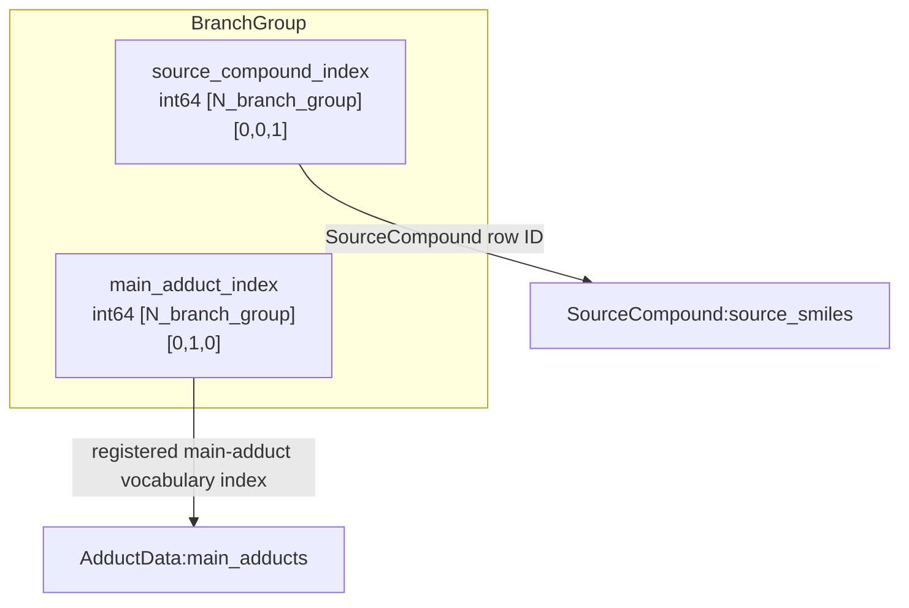

References: [SourceCompound](#21-sourcecompound) · [AdductData](#25-adductdata)


| Logical field | Type / shape | Concrete example | Reference |
|---|---|---|---|
| `source_compound_index` | int64 [N_branch_group] | [0,0,1] | → [SourceCompound](#21-sourcecompound):`source_smiles` |
| `main_adduct_index` | int64 [N_branch_group] | [0,1,0] | → [AdductData](#25-adductdata):`main_adducts` |

`main_adduct_index` references the shared AdductData main-adduct rows defined
in section 2.5. It is not an independent PreparationContext vocabulary.

### Concrete group rows

For illustration, let the Sources be `("CCO","CC(=O)O")` and the main-adduct
vocabulary be `("[M+H]+","[M+Na]+")`.

| group_id (implicit row) | source_compound_index | main_adduct_index | Meaning |
|---|---|---|---|
| 0 | 0 | 0 | CCO with [M+H]+ |
| 1 | 0 | 1 | CCO with [M+Na]+ |
| 2 | 1 | 0 | CC(=O)O with [M+H]+ |

The two columns have the same length N_branch_group=3. The pair is unique:
multiple spectra of CCO/[M+H]+ at 10 and 40 eV both reference group 0. Changing
main adduct creates another group; changing Source creates another group.
An observed adduct with a neutral loss can resolve to the same registered main
adduct, so the raw observed string is not the group key.

ReactionSet membership remains independent of BranchGroup. Groups can reference
the same set row while retaining their own branch context; no reaction-membership
CSR belongs in BranchGroup. Its purpose is context/sharing, not Compound identity.

### Mapping to current storage

| Logical schema field / relation | Current storage |
|---|---|
| `BranchGroup.source_compound_index` | `SourceReactionStructure.branch_groups.source_compound_index` |
| `BranchGroup.main_adduct_index` | `SourceReactionStructure.branch_groups.main_adduct_index` |
| Spectrum -> group | `SpectrumData.branch_group_index`; model-input view `sample_branch_group_index` |
| Candidate context -> group | `ReactionContextData.candidate_branch_group_index` |

The last two entries are references from their respective records, not extra
columns owned by BranchGroup. SpectrumData below references these implicit group
rows. Its Source and main-adduct information are obtained through the group.

Implementation: [BranchGroup](branch_group.py), [AdductData](adduct_data.py).

## 2.8 SpectrumData

**observed spectrum rows and peak lists**

This schema is implemented by `structure.annotations.spectra`.
One row is one observed spectrum. N_spectrum counts spectra and N_peak counts
their total observed peaks. A spectrum ID is its implicit row number; there is
no separately stored spectrum_id vector. Different CE observations remain
separate spectrum rows even when their SourceCompound, main adduct, and peak
m/z values are the same.

### Schema and references

The example uses actual prepared values from SourceCompound `CC(N)O`, observed
adduct `[M+H]+`, and CE 10/40 eV. Both spectra refer to branch group 0, which selects Source row 0; the group is shared because CE is not part of group identity.
The branch-group schema is referenced by name only.

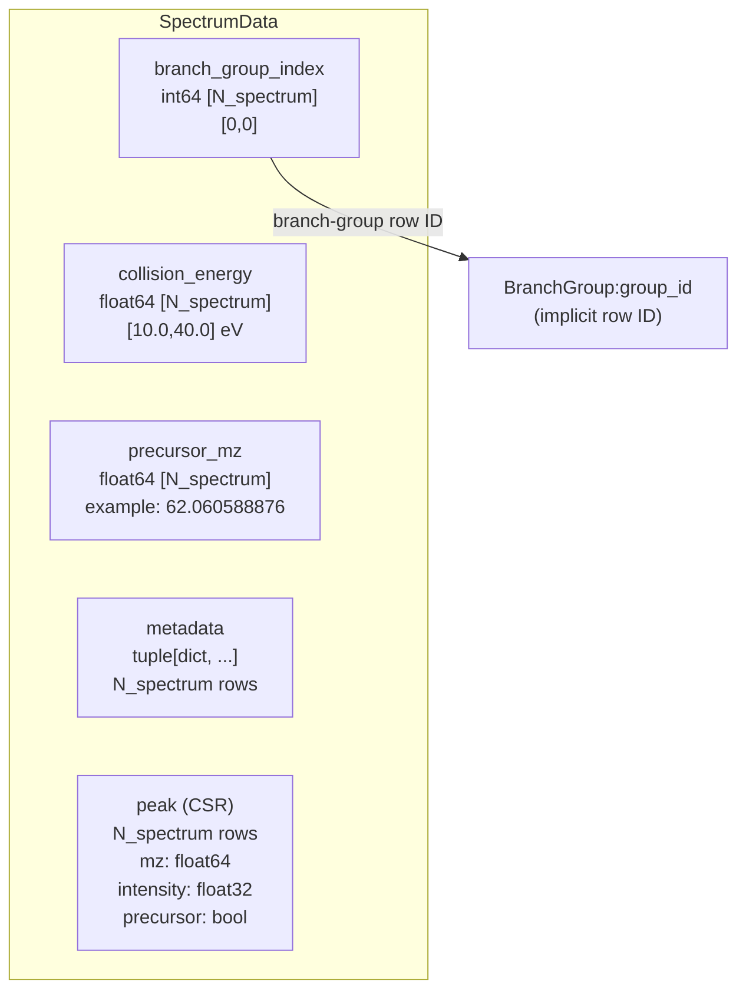

References: [BranchGroup](#27-branchgroup)


| Field / relation | Type / shape | Concrete value | Reference / meaning |
|---|---|---|---|
| `branch_group_index` | int64 [N_spectrum] | [0,0] | → [BranchGroup](#27-branchgroup):`group_id`; implicit group row |
| `collision_energy` | float64 [N_spectrum] | [10.0,40.0] | Observational CE in eV |
| `precursor_mz` | float64 [N_spectrum] | [62.060588876,62.060588876] | Precursor m/z recorded for each spectrum |
| `metadata` | tuple[dict, ...], length N_spectrum | Dictionaries in the example below | Remaining per-spectrum annotations |
| `peak (CSR)` | N_spectrum variable-length rows | Two peaks per spectrum here | Aligned observed mz/intensity/precursor values |

`group_id` is an implicit BranchGroup row. Source and registered main adduct
are obtained through that row, so SpectrumData has no separate source_index or
main-adduct column in this schema.

An observed precursor adduct can differ from the main adduct: `[M+H-H2O]+` may
resolve to the same group main adduct as `[M+H]+`. The original label is therefore
not generally derivable from BranchGroup. If it needs preserving, put it in
optional `metadata["observed_adduct"]`, rather than a mandatory adducts column.
A redundant mainAdduct label does not need copying into metadata.

### Concrete spectrum rows

```python
# Spectrum rows:     0                    1
branch_group_index = [0, 0]
collision_energy = [10.0, 40.0]
precursor_mz = [62.060588876, 62.060588876]

# Logical CSR rows: (mz, intensity, precursor)
peak = [
    [(18.033826, 0.5, False), (44.049476, 1.0, False)],
    [(18.033826, 1.0, False), (44.049476, 0.5, False)],
]

metadata = (
    {"assignmentScore": 1.0,
     "assignmentScoreWithoutPrecursor": 1.0},
    {"assignmentScore": 1.0,
     "assignmentScoreWithoutPrecursor": 1.0},
)
```

Spectrum 0 and spectrum 1 have identical m/z values but different measured
relative intensities and CE. These are separate observations, not a shared
Compound or ion identity. `metadata` contains optional per-spectrum annotations, including an original
observed_adduct label only if needed. Core conditions derived from BranchGroup
are not copied into it. The shown score
fields are preparation annotations, not model predictions.

### peak (CSR): multiple aligned values per spectrum

The single logical relation `peak (CSR)` uses a shared row boundary for three
parallel value arrays. It has no separately stored peak-index array: the
observed peak ID is the implicit flattened peak row.

| Peak value | Type / physical shape | Concrete values |
|---|---|---|
| `mz` | float64 [N_peak] | [18.033826,44.049476,18.033826,44.049476] |
| `intensity` | float32 [N_peak] | [0.5,1.0,1.0,0.5] |
| `precursor` | bool [N_peak] | [False,False,False,False] |

There are N_spectrum=2 CSR rows and N_peak=4 values in each aligned array.
The physical boundary vector is `[0,2,4]`, length N_spectrum+1; in code it is
`peak_ptr`. It is packing metadata for the one peak relation, not an additional
foreign-key field in the diagram. Spectrum 1's peaks occupy flattened rows 2:4.
Empty spectra have empty CSR slices, not a fabricated zero-intensity peak.

`mz` and `intensity` are observation inputs. `precursor` is an annotation flag:
the current builder marks whether a peak is within the configured precursor mass
tolerance. Intensities are retained as supplied by preparation; this table does
not itself apply an additional intensity normalization.

### Precursor and CE interpretation

`precursor_mz` stores the value of the observation's precursorMz field. The current
ReactionStructureBuilder derives that value from the Source formula and observed
adduct, so the example is a theoretical precursor m/z, not a separately read
instrument measurement. The field itself is per-spectrum metadata.

SpectrumData stores CE as float64. The separate model-input view
`SourceReactionStructure.collision_energy_eV` is float32; corresponding sample
values must agree after that dtype conversion. This documents current storage
rather than introducing a new duplicated condition field.

Compound/formula/ion assignments are not columns of SpectrumData: the current
PeakAssignmentData table references these implicit observed peak rows. Its schema
is defined in section 2.9. This section only defines SpectrumData.

Implementation: [SpectrumData and normalization](annotated_spectrum_data.py).

## 2.9 PeakAssignmentData

**structural explanations assigned to observed peaks**

This table is separate from TeacherData. Each implicit row corresponds to the
same flattened peak row in [SpectrumData](#28-spectrumdata):`mz`. A single CSR lists the
FormulaExplanationData rows assigned to each peak.

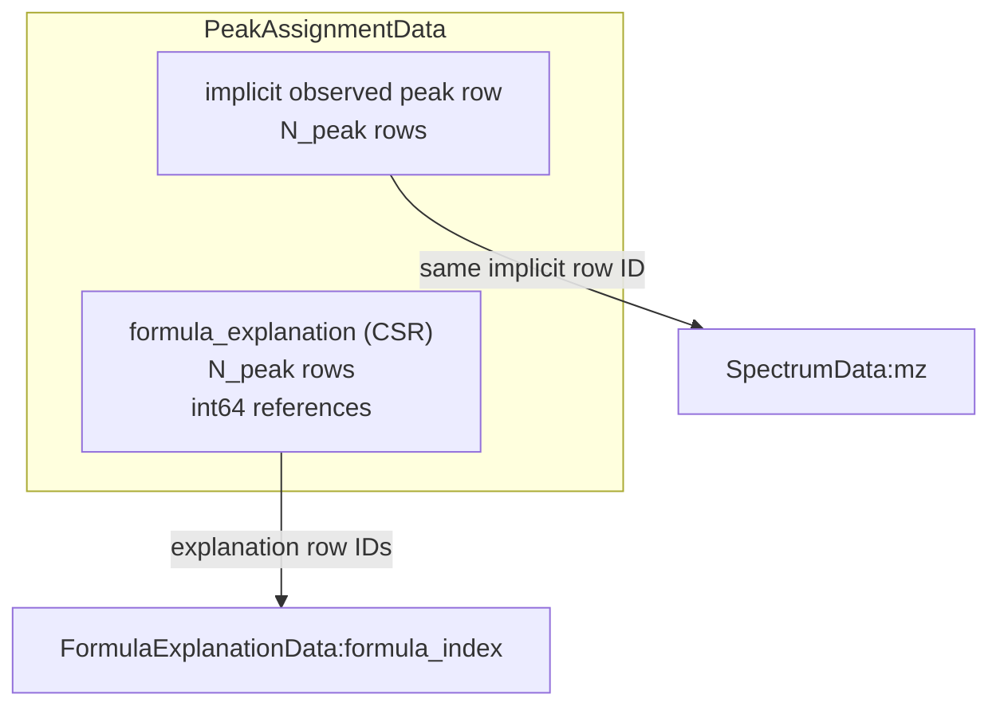

References: [SpectrumData](#28-spectrumdata) · [FormulaExplanationData](#formulaexplanationdata)


| Field / relation | Type / shape | Concrete value | Reference |
|---|---|---|---|
| `formula_explanation (CSR)` | int64, N_peak variable-length rows | `[[0,1],[0,2],[]]` | → [FormulaExplanationData](#formulaexplanationdata):`formula_index` |

```python
formula_explanation_ptr = [0,2,4,4]       # int64 [N_peak + 1]
formula_explanation_index = [0,1,0,2]     # int64 [N_peak_assignment]
```

Using section 2.6's explanation rows, peak 0 has two structural explanations
of Formula 0. Peak 1 has explanations of Formula 0 and Formula 1. Peak 2 is
unassigned. Thus each peak can still have multiple formulas: obtain them from
the referenced explanation rows and deduplicate their formula_index values.
PeakAssignmentData does not duplicate those formula IDs or store a second CSR.
The diagram shows direct references only.

Explanation IDs are sorted and unique within each peak. Distinct explanations
of the same formula remain separate assignments. Preparation checks chemical
consistency and admissibility for the spectrum's BranchGroup and available
Compounds. Empty slices are not Teacher negative labels. SpectrumData:precursor
remains an independent mass-tolerance annotation.

Implementation: [PeakAssignmentData](annotated_spectrum_data.py). The only stored
assignment fields are `formula_explanation_ptr` and `formula_explanation_index`.

## 2.10 CompoundReactionGraph

**CompoundBatch nodes and concrete-reaction edges**

The `structure.compound_graph` stores the structural graph. A node ID is directly a
CompoundBatch row ID; there is no separate node table or reaction-history node.
Each edge is one `(source Compound, target Compound, Reaction)` triple. The same
Compound has one node across all histories and BranchGroups. Distinct reactions
between the same nodes remain separate edges; identical triples are shared.

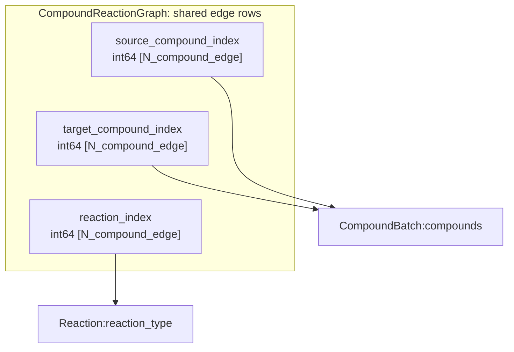

References: [CompoundBatch](#24-compoundbatch) · [Reaction](#22-reaction)

| Field | Type / shape | Example | Direct reference |
|---|---|---|---|
| `source_compound_index` | int64 [N_compound_edge] | `[0,0,1,2,0]` | → [CompoundBatch](#24-compoundbatch):`compounds` |
| `target_compound_index` | int64 [N_compound_edge] | `[1,2,3,3,4]` | → [CompoundBatch](#24-compoundbatch):`compounds` |
| `reaction_index` | int64 [N_compound_edge] | `[0,1,1,0,2]` | → [Reaction](#22-reaction):`reaction_type` |

The example has edges 0: A→B by reaction 0, 1: A→C by reaction 1,
2: B→D by reaction 1, 3: C→D by reaction 0, and 4: A→E by reaction 2. D is one Compound node,
even though it has two incoming routes. Edge IDs are implicit row numbers.
A reaction that changes history while preserving structure is a self-loop;
these edges are retained too. No ReactionSet ID belongs to a structural node.

The edge registry is shared across BranchGroups; group selection and labels
belong to [ReactionContextData](#211-reactioncontextdata). The registry contains
both supported and unsupported valid candidates. reaction_index is retained:
multiple generating ReactionSets per Compound prevent recovering a unique
reaction by subtracting the sets associated with two Compound rows.

If Compound sharing creates cycles or structure-preserving reaction edges,
the current DAG propagator cannot consume them directly. Enforce history/depth
constraints in a finite execution view or explicitly choose another propagation
strategy. Canonical Compound nodes remain shared. This expansion is derived at runtime and is not serialized.

## 2.11 ReactionContextData

**Proposed CE-independent branch candidates and edge labels**

This replaces the former Q/V reaction-context table. One CSR row corresponds
to one BranchGroup; there is no candidate_branch_group_index vector, candidate
ReactionSet foreign key, or occurrence-row reference in this table.
The shared structural edge registry remains in CompoundReactionGraph.

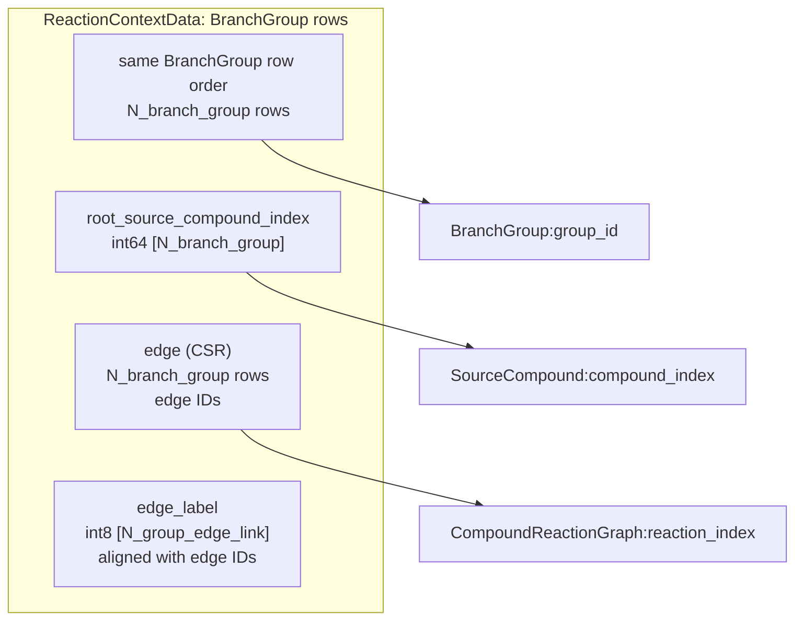

References: [BranchGroup](#27-branchgroup) · [SourceCompound](#21-sourcecompound) · [CompoundReactionGraph](#210-compoundreactiongraph)

| Field / relation | Type / shape | Example | Meaning / reference |
|---|---|---|---|
| `root_source_compound_index` | int64 [N_branch_group] | `[0,0]` | → [SourceCompound](#21-sourcecompound):`compound_index`; Source row IDs selected by each group |
| `edge (CSR)` | N_branch_group variable-length rows | `[[0,1,2,3,4],[0,1,2,3]]` | → [CompoundReactionGraph](#210-compoundreactiongraph):`reaction_index`; edge row IDs |
| `edge_label` | int8 [N_group_edge_link] | `[1,1,1,1,0, 1,1,0,-1]` | 1 supported candidate; 0 weak negative; -1 excluded from branch loss |

```python
root_source_compound_index = [0,0]  # Source row IDs
# SourceCompound.compound_index = [0,5] -> initial Compound IDs [0,0]
edge_ptr = [0,5,9]                   # int64 [N_branch_group + 1]
edge_index = [0,1,2,3,4, 0,1,2,3]   # int64 [N_group_edge_link]
edge_label = [1,1,1,1,0, 1,1,0,-1]  # int8  [N_group_edge_link]
```

Group 0 and group 1 can be the same Source with [M+H]+ and [M+Na]+ respectively.
They share edge rows but select and label them independently. Index and label
positions are paired and have one shared pointer. -1 means the edge is retained
for computation but contributes no branch-label loss; it is different from an
edge omitted from the group's candidate graph. Valid outgoing candidates at
intermediate nodes are included too: for A→B→C, the CSR contains candidates
leaving A and candidates leaving B, not only the observed path's edges.
root_source_compound_index references Source rows. Resolve initial Compound
nodes as SourceCompound.compound_index[root_source_compound_index]. Each root
Source ID must agree with BranchGroup.source_compound_index for the same group.
The diagram shows only direct references; section 2.1 shows the next reference.
An isolated root is retained even for an empty edge slice.

### Edge-level branch objective

For each selected edge predict a logit z(group, edge), conditioned on the group's
main adduct and the source Compound, target Compound, and concrete Reaction.
CE is not an input to this branch objective. Train labelled entries with weighted
binary cross entropy: positive loss softplus(-z), weak-negative loss
negative_weight * softplus(z); mask label -1. Normalize by the sum of supervised weights (N_positive + negative_weight *
N_weak_negative). No supervised weight contributes zero. This edge classification
does not retain alternative-path MIL semantics.

A positive label means the edge is useful in at least one retained explanation
at some CE, not that its physical occurrence has been established. A weak
negative must be chemically admissible in some reachable history but unsupported
by all retained explanations in the group. If any history supports an edge,
the group/edge summary is positive; it cannot simultaneously be a weak negative
in this table. Invalid or uncertain cases are omitted or masked, not strong
negative facts. Labels summarize support, not history-specific applicability.
Search and propagation must still enforce used-reaction, conflict and depth
constraints where needed. There is no required peak-path CSR for this branch loss.

## 2.12 SpectrumExplanationData

**Proposed spectrum-to-FormulaExplanationData candidates for intensity prediction**

This relation connects each spectrum to candidate chemical explanations. It
references FormulaExplanationData directly and does not use FragmentOccurrenceData.
Rows follow SpectrumData order; no duplicate spectrum_index column is needed.

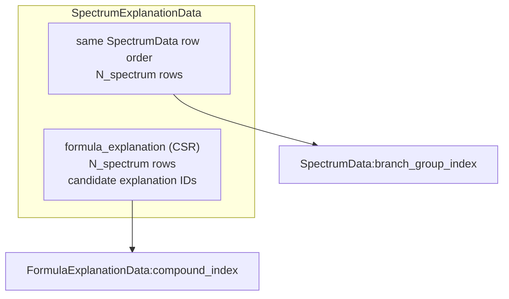

References: [SpectrumData](#28-spectrumdata) · [FormulaExplanationData](#formulaexplanationdata)

| Relation | Type / shape | Example | Direct reference |
|---|---|---|---|
| `formula_explanation (CSR)` | N_spectrum rows of int64 IDs | `[[0,1,2],[0,1,2]]` | → [FormulaExplanationData](#formulaexplanationdata):`compound_index`; explanation row IDs |

```python
formula_explanation_ptr = [0,3,6]       # int64 [N_spectrum + 1]
formula_explanation_index = [0,1,2,0,1,2]  # int64 [N_spectrum_explanation]
```

Assume explanation rows 0 and 1 refer to Compound B and D, share Formula F0,
and row 2 refers to Compound C and Formula F1. A spectrum selects its graph
through SpectrumData.branch_group_index. Propagation on that graph supplies
retained probabilities for the Compound IDs referenced by these explanation
rows; conditional fragment-adduct/hydrogen-shift predictions split the retained
probability into candidate ion contributions. All valid routes reaching one
Compound contribute to its probability; an explanation need not pick one route.
Thus no additional stored explanation-to-path relation is required for the
current intensity objective, which sums indistinguishable explanations.

Preparation checks Compound reachability from the group's root, allowed fragment
adduct membership under its main adduct, allowed hydrogen shifts, and formula
validity. Include unsupported/unobserved candidate ions as well as matched ones:
PeakAssignmentData alone lists matches and cannot define the whole negative
candidate universe. Keep branch weak negatives and masked branch edges as
intensity candidates when valid. PeakAssignmentData remains the independent
observed-peak-to-explanation annotation; this CSR defines candidates per spectrum.
The diagram shows direct references only.

For spectrum s and explanation e, conceptually compute
q(s, compound[e]) * p(fragment adduct[e], hydrogen shift[e] | s, compound[e]).
Sum contributions sharing (spectrum, Formula) before comparing to the targets
below. An intermediate Compound may retain almost no observed intensity while
transmitting substantial probability to descendants; zero intensity does not
make its incoming/outgoing reaction edges false.

## 2.13 SpectrumFormulaTarget

**Proposed spectrum-specific supervision view, derived from annotations**

The identity is (spectrum, Formula), not (spectrum, reaction edge) or Compound.
A branch candidate supported at some CE may yield no observed ion at another CE.
This does not make the underlying reaction edge false: an unobserved intermediate
can still transmit probability to an observed descendant.

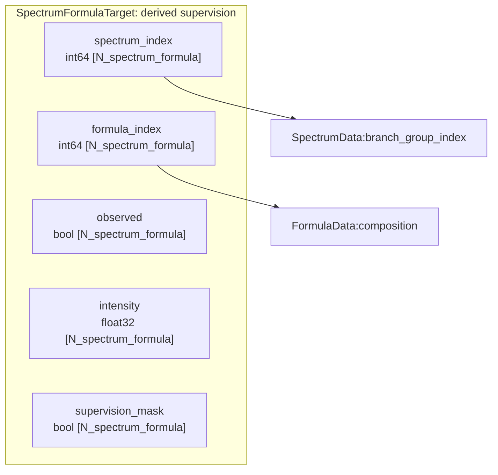

References: [SpectrumData](#28-spectrumdata) · [FormulaData](#26-formuladata)

| Field | Type / shape | Example |
|---|---|---|
| `spectrum_index` | int64 [N_spectrum_formula] | `[0,0,1,1]` |
| `formula_index` | int64 [N_spectrum_formula] | `[0,1,0,1]` |
| `observed` | bool [N_spectrum_formula] | `[True,False,False,True]` |
| `intensity` | float32 [N_spectrum_formula] | `[1.0,0.0,0.0,1.0]` |
| `supervision_mask` | bool [N_spectrum_formula] | `[True,True,True,True]` |

For example, spectra 0 and 1 are CE 10 and 40 observations of the same group.
An observed flag means at least one retained peak assignment supports the formula;
False means unobserved, not proven chemical absence. The mask excludes invalid
formulas and unavailable supervision. Valid surveyed candidates without matched
peaks can receive zero intensity as weak non-observation targets.

This is a derived view: measured intensities stay in SpectrumData and chemical
assignments stay in PeakAssignmentData. To match the current target construction,
take the maximum assigned intensity per (spectrum, Formula). Multiple structural
explanations share a formula target; their predicted contributions are summed
before loss evaluation. Ambiguous peak-to-formula assignments remain available
rather than being asserted to identify a unique structural explanation.

Keep the current intensity-distribution cross entropy and cosine loss, including
its full-spectrum and precursor-excluded evaluations. observed is useful target
metadata, not a newly introduced presence classifier or BCE loss. Samples with
no positive target intensity are skipped by the current objective. An independent
presence loss, if desired later, requires a separate model/loss decision.

The implemented branch loss is weighted binary cross entropy on the selected
edges (1: positive, 0: weak negative, -1: excluded). Intensity predictions use
the explanation-to-formula aggregation above before distribution and cosine loss.
