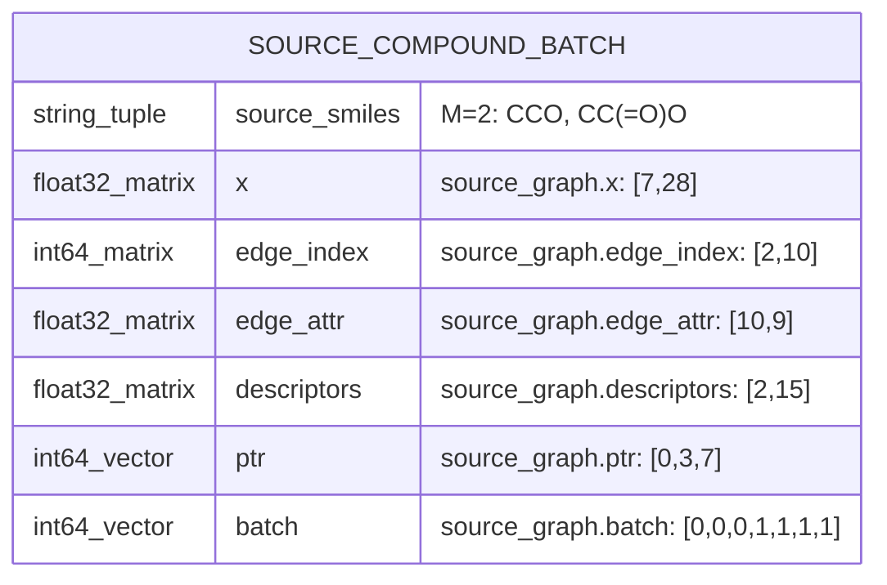
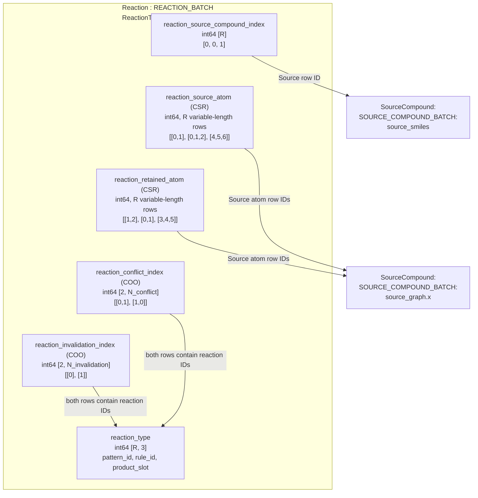
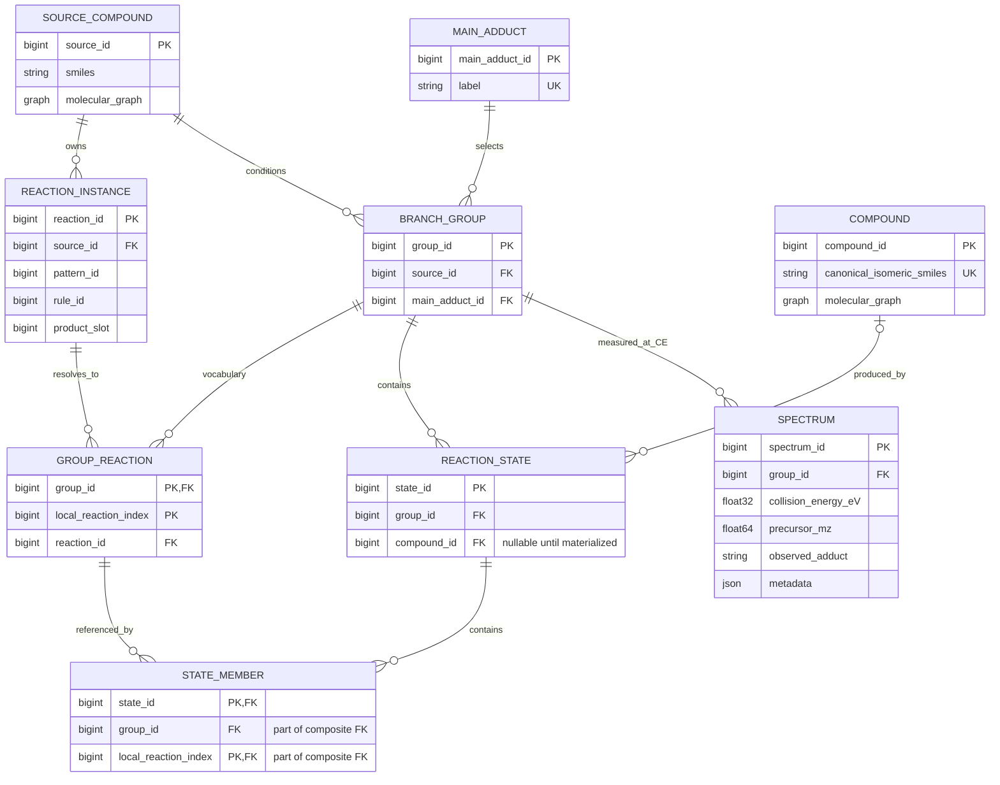
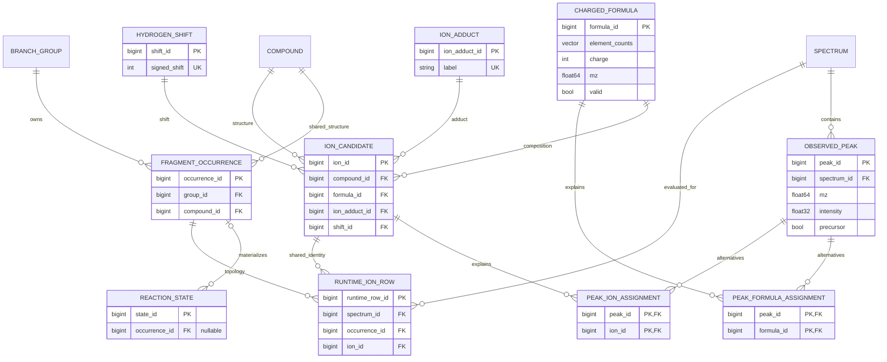
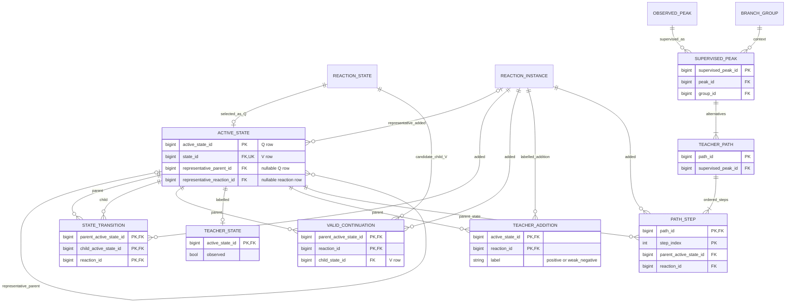

# Relational view of SourceReactionStructure

This is a logical RDB-style schema of the current tensor data, not a SQL database
implementation or a proposal to change prediction behavior. PK means primary key,
FK foreign key, and UK unique key. An ID names one row. Nullable FKs correspond to
-1 in tensor tables. Crow's feet show cardinality, not preparation order.

CSR lists are drawn as relationship tables. Their `ptr` arrays are storage
boundaries, not foreign keys, so the logical ER tables do not store a `ptr` column.
Names such as STATE_MEMBER and GROUP_REACTION describe logical tables/views;
there is no separate Python dataclass for each of them.

## SourceCompound: independent Batch structure (step 1)

The actual molecular graph storage is `source_graph: torch_geometric.data.Batch`,
including `ptr` and `batch`. This section describes that physical Batch first,
not a single-molecule RDB row. `source_smiles` is stored alongside the Batch in
SourceReactionStructure. SOURCE_COMPOUND_BATCH below is a logical name for those
fields together, not a new Python class. No implementation changes are made.
There are no external foreign keys in this component.

### Batch schema with concrete field values

Use ethanol `CCO` and acetic acid `CC(=O)O`, with `symbols=("C","O")`.
M=2 molecules, A=7 total atoms, E=10 directed edges. Atom feature dimension is
`F_atom=len(sorted(set(symbols)))+26=28`; bond feature dimension is `F_bond = MolGraphBuilder.bond_dim = 9` in the current implementation (4 bond-type + 5 ring-type features).



| Actual field | Type / shape | Concrete value / meaning |
|---|---|---|
| `source_smiles` | tuple[str, ...], length M | `("CCO", "CC(=O)O")` |
| `source_graph.x` | float32 `[A,F_atom]` | `[7,28]`; concatenated atom features |
| `source_graph.edge_index` | int64 `[2,E]` | `[2,10]`; endpoints use Batch-global atom rows |
| `source_graph.edge_attr` | float32 `[E,F_bond]` | `[10,9]`; directed-edge features |
| `source_graph.descriptors` | float32 `[M,15]` | `[2,15]`; one descriptor row per molecule |
| `source_graph.ptr` | int64 `[M+1]` | `[0,3,7]`; atom-row boundaries per molecule |
| `source_graph.batch` | int64 `[A]` | `[0,0,0,1,1,1,1]`; molecule ID per atom |

```python
source_smiles = ("CCO", "CC(=O)O")
source_graph.ptr = [0, 3, 7]                    # [M+1]
source_graph.batch = [0, 0, 0, 1, 1, 1, 1]     # [A]
source_graph.edge_index = [
    [0, 1, 1, 2, 3, 4, 4, 5, 4, 6],
    [1, 0, 2, 1, 4, 3, 5, 4, 6, 4],
]
# source_graph.x:           float32 [7,28]
# source_graph.edge_attr:   float32 [10,9]
# source_graph.descriptors: float32 [2,15]
```

For Source row `m=1`, `source_smiles[1]` is acetic acid, atoms are
`x[ptr[1]:ptr[2]] = x[3:7]`, and descriptors are `descriptors[1]`.
The Source identifier is the implicit molecule row `m`; there is no separate
stored scalar `source_id` and no Batch-level PK field. Other tables can refer
to `m` later. `ptr` and `batch` describe the same atom ownership in complementary
forms. There is no separately stored `edge_ptr` in the builder output.

### One-molecule feature values inside the Batch

The values below were computed with `Compound.from_smiles("CCO")` and
`MolGraphBuilder(("C","O"))`. They show Source 0's three atom rows and four
edge rows inside the Batch. A one-molecule Batch still has `ptr=[0,3]` and
`batch=[0,0,0]`.

The atom rows are `0:C(CH3)`, `1:C(CH2)`, `2:O(OH)`. Atom-map labels are
`[1,2,3]` in this run, but are not separately stored in the molecular graph.
Atom row IDs differ from atom-map labels. Features below are numerical values,
not a replacement for the Batch fields above.

### Exact atom and bond feature values

Integer-looking entries below are stored as float32 in `x` and `edge_attr`;
`edge_index` is int64. All vectors are prepared features, not learned embeddings.

```python
smiles = "CCO"
symbols = ("C", "O")
x = [
    [1, 0, 0, 1, 0, 1, 0, 0, 0, 0, 0, 0, 1, 0, 0, 0, 0, 0, 1, 0, 1, 0, 0, 0, 0, 0, 0, 0],
    [1, 0, 0, 1, 0, 1, 0, 0, 0, 0, 0, 0, 1, 0, 0, 0, 0, 1, 0, 0, 0, 1, 0, 0, 0, 0, 0, 0],
    [0, 1, 0, 1, 0, 1, 0, 0, 0, 0, 0, 0, 1, 0, 0, 0, 1, 0, 0, 0, 1, 0, 0, 0, 0, 0, 0, 0],
]
edge_index = [[0, 1, 1, 2], [1, 0, 2, 1]]
edge_attr = [
    [0, 1, 0, 0, 1, 0, 0, 0, 0],
    [0, 1, 0, 0, 1, 0, 0, 0, 0],
    [0, 1, 0, 0, 1, 0, 0, 0, 0],
    [0, 1, 0, 0, 1, 0, 0, 0, 0],
]
```

Atom feature columns for this exact two-symbol configuration:

| Slice | Feature | Vocabulary / order |
|---|---|---|
| `0:2` | symbol | C, O |
| `2:5` | charge | -1, 0, +1 |
| `5:10` | ring_type | no-ring, small-ring, 5-cycle, 6-cycle, large-ring |
| `10:15` | hybridization | sp, sp2, sp3, sp3d, sp3d2 |
| `15:20` | num_hydrogens | 0, 1, 2, 3, 4 |
| `20:28` | valence_electrons | 1, 2, 3, 4, 5, 6, 7, 8 |

Each feature block is one-hot when the value belongs to its vocabulary.
Unsupported symbols raise an error; out-of-vocabulary values in the other
feature blocks can be all-zero. Symbols are sorted/deduplicated by the builder.
The implementation calls `GetExplicitValence()` for `valence_electrons`:
that block is explicit valence, despite its current field name. It is not the
number of elemental valence electrons.

Bond columns `0:4` are `[AROMATIC,SINGLE,DOUBLE,TRIPLE]`; columns `4:9` are
`[no-ring,small-ring,5-cycle,6-cycle,large-ring]`. Ethanol's two single bonds
are stored in both directions, hence four equal rows. E counts directed edges,
not physical bonds. A molecule with no represented bonds has `edge_index [2,0]`
and `edge_attr [0,9]`.

### Molecular descriptor values

The order is `SUPPORTED_DESCRIPTOR_NAMES`; all 15 values are stored even if the
model later selects only a subset. These values are computed features rather
than model embeddings. Small floating-point/version differences are possible.

| Column | Descriptor | Value (rounded float32) |
|---|---|---|
| 0 | `MolWt` | 46.069 |
| 1 | `ExactMolWt` | 46.041866 |
| 2 | `HeavyAtomCount` | 3 |
| 3 | `TPSA` | 20.23 |
| 4 | `MolLogP` | -0.0014 |
| 5 | `NumHAcceptors` | 1 |
| 6 | `NumHDonors` | 1 |
| 7 | `NumRotatableBonds` | 0 |
| 8 | `RingCount` | 0 |
| 9 | `NumAromaticRings` | 0 |
| 10 | `NumAliphaticRings` | 0 |
| 11 | `FractionCSP3` | 1 |
| 12 | `NumHeteroatoms` | 1 |
| 13 | `FormalCharge` | 0 |
| 14 | `BertzCT` | 2.7548876 |

### Multiple SourceCompounds: physical Batch layout

For M source molecules, A total graph atoms, and E total directed edges:

| Stored field | Type / shape | Single ethanol example |
|---|---|---|
| `source_smiles` | tuple[str, ...], length M | `("CCO",)` |
| `source_graph.x` | float32 `[A,F_atom]` | `[3,28]` |
| `source_graph.edge_index` | int64 `[2,E]` | `[2,4]` |
| `source_graph.edge_attr` | float32 `[E,F_bond]` | `[4,9]` |
| `source_graph.descriptors` | float32 `[M,15]` | `[1,15]` |
| `source_graph.ptr` | int64 `[M+1]` | `[0,3]` |
| `source_graph.batch` | int64 `[A]` | `[0,0,0]` |

`ptr` and `batch` are packing metadata for multiple molecules, not additional
molecular properties. For two graph atom counts 3 and 4, `ptr=[0,3,7]` and
`batch=[0,0,0,1,1,1,1]`; edge endpoints are shifted to batch-global atom rows.
There is no separate stored `edge_ptr` in this builder's output.

Interpretation requires the atom/bond vocabularies, descriptor order, and graph
hydrogen policy. Current code holds these in the graph builder/descriptor
constants, not as additional fields of each SourceCompound. Hydrogens become
independent graph nodes only when `"H"` is in `symbols`; hydrogen counts remain
atom features. One shared configuration applies to a packed Batch.

`source_id` is a batch-local row number, not an immutable dataset-global ID.
SMILES uniqueness is not automatically enforced by the dataclass. Whether to
require a unique molecular identity is a separate schema decision to make
before adding dependent tables.

Implementation references:
[MolGraphBuilder](../mol/graph_builder.py),
[atom features](../mol/atom_feature.py),
[bond features](../mol/bond_feature.py),
[descriptors](../../domain/molecule/descriptors.py).

## Reaction: concrete reaction Batch (step 2)

Actual storage is `SourceReactionStructure.reactions: ReactionTensorData`.
R is the total number of concrete reactions in the current Batch. A reaction ID
is an implicit row `r` of `reaction_type`; it is not a pattern ID. These IDs and
atom IDs are Batch-global. The group-local IDs in State reaction sets are a
separate index space resolved through the group's Source reaction vocabulary.

### Notation and reference diagram

External targets are named only, as `Component:Batch:field`. The SourceCompound
Batch is not expanded again. A CSR relation is shown once as `(CSR)` with its
logical list values; its index and ptr arrays are not drawn as separate fields.
`reaction_source_atom` and `reaction_retained_atom` below are display names for
their respective stored CSR pairs, not additional dataclass fields.

Conflict/invalidation arrays are actually COO pairs, so they remain `(COO)`;
they are not relabelled CSR. The examples below are schematic reaction registry
values, not chemistry-calculated reactions or real configured pattern IDs.
They use the Source example's atom rows 0..2 and 3..6.



### Fields, values, and foreign-row references

| Field / relation | Type and shape | Concrete logical value | Reference target |
|---|---|---|---|
| `reaction_source_compound_index` | int64 `[R]` | `[0,0,1]` | → `SourceCompound:SOURCE_COMPOUND_BATCH:source_smiles` (Source row m) |
| `reaction_type` | int64 `[R,3]` | `[[10,0,0],[11,0,0],[10,1,0]]` | Pattern/rule definitions; product slot is a value, not a Compound FK |
| `reaction_source_atom (CSR)` | int64; R variable-length lists | `[[0,1],[0,1,2],[4,5,6]]` | → `SourceCompound:SOURCE_COMPOUND_BATCH:source_graph.x` |
| `reaction_retained_atom (CSR)` | int64; R variable-length lists | `[[1,2],[0,1],[3,4,5]]` | → `SourceCompound:SOURCE_COMPOUND_BATCH:source_graph.x` |
| `reaction_conflict_index (COO)` | int64 `[2,N_conflict]` | `[[0,1],[1,0]]` | Both endpoints → `Reaction:REACTION_BATCH:reaction_type` |
| `reaction_invalidation_index (COO)` | int64 `[2,N_invalidation]` | `[[0],[1]]` | Both endpoints → `Reaction:REACTION_BATCH:reaction_type` |

`reaction_source_compound_index[r]=m` selects `source_smiles[m]`, descriptor row m, and
atom rows `source_graph.ptr[m]:source_graph.ptr[m+1]`. The referenced ID is the
Source row, not a ptr value or an atom row. Every matched/retained atom of reaction
r must lie inside that Source's interval.

### What each field means

**reaction_type.** The columns are `[reaction_pattern_id, reaction_rule_id,
product_molecule_id]`. For example row 2 `[10,1,0]` selects pattern ID 10, rule ID
1, and product slot 0. The implementation calls the last field
`product_molecule_id`, but it does not reference `annotations.compounds`.
Pattern/rule definitions belong to the preparation Fragmenter; their schema is
outside this Reaction section. The concrete reaction row additionally encodes
which Source and which matched/retained atoms are involved.

**reaction_source_atom (CSR).** One list per concrete reaction of the Source
atom rows participating in its match. Reaction 1's list `[0,1,2]` points to
`source_graph.x[[0,1,2]]`. Values are graph row indices, not atom-map labels.
Do not apply the State-set ascending-order rule here: matched atom rows are
stored by preparation and are not guaranteed to be numerically sorted.

**reaction_retained_atom (CSR).** One list per concrete reaction of atoms retained
in its product. Reaction 2 keeps atom rows `[3,4,5]` of Source 1. These represent
retention relative to the Source, rather than new product-local atom numbering.
Empty lists are supported.

For each CSR relation there are R logical rows, so its physical pointer has
length R+1 and its value array has length equal to the sum of list lengths.
In this example both displayed relations have 8 values across 3 rows. The
schema shows the single logical relation rather than two separate arrows.

**reaction_conflict_index (COO).** Each column is `[reaction_i,reaction_j]`.
`[[0,1],[1,0]]` has two columns: `(0,1)` and `(1,0)`. Reactions that modify a
common Source bond conflict; both directions are stored. These are co-existence
constraints, not edges indicating execution order.

**reaction_invalidation_index (COO).** Each column is
`[invalidating_reaction,invalidated_reaction]`. `[[0],[1]]` means reaction 0
discards an atom needed by reaction 1's Source match. Here reaction 0 discards
atom 0 and reaction 1 needs atom 0. This relation is directional; a reverse pair
is not implied. Sets containing an invalidating pair are rejected regardless of
reaction order. An empty pair relation has shape `[2,0]`.

### One row read through its references

| r | Source row | reaction_type | Matched atoms (CSR) | Retained atoms (CSR) |
|---|---|---|---|---|
| 0 | 0: CCO | [10,0,0] | [0,1] | [1,2] |
| 1 | 0: CCO | [11,0,0] | [0,1,2] | [0,1] |
| 2 | 1: CC(=O)O | [10,1,0] | [4,5,6] | [3,4,5] |

For r=2, Source row 1 supplies the parent molecule; graph atom rows `[4,5,6]`
supply its match features. The type values alone do not identify this concrete
match. Two rows can share a pattern/rule/product slot but differ in Source or
matched position.

When collating Batches, Source IDs, Source atom IDs, and both endpoints of
reaction pair relations are offset. Pattern/rule IDs and product slots remain
unchanged. CSR boundaries are recomputed/offset as packing metadata. This is
separate from State-set group-local reaction IDs, which remain group-local.

The packed table does not itself store complete reaction edit objects or all
atom-map labels. Pattern/rule definitions and preparation chemistry supply
those semantics. Its tensors are the prepared model inputs and constraints.

Implementation: [ReactionTensorData](reaction_tensor_data.py),
[ReactionRelations](../../domain/fragment/reaction/ReactionRelations.py).

## 1. Sources, reactions, unique reaction sets, and Compounds

A State is one reaction set within one branch group. Two execution orders for the
same set share a State. Multiple States may reference the same Compound; they do
not require separate Compound nodes. Each materialized State currently produces
one Compound; an unmaterialized State has no Compound FK yet.



Integrity rules accompanying the diagram:

- `BRANCH_GROUP` is unique on `(source_id, main_adduct_id)`; CE belongs to SPECTRUM.
- `GROUP_REACTION` has composite PK `(group_id, local_reaction_index)` and is
  unique on `(group_id, reaction_id)`. Its reaction must belong to the group's
  Source. Local indices follow ascending registry rows of that Source.
- `STATE_MEMBER.(group_id, local_reaction_index)` is a composite FK to
  GROUP_REACTION. Its group must equal the group's ID on REACTION_STATE.
- State identity is unique on `(group_id, sorted reaction-member set)`.
  A member-table PK alone does not enforce this whole-set constraint: an actual
  RDB would also need a canonical set key or equivalent checked insertion logic.
  The empty set is the Source/root State within each group.
- REACTION_INSTANCE pattern/rule IDs refer to external reaction definitions;
  `product_slot` is a product position, not a COMPOUND FK.
- Molecular graphs are shown as graph values. At atom-row granularity they can
  be expanded into SourceAtom, SourceBond, ReactionMatchedAtom, and
  ReactionRetainedAtom tables. Conflict/invalidation arrays similarly become
  relation tables with two REACTION_INSTANCE FKs (invalidation is directional).

### Concrete rows and the two CSR levels

For one group, consider four State rows:

| state_id | group_id | reaction members (local IDs) | compound_id |
|---|---|---|---|
| 0 | 0 | {} | 0 |
| 1 | 0 | {0} | 1 |
| 2 | 0 | {1} | 1 |
| 3 | 0 | {0,1} | 2 |

STATE_MEMBER contains `(state_id, group_id, local_reaction_index)` rows
`(1,0,0)`, `(2,0,1)`, `(3,0,0)`, `(3,0,1)`. State 0 has no member rows.

```python
# State -> sorted reaction members: V=4
states.candidate_reaction_ptr   = [0, 0, 1, 2, 4]  # shape [V+1]
states.candidate_reaction_index = [0, 1, 0, 1]

# State -> Compound FK
annotations.compounds.state_index = [0, 1, 1, 2]

# Inverse index of the same FK: Compound -> State IDs, C=3
annotations.compounds.reaction_set_ptr   = [0, 1, 3, 4]  # shape [C+1]
annotations.compounds.reaction_set_index = [0, 1, 2, 3]
```

Compound 1 is one row/node and references States 1 and 2. In an RDB,
`SELECT state_id FROM reaction_state WHERE compound_id = 1` returns those same
rows. The inverse CSR is an index on this relation, not another set of Compounds.
`A -> B` and `B -> A` both end at State 3; ordering is kept in paths, not in the
State's member set.

## 2. Compound/ion identity, observed spectra, and assignments

A fragment occurrence is topology-local: `(group_id, compound_id)` is unique.
Different groups may have occurrences of the same unique Compound. Within one
group, different States producing that Compound refer to the same occurrence.

An ion candidate is shared across CE samples and is unique on
`(compound_id, formula_id, ion_adduct_id, shift_id)`. Main-adduct and fragment-ion
adduct vocabularies are separate ID spaces. Runtime rows carry sample/topology
context; they do not create new Compound or ion identities.



Additional relationships/constraints:

- SPECTRUM in this figure is the same table as in figure 1. Its group supplies
  its Source and main adduct; the measured precursor adduct label may differ.
- REACTION_STATE and its occurrence must belong to the same branch group and
  reference the same Compound. Missing materialization is allowed.
- A runtime row's spectrum and fragment occurrence belong to the same group;
  its occurrence and ion candidate reference the same Compound.
- Formula identity includes charge and a shared element-column vocabulary.
- Formula assignment is a projection of ion assignments onto formula IDs.
  Both CSR views are stored for convenient access. Multiple explanations and
  unassigned peaks are supported.
- `shift_id` refers to a vocabulary row: it is not the signed hydrogen count.

## 3. State transitions and Teacher references

ACTIVE_STATE is the Q-row view of the canonical V-row REACTION_STATE table.
Q rows do not define additional chemical States. `candidate_index` is Q -> V.
Representative parent fields are optional traversal metadata; the complete
transition table keeps multiple incoming paths.



STATE_TRANSITION endpoints are Q IDs. VALID_CONTINUATION points from Q to V,
including candidate States outside Q. All reaction FKs here refer to the concrete
registry, unlike the group-local IDs stored in STATE_MEMBER.

A TEACHER_ADDITION label belongs to a State/reaction pair, not to a Compound:
two States sharing a Compound may have different continuation labels. Teacher
paths reference observed peak rows and preserve alternative reaction orders.
Each path step identifies its parent Q row and the added reaction. Its order is
`step_index`, corresponding to position within `path_step_ptr` slices.

`TEACHER_STATE.observed` is supervision metadata and is separate from the
chemical state definition. Teacher intensity targets are derived from observed
peak intensities and formula assignments, not duplicated as chemical properties.

## Mapping logical relations to implementation fields

| Logical table/relation | Tensor/object representation |
|---|---|
| SOURCE_COMPOUND | `source_graph`, `source_smiles` |
| REACTION_INSTANCE | `reactions.reaction_source_compound_index`, `reaction_type` |
| BRANCH_GROUP | `branch_group_tree_index`, `branch_group_adduct_index` |
| GROUP_REACTION | Derived Source-reaction vocabulary; `reaction_registry_index()` resolves local to registry IDs |
| REACTION_STATE | `states.candidate_branch_group_index`; V rows |
| STATE_MEMBER | `states.candidate_reaction_ptr/index` |
| State -> Compound | `states.compound_index`, synchronized with `annotations.compounds.state_index` |
| Compound -> States | `annotations.compounds.reaction_set_ptr/index`; inverse CSR with C+1 pointers |
| COMPOUND | `annotations.compounds.smiles`, `graph`, `compounds` |
| FRAGMENT_OCCURRENCE | `annotations.compounds.occurrence_index`, `occurrence_group_index` |
| State -> occurrence | `states.candidate_fragment_index` |
| ION_CANDIDATE | `annotations.ions` identity columns |
| CHARGED_FORMULA | `annotations.formulas` |
| ION_ADDUCT / HYDROGEN_SHIFT | `annotations.ion_adducts`, `ions.hydrogen_shifts` |
| SPECTRUM | Sample arrays and `annotations.spectra` |
| OBSERVED_PEAK | `annotations.spectra.peak_ptr`, `mz`, `intensity`, `precursor` |
| PEAK_FORMULA_ASSIGNMENT | `annotations.assignments.formula_ptr/index` |
| PEAK_ION_ASSIGNMENT | `annotations.assignments.ion_ptr/index` |
| RUNTIME_ION_ROW | `ions.runtime_index`, `runtime_sample_index`; `spectrum_batch.state_node_index` |
| ACTIVE_STATE | `states.candidate_index`, Q-row fields |
| STATE_TRANSITION | `states.transition_parent_index`, `transition_child_index`, `transition_reaction_index` |
| VALID_CONTINUATION | `states.next_ptr`, `next_reaction_index`, `next_state_index` |
| TEACHER_STATE | `teacher.observed` |
| TEACHER_ADDITION | `teacher.positive_reaction_ptr/index`, `negative_reaction_ptr/index` |
| SUPERVISED_PEAK | `teacher.peak_index`, `peak_branch_group_index` |
| TEACHER_PATH | `teacher.peak_path_ptr` |
| PATH_STEP | `teacher.path_step_ptr`, `path_step_state_index`, `path_step_reaction_index` |

An actual SQL implementation would enforce PK/FK/UK constraints. In the current
code these are tensor row references; validation checks selected invariants,
not every relational constraint listed above. `spectrum_batch` is an expanded
runtime view, while `observations` is initialization input rather than a table.
